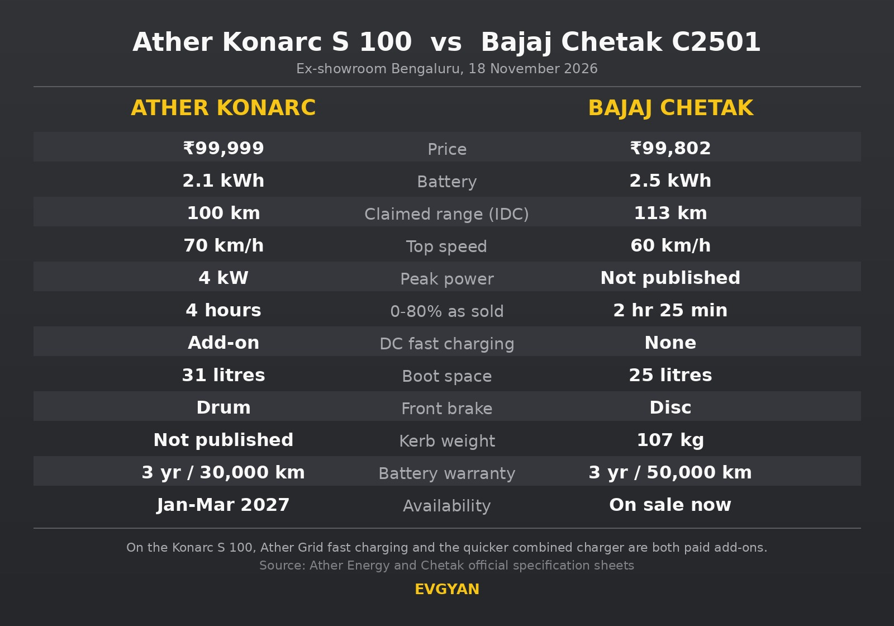

*Representative image (AI-generated)*

Two electric scooters, ₹197 between them. The Ather Konarc S 100 is ₹99,999 and the Bajaj Chetak C2501 is ₹99,802, both ex-showroom Bengaluru on 18 November 2026. At that gap, price is not the deciding factor. Everything else is.

Both numbers are moving, though, and in opposite directions. Ather calls ₹99,999 an introductory price. The Chetak launched in January 2026 at ₹91,399, so it has already gone up ₹8,403 in ten months. And only one of them is actually on sale: Ather lists S 100 deliveries for Q1 2027, January to March, while the Chetak is in showrooms today. We wrote about that wait in [Ather delays the entry-level Konarc](/blogs/ather-delays-konarc-entry-level).

## The full spec sheet

|  | Ather Konarc S 100 | Bajaj Chetak C2501 |
| --- | --- | --- |
| Price (ex-showroom, Bengaluru) | ₹99,999 (introductory) | ₹99,802 |
| Battery | 2.1 kWh | 2.5 kWh |
| Claimed range | 100 km (IDC) | 113 km (IDC) |
| Ather TrueRange | 80 km | Not published |
| Top speed | 70 km/h | 60 km/h |
| Peak power | 4 kW, 16 Nm | Not published (hub motor) |
| Kerb weight | Not published by Ather | 107 kg |
| Wheelbase | 1,352 mm | 1,225 mm |
| Front brake | 130 mm drum | Disc |
| Rear brake | 130 mm drum with CBS | Drum |
| Boot space | 31 litres | 25 litres |
| Charger in the box | 450W on-board | 750W off-board |
| 0-80% as sold | 4 hours | 2 hours 25 minutes |
| Faster home charging | Combined charger, extra 450W, add-on: 2 hours | Not offered |
| DC fast charging | Ather Grid, up to 13 km in 10 min, add-on | None |
| Battery warranty | 3 years / 30,000 km | 3 years / 50,000 km |
| Availability | Jan-Mar 2027 | On sale now |

## Range and speed go in opposite directions

The Chetak carries the bigger battery and the bigger claimed number: 113 km IDC against the Konarc's 100 km IDC. Both are lab figures, so treat them the same way.

The Konarc answers with speed. 70 km/h against 60 km/h, from a 4 kW motor making 16 Nm. Bajaj does not publish a power figure for the C2501, only that it uses a hub motor, so there is no honest kW-for-kW comparison to make here. On a Bengaluru flyover with a pillion, 4 kW matters more than it looks on a spec sheet.

Ather also publishes a TrueRange figure next to the IDC number, 80 km for the S 100. That is the one to plan your day around. Bajaj publishes no equivalent, so you are comparing a company's honest estimate against another company's lab result.

## Out of the box, the Chetak charges faster

This is where most comparisons get it backwards.

The Konarc ships with a 450W charger built into the scooter, which is neat: you carry a cable instead of a brick. But 450W is not much, and 0-80% takes four hours.

The Chetak comes with a 750W off-board charger, listed in Bajaj's own C25-series brochure, and does 0-80% in 2 hours 25 minutes. That is roughly 40% quicker than the Konarc, with nothing extra to buy.

Ather can beat it, but you have to pay. The combined charger adds another 450W on top of the on-board unit, around 900W in total, and brings 0-80% down to two hours. On the S 100 that charger is a paid add-on. It is only included as standard on the S 161.

## DC fast charging: there, but not included

The Konarc can use Ather Grid, which Ather calls India's largest two-wheeler fast-charging network, for up to 13 km of range in 10 minutes. In January 2026 Ather said its riders could reach over 5,000 public fast chargers, 3,675 of them its own and the rest through partner networks on the LECCS standard.

Read that row carefully though. On the S 100, Ather Grid access is an add-on, not standard. Ather includes it on the S 125 and S 161 and sells it separately on the entry model. Ather has not published what either the Grid add-on or the combined charger costs, so neither of those numbers is in this comparison yet.

The Chetak C2501 has no DC fast-charging option at all. You charge it from a wall socket with the charger from the boot, and that is the whole story. For a scooter that already does 0-80% in under two and a half hours, that is a fair trade for many buyers.

## Brakes, weight and size: two different scooters

The Chetak has a disc brake up front. The Konarc S 100 has drums at both ends, with CBS at the rear. Ather does fit a 220 mm front disc, but only from the S 125 upwards, so the cheapest Konarc is also the one with the weakest stopping hardware of the family.

Ather does not publish a kerb weight for the S 100. Its spec sheet lists 126.5 kg for the S 125 and 129 kg for the S 161 and leaves the entry model blank, so we are not borrowing another variant's number. What Ather does publish is the wheelbase, 1,352 mm. Bajaj's brochure puts the Chetak at 107 kg on 1,225 mm, lighter and 127 mm shorter.

The Konarc is a family scooter, built for two adults and a week's shopping. The Chetak is a light city scooter, easier to park and easier for a smaller rider to hold up at a signal.

## Warranty

Bajaj covers the C2501 for 3 years or 50,000 km. Ather's standard battery warranty is 3 years or 30,000 km. If you ride 1,500 km a month, Bajaj's number covers you for the full three years and Ather's runs out in under two.

There is a catch in Ather's favour, though. Ather's FAQ says that with AtherStack Pro, which it calls optional but recommended, the battery warranty goes to 5 years or 60,000 km at no extra cost. Longer cover beyond that is paid: 8 years or 80,000 km for ₹4,999, and 10 years or 1,00,000 km for ₹8,999. So on warranty the two are closer than the headline numbers suggest, as long as you take AtherStack Pro within the 60-day window Ather allows.

## What the Konarc gives you that a spec table hides

Everything above runs against the Konarc, so it is worth being fair about where the money goes.

It is the better-engineered scooter to ride. A 14-inch front wheel with a 90/90 tyre, a 12-inch rear, telescopic forks with 90 mm of travel and a monoshock with 100 mm. 160 mm of ground clearance. The Chetak's smaller wheels and shorter wheelbase make it nippier in traffic; the Konarc's should make it steadier on a broken road with a pillion.

And you get the software. A 4.2-inch DeepView display, three riding modes, and the Ather app behind it. Whether that is worth the four-hour charge and the drum brakes depends entirely on what you want from a scooter, but it is not nothing.

## Running cost and service

Charging either one costs very little. At ₹8 a unit, a round number rather than a quoted tariff, a full charge is about ₹16.80 for the Konarc's 2.1 kWh and ₹20 for the Chetak's 2.5 kWh. Per kilometre the honest answer is that we cannot compare them yet: Ather's 80 km is a conservative real-world figure and Bajaj's 113 km is a lab figure, so dividing one by the other would flatter the Chetak unfairly.

Service reach is a clearer win for Bajaj. In July 2026 the company said Chetak had passed 530 exclusive stores and around 4,500 customer touchpoints across more than 850 cities. Ather reached 500 service centres in March 2026. If you live outside a metro, that gap is worth more than any spec row above.

## What this means for you

**If you need a scooter now:** the Chetak C2501, because it is the only one you can buy. The Konarc S 100 is a January-to-March 2027 proposition.

**If you charge only at home:** still the Chetak. It is faster out of the box, 2 hours 25 minutes against four, with no add-on to buy, and it is lighter to handle every day.

**If you want the Konarc's tech and can wait:** the Konarc S 100 wins on paper, with more speed, 31 litres of boot, better suspension and a fast-charging network the Chetak cannot touch. Price the add-ons at the dealership first, because on this variant both the fast charging and the quick home charging cost extra.

For ₹197, you are not choosing a cheaper scooter. You are choosing when you want it and what you are willing to pay on top.

## Frequently asked questions

**Is Ather Grid fast charging included with the Konarc S 100?**
No. Ather lists Grid access as an add-on on the S 100 and as standard on the S 125 and S 161. On the S 100 it adds up to 13 km of range in 10 minutes, against up to 15 km on the bigger variants.

**Which one charges faster at home?**
The Chetak C2501, as sold. It does 0-80% in 2 hours 25 minutes against four hours for the Konarc S 100. With Ather's optional combined charger the Konarc drops to two hours, but that charger costs extra on this variant.

**Does the Ather Konarc S 100 get a front disc brake?**
No. The S 100 has drum brakes at both ends. The 220 mm front disc starts from the S 125.

**When can I actually buy the Konarc S 100?**
Ather has listed deliveries for Q1 2027, that is January to March. The Chetak C2501 is on sale now.

Want the video version? We reviewed the Konarc, the good and the bad, on our [EV Gyan YouTube channel](https://www.youtube.com/watch?v=us6L7PpUEZ8). Also read why [Ather cannot make scooters fast enough](/blogs/ather-cant-meet-scooter-demand) and what [Bajaj's 80,000-a-month Chetak target](/blogs/bajaj-chetak-production-80000-target) means.

*Prices are ex-showroom Bengaluru on 18 November 2026 and change often. Confirm at the dealership before you book.*

*Correction (18 Nov 2026): An earlier version said Ather Grid came with the Konarc S 100, put the Grid top-up at 15 km in 10 minutes, called the extra charger a 900W unit giving 1.35 kW combined, gave the Chetak's 0-80% time as 2 hours 15 minutes, listed no boot figure for it, and put the Ather Grid network at about 6,000 chargers. On the S 100 both Grid access and the combined charger are paid add-ons; the top-up is up to 13 km in 10 minutes; the combined charger adds 450W for about 900W in total; Bajaj lists 0-80% at 2 hours 25 minutes and a 25-litre boot; and Ather said in January 2026 that riders could reach over 5,000 public fast chargers. A kerb weight of 126.5 kg was also removed: that is the S 125's figure, and Ather publishes none for the S 100.*
