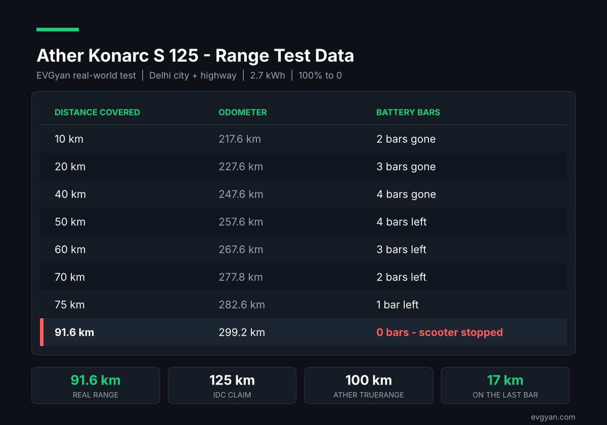

We rode a brand-new [Ather Konarc](https://www.atherenergy.com/konarc) S 125 from 100% to a dead stop in Delhi traffic, and the odometer settled at 91.6 km. Ather claims 125 km IDC for this variant. So the honest answer to the question sitting in our comments for weeks is this: expect around 92 km of real range, and expect it in normal city use, not in some range-saving crawl.

**Key Takeaways**

- Real range: 91.6 km on a single charge, which is about 73% of the 125 km IDC claim.
- Against Ather's own TrueRange figure of 100 km, the scooter delivered roughly 92%.
- The last battery bar alone covered 17 km, from the 75 km mark to 91.6 km.
- Riding mix: mostly 40-50 km/h, Delhi city traffic plus some highway, no pillion, 60 km/h touched once.
- Running cost works out to roughly 24 paise per km at ₹8 a unit.

The unit we tested is the mid variant, the Konarc S 125, with a 2.7 kWh battery pack, priced at ₹1,21,999 ex-showroom Bengaluru. One more detail matters: it is a **non-Pro unit**. No Pro Pack. That changes what the screen tells you, and we will come to that.

The full test is on video here: [Ather Konarc range test on EVGyan](https://www.youtube.com/watch?v=qf6vOda6H1k).

## How the test was set up

Full charge overnight, odometer at 207.6 km at the start. The plan was simple and brutal: ride until the scooter refuses to move, and show the final reading on camera.

No tricks. Speeds stayed mostly between 40 and 50 km/h, touching 55 at times, and 60 km/h exactly once. Top speed on the Konarc is rated at 70 km/h, and we never went looking for it. The route was mixed: heavy city traffic, open stretches past Akshardham, some highway running, and plenty of stop-and-go where the brakes got used hard. No pillion, normal November weather.

That is the point of this test. We rode it the way a daily commuter rides it, not the way a range test rides it.

## Bar by bar, where the battery went

Without the Pro Pack, the display shows battery as bars. Eight bars, no percentage. So we logged every bar drop against the odometer.

Look at the top of that table and the bottom. The first two bars disappeared in 10 km. Four were gone by 40 km. At that point we were ready to call it an 80 km scooter on camera.

Then the bottom half of the pack behaved completely differently. The last bar came on at 75 km and the scooter kept running till 91.6 km. One bar did 17 km, almost a fifth of the total range sitting in the final segment of the gauge.

Two things are happening here. One, the bar graph is not linear, so the early bars drop fast and the late ones hold on much longer. Two, Ather is clearly protecting the bottom of the pack, which is good for battery life but makes the gauge hard to read for a new owner.

The last few kilometres were slower. Full throttle no longer gave the same response, and the scooter was holding around 10 km/h before it finally cut out. The motor was switching on, but it would not pull. That is the scooter telling you the party is over, and it gives you a decent warning window to get home.

## 92 km against two different claims

Here is where the number needs context, because Ather itself publishes two figures for this scooter.

The IDC claim for the Konarc S 125 is 125 km. Our result of 91.6 km is about 73% of that. On its own that sounds like a big gap, and if you walk into a showroom expecting 125 km, it is a gap you will feel.

But Ather also publishes a TrueRange figure of 100 km for this variant, which is the company's own estimate of real-world riding. Against that number, 91.6 km is roughly 92% delivered. In mixed city traffic, with hard braking and a few highway runs, that is a credible result.

Run the efficiency math and it holds up. 91.6 km from a 2.7 kWh pack works out to about 34 km per kWh, or close to 29 Wh per km. At ₹8 per unit of electricity, a full charge costs roughly ₹22, which is about 24 paise per kilometre. A 110cc petrol scooter at 45 kmpl costs you well over ₹2 per km. That is the real story in this test, and it has nothing to do with the 125 km badge.

## The non-Pro screen is the weak link

This is the part we would flag to Ather directly.

On our non-Pro unit, the display showed speed and battery bars, and that was mostly it. No battery percentage. No estimated range left. No mode selection on screen. Ather's spec sheet lists SmartEco, Eco and Power across the Konarc S line, and the Pro pack is what unlocks the fuller connected experience.

For a range test it was workable. For a first-time EV buyer it is not. A percentage number and a range estimate are what stop a new owner from panicking at the second bar. We will do a follow-up once the Pro Pack is activated on this scooter, and we will publish whether that estimated range reading is actually trustworthy.

## The riding bit, briefly

Range aside, this was the most fun we have had on an Ather commuter. The 14-inch front wheel with the longer-travel rear setup soaks up broken Delhi roads properly, and the metal body panels give it a solidity that plastic-bodied rivals do not have. Acceleration is sufficient rather than exciting, which is exactly right for a scooter rated at 70 km/h and built for families.

## What this means for you

If you are buying the Konarc S 125 at ₹1,21,999 ex-showroom Bengaluru, plan your life around 85 to 92 km per charge in city use. Ride slower and stay out of traffic and you will see more. Add a pillion, carry a load, or sit at 55 km/h on the highway and you will see less.

For a daily commute of up to 35 km each way, this scooter does not need a mid-day charge. Beyond that, or if you carry a pillion every day, the S 161 with the 3.5 kWh pack is the variant worth paying for. If your budget is tighter, the entry S 100 is a different conversation, and we have covered both [its delivery wait](/blogs/ather-delays-konarc-entry-level) and [how it stacks up against the Bajaj Chetak C2501](/blogs/ather-konarc-s-100-vs-bajaj-chetak-c2501).

Charging is the other number to plan for. Ather rates the 2.7 kWh pack at 4 hours 30 minutes for 0 to 80% on the standard 450W onboard charger, dropping to about 2 hours 25 minutes when the portable charger is combined with it for 900W. An overnight charge covers everything this test threw at it.

## The EVGyan take

A 125 km IDC claim and a 92 km real result is not a scandal, it is how IDC works, and every brand plays the same game. What we care about is whether a company's own real-world number is honest, and here Ather's 100 km TrueRange claim landed within 8% of what we actually got. That is the figure buyers should be shown on the showroom board.

We bought this scooter to live with, not to review once. A charging-time test, a Pro Pack comparison, a highway-only range run and a long-term update are all coming.

*Range figures in this article are from a single EVGyan test on a non-Pro Ather Konarc S 125 in Delhi conditions. Your range will vary with speed, load, traffic and weather. Prices are ex-showroom Bengaluru and were verified at the time of publishing.*
