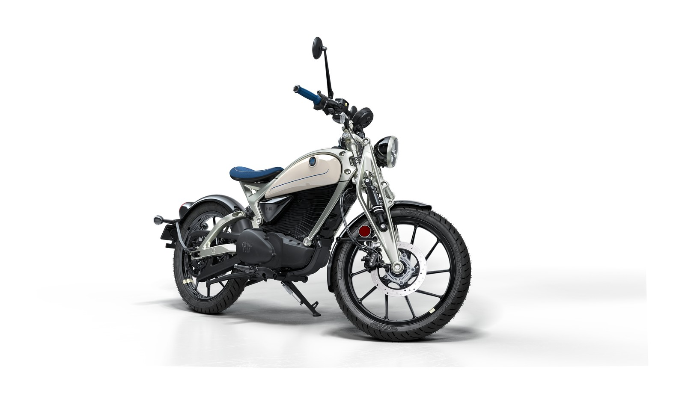
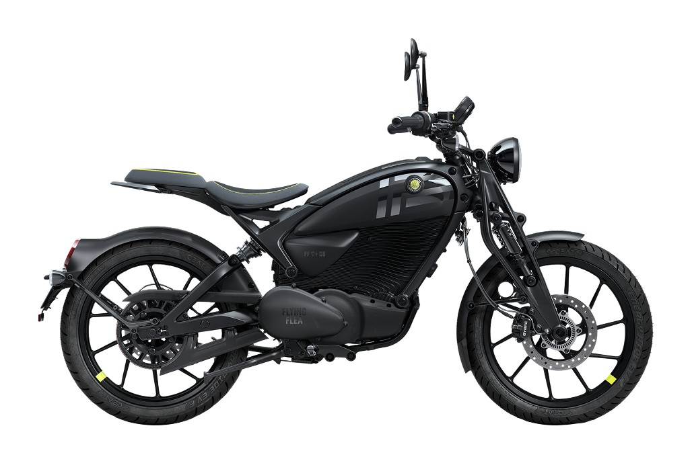
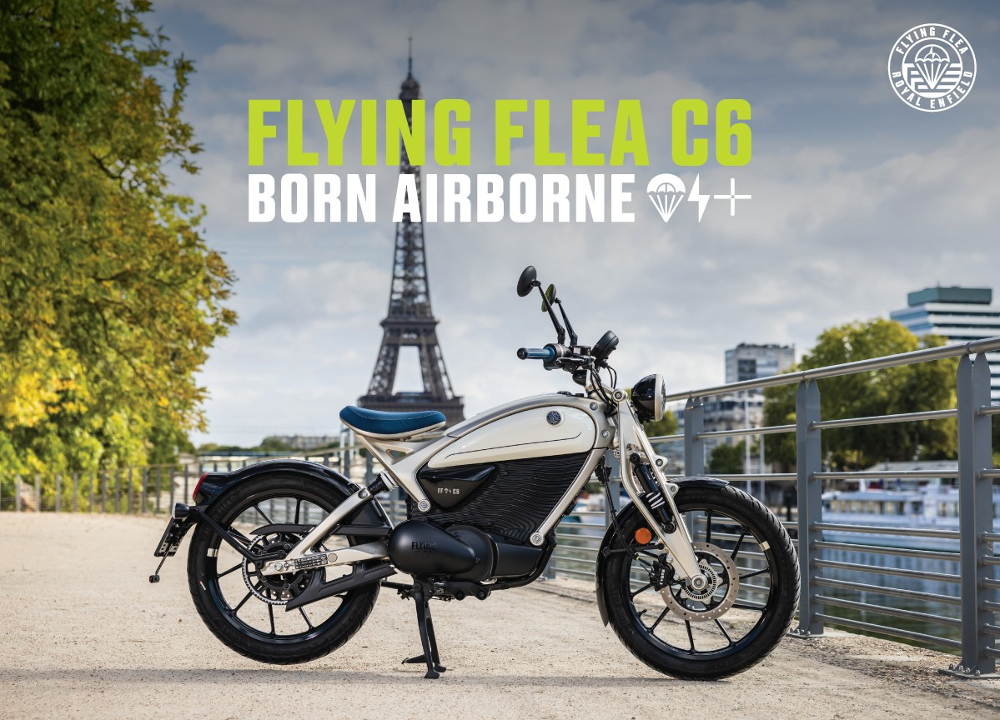

Royal Enfield has put a fresh ₹1,000 crore on the table for its electric bikes. The money goes into Tamil Nadu over the next 7 years, and the company expects it to create up to 500 jobs, direct and indirect.

The deal was signed on 25 November as a non-binding MoU with the Tamil Nadu government. Royal Enfield says the cash is meant for three things: building new EV products, upgrading its technology, and adding manufacturing where it is needed. In plain words, this is the budget that keeps the Flying Flea brand growing.

## Where the ₹1,000 crore will go

Flying Flea already has a home. Its EV innovation lab and its manufacturing line sit at Vallam Vadagal, near Chennai, and that is where the first electric Royal Enfield, the Flying Flea C6, is built.

Spread evenly, ₹1,000 crore over 7 years works out to roughly ₹143 crore a year. That's our rough maths, not a company schedule. Royal Enfield hasn't shared a year-by-year plan or named a new plant for this money.

This isn't Royal Enfield's only big cheque in the state this year. In February 2026 it committed ₹958 crore to expand its Cheyyar plant, which will take its total yearly capacity to 2 million motorcycles. Put the two together and that's ₹1,958 crore promised to Tamil Nadu in 2026 alone, with the EV share now clearly marked out.

B Govindarajan, MD of Eicher Motors and CEO of Royal Enfield, called Tamil Nadu "our home and the anchor for our engineering and manufacturing" in the company's statement. The brand runs four factories there, plus its head office and technical centre.

## What it means for the C6 and the S6

The C6 launched in April at ₹2.79 lakh (ex-showroom), or ₹1.99 lakh if you go with the Battery-as-a-Service plan. It runs a 3.91 kWh battery, makes 15.4 kW at peak and weighs 124 kg. It comes in Storm Black and Flea Green.

Next in line is the scrambler-style S6, shown at EICMA this month. We covered it here: [Royal Enfield Flying Flea S6 Lands Summer 2027](/blogs/royal-enfield-flying-flea-s6-scrambler). A dedicated EV budget is exactly what a second model needs, because building a family of electric bikes costs far more than building one.

## The EVGyan take

Royal Enfield is not chasing volume with Flying Flea. The C6 is a premium city bike, and the brand has been rolling it out one city at a time instead of flooding the market. A 7-year commitment tells you the company sees this as a long game, not a one-bike experiment.

Two things to keep in mind. First, this is a non-binding MoU, so the ₹1,000 crore is a plan, not money already spent. Second, Royal Enfield has a decent record here: it signed similar MoUs with Tamil Nadu in 2012, 2019 and 2024. For buyers waiting on a Royal Enfield EV that's cheaper or more practical than the C6, this is the money that would pay for it.
