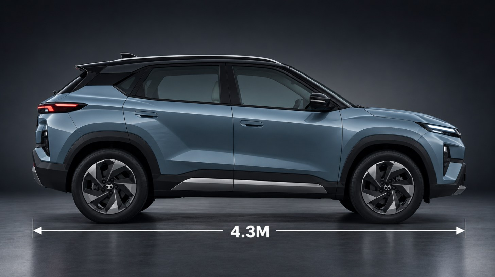
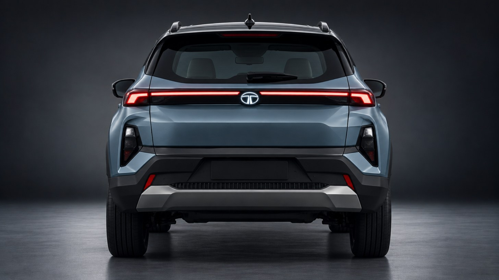

*Images for representational purposes only. AI illustrations by EVGyan, not Tata design images.*

Tata is lining up a new midsize electric SUV with the capacity to build up to 1 lakh of them a year. Autocar India reported on 31 October 2026 that the project, codenamed Kuno, is planned for Tata's Sanand plant, with the line sized for 80,000 to 1 lakh units a year. For scale: the MG Windsor EV, the car the Tata Kuno EV is meant to fight, took about two years to cross 80,000 sales in India.

## What Autocar India says

Everything public about this car comes from [Autocar India's scoop](https://www.autocarindia.com/car-news/scoop-tata-developing-kuno-as-mg-windsor-ev-rival-441172), which cites its own sources:

- Length: around 4.3m, a midsize SUV
- Platform: Tata's Acti.ev, which can do front-, rear- or all-wheel drive
- Built at: Tata's Sanand plant in Gujarat
- Timing: 2027-28
- Planned capacity: 80,000 to 1 lakh units a year

Autocar India also flags that Kuno is only the in-house project name, so the badge on the boot will almost certainly read something else. Battery, motor and price are unsettled.

*Image for representational purposes only.*

## It fills a gap Tata can see

At 4.3m the Kuno would sit between the next-generation Nexon EV and the Sierra EV, Autocar India reports. Narrow gap on paper. It is also where the Windsor has been quietly winning.

MG's Windsor is not a normal SUV. It is a tall, roomy, five-seat car people buy for the back seat. It runs a 136 hp front motor, comes with two battery choices and claims 332 km to 449 km depending on the pack. MG said in October 2026 that over 80,000 families now own one, counting from the September 2024 launch. In September 2026 it registered 3,224 units.

Tata took about 41 percent of India's electric car registrations in September 2026, per Autocar India's Vahan-based numbers. It already sells seven electric cars, from the Tiago EV up to the Sierra EV. What it does not sell is a space-first EV like the Windsor. The Kuno looks like that answer, and it fits the plan Tata set out at its June 2026 Investor Day to grow its EV range from 6 models to 10 by FY2031.

*Image for representational purposes only.*

## What this means for you

Nothing to book. 2027-28 is a long way off, and a codename is not a car.

The capacity figure is the bit worth filing away. Nobody plans a line for 80,000 to 1 lakh units a year for a car they expect to sell in hundreds. On price, Autocar India expects the Kuno to land in the same bracket as the Curvv EV (₹17.19 lakh to ₹19.39 lakh) and the Sierra EV (₹18.79 lakh to ₹25.99 lakh), both ex-showroom. More cars fighting in that bracket is how EV prices come down.

One honest caveat. This is a single-source report about a car roughly two years out, and Tata has confirmed none of it. Read it as a direction, not a spec sheet.
