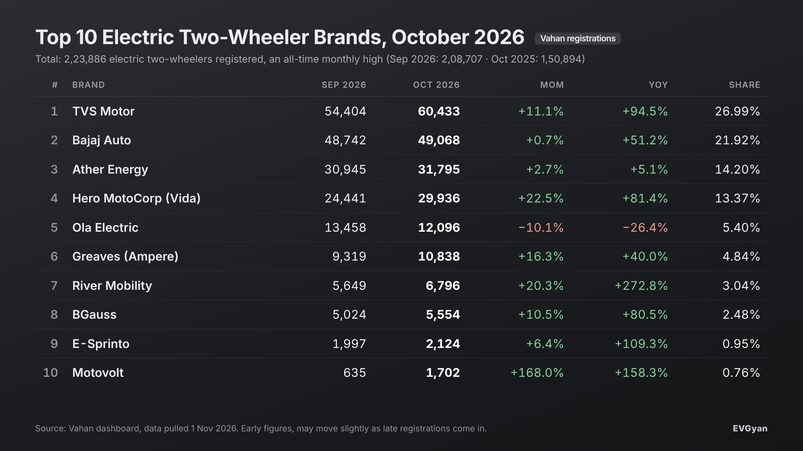

Representative image (AI-generated)

India registered **2,23,886 electric two-wheelers in October 2026**. That is the highest monthly figure the country has ever seen, and it beats September's record of 2,08,707 by a little over 15,000 scooters and bikes.

The electric two-wheeler registrations October 2026 story is simple: the festive month delivered. Navratri started on 11 October, Dussehra fell on 20 October, and buyers who had been waiting for a good day to bring a vehicle home finally did. Dhanteras and Diwali land in the first week of November, so the buying window is not closed yet.

*(These are Vahan retail registrations pulled on 1 November. Early numbers can move a little as late registrations come in. Vahan does not split scooters from motorcycles, so the ranking below is by brand.)*

## The headline numbers

| | October 2026 | September 2026 | October 2025 |
|---|---|---|---|
| Electric two-wheelers registered | 2,23,886 | 2,08,707 | 1,50,894 |
| All two-wheelers registered (petrol, CNG, electric) | 23,20,139 | 18,02,413 | 32,40,664 |
| Electric share | 9.65% | 11.58% | 4.66% |

Three things to notice.

- Volume is up **7.3% over September** and **48.4% over October 2025**. A year ago, 1.5 lakh in a month looked like a lot. Now 2.24 lakh is the new floor to beat.
- The overall two-wheeler market also had a festive bump, from 18 lakh to 23.2 lakh. Because petrol scooters and bikes were registered in huge numbers too, the electric share slipped from 11.58% to 9.65%. That is a share dip in a growing market, not a fall in EV demand. In absolute units, October was the best month electric two-wheelers have ever had.
- Against last October, the electric share has more than doubled, from 4.66% to 9.65%.

One more point for context. September's number was first reported as 2,07,134 in [our September article](/blogs/electric-two-wheeler-sales-september-2026). Vahan has since revised it to 2,08,707, which is normal as late registrations get uploaded.

## Top 10 electric two-wheeler brands, October 2026

| Rank | Brand | Oct 2026 | Sep 2026 | MoM | YoY | Share |
|---|---|---|---|---|---|---|
| 1 | TVS Motor | 60,433 | 54,404 | +11.1% | +94.5% | 26.99% |
| 2 | Bajaj Auto | 49,068 | 48,742 | +0.7% | +51.2% | 21.92% |
| 3 | Ather Energy | 31,795 | 30,945 | +2.7% | +5.1% | 14.20% |
| 4 | Hero MotoCorp (Vida) | 29,936 | 24,441 | +22.5% | +81.4% | 13.37% |
| 5 | Ola Electric | 12,096 | 13,458 | −10.1% | −26.4% | 5.40% |
| 6 | Greaves (Ampere) | 10,838 | 9,319 | +16.3% | +40.0% | 4.84% |
| 7 | River Mobility | 6,796 | 5,649 | +20.3% | +272.8% | 3.04% |
| 8 | BGauss | 5,554 | 5,024 | +10.5% | +80.5% | 2.48% |
| 9 | E-Sprinto | 2,124 | 1,997 | +6.4% | +109.3% | 0.95% |
| 10 | Motovolt | 1,702 | 635 | +168.0% | +158.3% | 0.76% |

The top eight ranks did not move. The only change at the bottom: Motovolt enters the top 10 and Bounce drops out after its September spike.

## 1. TVS pulls away at the top

TVS registered **60,433** electric scooters, its first month above 60,000. Growth was 11.1% over September and 94.5% over October 2025, when TVS did 31,074.

The gap to Bajaj tells the story. In September the two were separated by 5,662 units. In October the gap widened to **11,365**. TVS added about 6,000 units in a month while Bajaj added 326. The iQube range is carrying this, and TVS has already said it wants to build [80,000 electric scooters a month](/blogs/tvs-electric-scooter-capacity-expansion). October suggests the demand is there to fill that.

## 2. Bajaj holds steady at 49,068

Bajaj Auto registered **49,068** Chetaks, almost flat against September (48,742). Year on year it is up 51.2%.

Here is a detail worth remembering: in October 2025, Bajaj was number one with 32,462 units, ahead of TVS. Twelve months later TVS has grown 94% and Bajaj 51%, and the order has flipped. Bajaj is not losing buyers. It is just that TVS is adding them faster. Bajaj's own plan is to take Chetak output to [around 80,000 a month](/blogs/bajaj-chetak-production-80000-target), so this race is far from settled.

## 3. Ather stays third, but only just

Ather registered **31,795** units, up 2.7% over September. Compared with October 2025 (30,246), the growth is just 5.1%.

That flat year-on-year line is not a demand problem. Ather has been open that it [cannot build enough scooters](/blogs/ather-cant-meet-scooter-demand) to meet what dealers are asking for. The Rizta is doing the heavy lifting on volume. The worry for Ather is the brand right behind it.

## 4. Hero Vida is the fastest mover in the top five

Hero MotoCorp registered **29,936** Vida scooters, a 22.5% jump in a single month and 81.4% more than October 2025. Share went from 11.7% in September to 13.37%.

The Ather–Hero gap was 6,504 units in September. In October it shrank to **1,859**. If Hero keeps this pace into November, the number three spot could change hands. Hero's Chittoor plant was running at about [91% of its 30,000-a-month capacity](/blogs/hero-vida-record-year-2026) by late October, so the ceiling is now the factory, not the showroom.

## 5. Ola Electric is the only top-10 brand that fell

Ola registered **12,096** units, down 10.1% from September and 26.4% below October 2025, when it did 16,439. Market share is now 5.40%. A year ago it was 10.9%.

Ola is still comfortably number five, with more than a thousand units over Greaves. But in the biggest month the market has ever had, it was the only name in the top 10 to go backwards in both directions, month on month and year on year.

## 6 to 10: the mid-table had a good festive season

- **Greaves (Ampere)** crossed 10,000 in a month with **10,838** units, up 16.3% over September and 40% over last year.
- **River Mobility** registered **6,796** Indies, up 20.3% in a month and 272.8% in a year. River is also [expanding its showroom count fast](/blogs/river-mobility-showrooms-expansion), and the numbers are following.
- **BGauss** did **5,554** units, up 10.5% month on month and 80.5% year on year.
- **E-Sprinto** registered **2,124**, up 6.4% over September and more than double last October.
- **Motovolt** is the surprise entry at number 10 with **1,702** units, up from 635 in September, a 168% jump.

## Just outside the top 10

Oben Rorr registered 1,563 electric motorcycles (up 9.5%), Simple Energy 1,505 (up 9.4%), Revolt 1,362 (up 31.2%) and Lectrix 1,258 (up 9%). Honda did 1,145, Suzuki 556 and Yamaha 305, so the three Japanese brands together were at 2,006 units. Bounce fell from 3,069 in September to 1,075, which is why it left the top 10.

## What this means for you

If you are planning to buy an electric scooter around Dhanteras (6 November) or Diwali (8 November), keep three things in mind.

1. **Waiting periods are real at the top.** TVS, Bajaj, Ather and Hero together registered 1,71,232 scooters, which is 76.5% of the market. All four are running close to their production limits. Book early and ask the dealer for a written delivery date.
2. **Service reach is deciding the race.** The four brands with the widest dealer networks are also the four biggest sellers. For a first EV, that is a reasonable way to shortlist.
3. **The mid-table is worth a look.** Greaves, River and BGauss all grew faster than the market. More competition at ₹1 lakh to ₹1.5 lakh means better deals for you.

## The EVGyan take

Every festive season someone asks whether electric scooters can hold up when petrol scooters are discounted heavily. October answered that. Petrol two-wheelers had a huge month, and electric two-wheelers still set an all-time record. The share dip to 9.65% will bounce back once the festive petrol rush settles, because the underlying EV growth, 48% in a year, has not slowed.

The thing to watch now is November. Dhanteras and Diwali both fall in it, and TVS, Bajaj, Hero and Ather are all adding capacity. A 2.5 lakh month is no longer a wild guess.

## Frequently asked questions

**How many electric two-wheelers were registered in India in October 2026?**
2,23,886, according to Vahan data pulled on 1 November 2026. This is the highest monthly figure ever.

**Which brand was number one in October 2026?**
TVS Motor, with 60,433 registrations, followed by Bajaj Auto (49,068) and Ather Energy (31,795).

**Why did the electric share fall if registrations went up?**
Because the overall two-wheeler market jumped from 18 lakh to 23.2 lakh in the festive month. Electric volume grew 7.3%, but petrol and CNG volume grew faster, so the share moved from 11.58% to 9.65%.

**Which brand grew the fastest among the top five?**
Hero MotoCorp (Vida), up 22.5% over September to 29,936 units.

**Did Ola Electric grow in October 2026?**
No. Ola registered 12,096 units, down 10.1% from September and 26.4% from October 2025.
