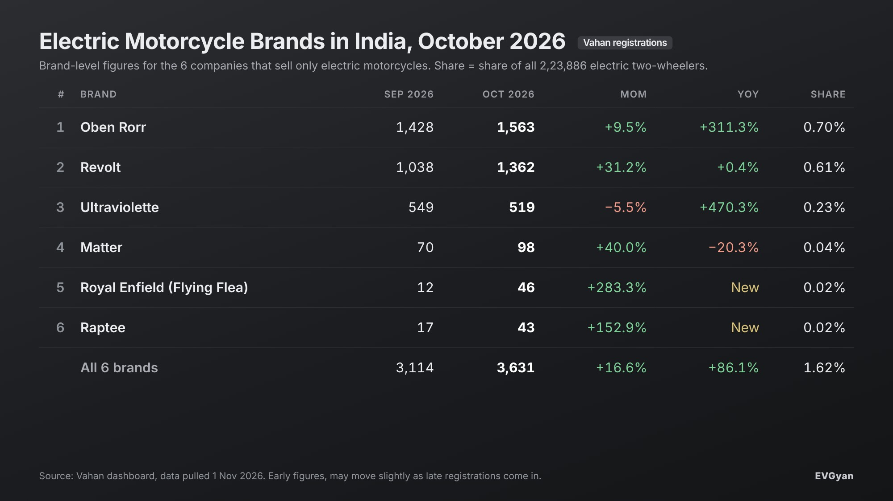

Representative image (AI-generated)

Six brands that sell only electric motorcycles registered **3,631 bikes in October 2026**, up 16.6% from September and 86.1% from October 2025. Oben Electric stayed on top with 1,563, Revolt had the biggest jump, and two famous names, Royal Enfield and Raptee, are now on the board.

The electric motorcycle registrations October 2026 numbers come from Vahan, pulled on 1 November. One caveat before the table: Vahan cannot separate a motorcycle from a scooter, so this list is built brand by brand. These six companies sell motorcycles only, which makes their numbers clean. Brands that sell both (for example a scooter maker with one bike) are not included.

## The six-brand table

| Rank | Brand | Oct 2026 | Sep 2026 | MoM | Oct 2025 | YoY |
|---|---|---|---|---|---|---|
| 1 | Oben Electric (Rorr) | 1,563 | 1,428 | +9.5% | 380 | +311.3% |
| 2 | Revolt Motors | 1,362 | 1,038 | +31.2% | 1,357 | +0.4% |
| 3 | Ultraviolette | 519 | 549 | −5.5% | 91 | +470.3% |
| 4 | Matter | 98 | 70 | +40.0% | 123 | −20.3% |
| 5 | Royal Enfield (Flying Flea) | 46 | 12 | +283.3% | 0 | New |
| 6 | Raptee | 43 | 17 | +152.9% | 0 | New |
| | **All six** | **3,631** | **3,114** | **+16.6%** | **1,951** | **+86.1%** |

Together these six brands hold 1.62% of the 2,23,886 electric two-wheelers registered in October. Small, but it was 1.29% a year ago (1,951 of 1,50,894), and the segment is growing faster than scooters are.

## 1. Oben Rorr: 1,563 and a fourth-place finish nobody expected

Oben registered **1,563** Rorr motorcycles, 9.5% more than September. A year ago the number was 380, so this is more than a four-times jump in twelve months.

What stands out is where Oben sits in the overall electric two-wheeler list. With 1,563 units it finished just behind Motovolt (1,702), the number 10 brand, and ahead of scooter makers like Simple Energy (1,505), Lectrix (1,258) and Honda (1,145). For a company that sells only commuter motorcycles, beating several scooter brands is a real result.

Oben's growth has been steady rather than spiky. In our [September round-up](/blogs/electric-two-wheeler-sales-september-2026) it had just crossed 1,400. October added another 135. If November keeps that line, the first 2,000 month is not far.

## 2. Revolt: the big mover, back to where it was a year ago

Revolt registered **1,362** units, a 31.2% jump from 1,038 in September. That is the best month-on-month growth of any brand in this list except the two tiny new entrants.

The year-on-year line is the honest one: October 2025 was 1,357, so Revolt is up a grand total of 5 units in a year. Put differently, Revolt spent most of 2026 below its 2025 pace and October is the month it got back to level. The RV400 and RV1 range still sells, and the festive month helped. The question for Revolt is whether 1,362 is a new base or a one-off festive bump.

## 3. Ultraviolette: 519, down a little, up a lot

Ultraviolette registered **519** motorcycles, down 5.5% from 549 in September. Against October 2025 (91 units) it is up more than five times.

The small dip is not a worry. Ultraviolette plays in the ₹2 lakh-plus performance bracket where monthly numbers move with deliveries and new variants, not with festival dates. Holding above 500 for two months in a row is the better signal. Its share of all electric two-wheelers is 0.23%, tiny in volume but it is the only premium Indian electric motorcycle doing hundreds a month.

## 4. Matter: 98, growing again from a low base

Matter registered **98** Aera motorcycles, up 40% from 70 in September but still below the 123 it did in October 2025. Matter has had a stop-start year on volume. Two months of growth in a row would tell us more than one.

## 5 and 6. Royal Enfield and Raptee: the new names

**Royal Enfield's Flying Flea** registered 46 units in October, up from 12 in September. These are the first meaningful registrations for Royal Enfield's electric brand. 46 is a tiny number, but Royal Enfield has a dealer network most EV startups can only dream of, so this line is worth watching every month from here.

**Raptee** registered 43 units, up from 17. The Chennai startup sells one bike, the T30, and is still ramping up deliveries. Both brands had zero registrations in October 2025, so there is no year-on-year figure yet.

## Why electric motorcycles are still so small

Scooters are 98% of India's electric two-wheeler market, and the reason is simple. A scooter buyer wants low running cost and easy riding in the city, and an electric scooter delivers exactly that. A motorcycle buyer often wants highway range, a certain sound and feel, and a wide service network. Battery costs have made it harder to deliver all three at a commuter price.

That is changing. Oben and Revolt are now both above 1,300 a month, Ultraviolette has a stable premium base, and Royal Enfield is in the game. Once the bigger legacy brands bring their electric motorcycles, this list will look very different in a year.

## What this means for you

- **Commuter bike at a scooter price:** Oben Rorr and Revolt are the two with real volume and growing service reach. Volume matters because it tells you spare parts and service will be around.
- **Performance bike:** Ultraviolette is the only Indian brand selling a premium electric motorcycle in hundreds a month. Expect to pay a premium for it.
- **Waiting for a big-brand bike:** Royal Enfield's Flying Flea has started registering. If you ride a Classic or a Hunter today and want to go electric, watch this one and ask your local Royal Enfield dealer about availability.

## The EVGyan take

3,631 bikes a month is still a rounding error next to 2.2 lakh scooters. But the growth rate is the point. Electric motorcycles grew 86% in a year while the overall electric two-wheeler market grew 48%. Oben alone is four times bigger than it was last October. When the big legacy brands bring their bikes, the question will not be whether buyers want an electric motorcycle. October shows they already do. The question is who builds the one they want at the price they can pay.
