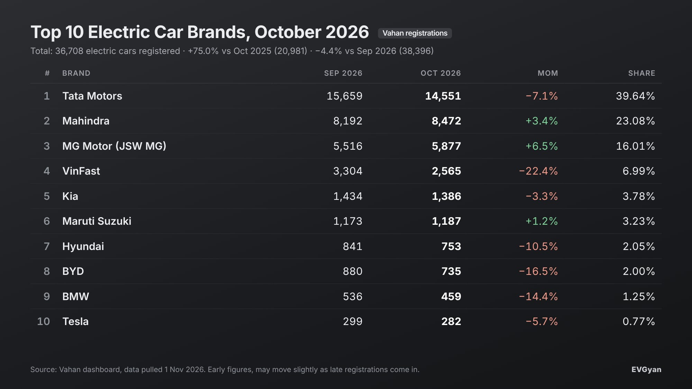

Representative image (AI-generated)

India registered **36,708 electric cars in October 2026**, 75% more than the 20,981 of October 2025. It is the second-biggest month ever for electric cars, a little behind September's revised 38,396.

The electric car registrations October 2026 picture has two sides. Year on year, the market is growing at a pace petrol and diesel cars can only dream of. Month on month, it took a 4.4% breather while the overall car market had its festive surge. Both things are true, and both matter if you are buying.

*(All figures are Vahan retail registrations pulled on 1 November. Early numbers can move slightly as late registrations are uploaded.)*

## The headline numbers

| | October 2026 | September 2026 | October 2025 |
|---|---|---|---|
| Electric cars registered | 36,708 | 38,396 | 20,981 |
| All cars registered (all fuels) | 5,04,816 | 4,40,336 | 5,91,167 |
| Electric share | 7.27% | 8.72% | 3.55% |

The overall car market jumped from 4.4 lakh to 5.05 lakh in the festive month, up 14.6%. Electric cars went the other way, down 4.4%. So the electric share slipped from 8.72% to 7.27%.

Two reasons sit behind that, and neither is bad news. First, festive discounts on petrol and diesel cars were unusually deep this year, which pulled fence-sitters into showrooms. Second, Dhanteras (6 November) and Diwali (8 November) both fall in November, and many families time a car delivery to those days. Some of October's electric car demand is simply sitting in November's queue.

Against a year ago, the share has doubled, from 3.55% to 7.27%. One in every 14 new cars registered in October ran on a battery.

## Top 10 electric car brands, October 2026

| Rank | Brand | Oct 2026 | Sep 2026 | MoM | Share |
|---|---|---|---|---|---|
| 1 | Tata Motors | 14,551 | 15,659 | −7.1% | 39.64% |
| 2 | Mahindra | 8,472 | 8,192 | +3.4% | 23.08% |
| 3 | MG Motor (JSW MG) | 5,877 | 5,516 | +6.5% | 16.01% |
| 4 | VinFast | 2,565 | 3,304 | −22.4% | 6.99% |
| 5 | Kia | 1,386 | 1,434 | −3.3% | 3.78% |
| 6 | Maruti Suzuki | 1,187 | 1,173 | +1.2% | 3.23% |
| 7 | Hyundai | 753 | 841 | −10.5% | 2.05% |
| 8 | BYD | 735 | 880 | −16.5% | 2.00% |
| 9 | BMW | 459 | 536 | −14.4% | 1.25% |
| 10 | Tesla | 282 | 299 | −5.7% | 0.77% |

Only one rank changed: Hyundai moved up to seventh and BYD slipped to eighth. Outside the top 10, Toyota registered 189 and Mercedes-Benz 61.

## 1. Tata: 14,551, still 4 in every 10 electric cars

Tata Motors registered **14,551** electric cars, 7.1% fewer than September's 15,659. Its share is 39.64%, down from about 40.8% a month earlier.

A dip at the top is not a crack. Tata's own October release puts its EV dispatches at 16,244 units, up 75% year on year, as [reported by Autocar Professional](https://www.autocarpro.in/news/tata-motors-pv-reports-23-percent-rise-in-october-dispatches-to-75426-units-135617). Dispatches are cars sent to dealers; Vahan counts cars registered to buyers. When dispatches run ahead of registrations, dealer stock is building up for the Diwali week, which is exactly what you would expect in October. The Nexon EV, Punch EV, Curvv EV and Harrier EV line-up is the widest in the market, and Tata has been [closing the supply gap](/blogs/tata-ev-supply-catching-up-demand-2026) through the year.

## 2. Mahindra: 8,472, growing in a month the market fell

Mahindra registered **8,472** electric SUVs, up 3.4% from September. Its share rose to 23.08%.

This is the quiet achievement of the month. In a month when Tata, VinFast, Kia, Hyundai, BYD, BMW and Tesla all registered fewer cars than in September, Mahindra added 280. The BE 6 and XEV 9e are doing the volume, and the brand now holds nearly one in four electric cars registered in India. Tata and Mahindra together account for 62.7% of the market.

## 3. MG: 5,877 and the best growth in the top five

JSW MG Motor registered **5,877** electric cars, up 6.5% from 5,516 in September, the strongest month-on-month growth among the top five. Share is 16.01%.

The Windsor remains the car to beat in the ₹14 lakh to ₹19 lakh bracket, and MG's battery-rental pricing keeps the sticker price low enough to pull first-time EV buyers. The top three, Tata, Mahindra and MG, together registered 28,900 cars, 78.7% of all electric cars in October.

## 4. VinFast: 2,565, the sharpest fall in the top 10

VinFast registered **2,565** cars, down 22.4% from 3,304 in September. Share fell from 8.6% to 6.99%.

Context matters here. VinFast only started deliveries in India this year and September was a very strong month as initial bookings were cleared. A pullback after a delivery backlog is normal. The number to watch is whether VinFast holds above 2,500 in November and December, when the launch-month effect is fully gone.

## 5 and 6. Kia and Maruti: both above 1,000 again

**Kia** registered **1,386** electric cars, down 3.3%. It has now been above 1,300 for two months running, which is a steadier base than it had earlier in the year.

**Maruti Suzuki** registered **1,187** e Vitaras, up 1.2% from 1,173. Maruti is in sixth place with 3.23% share, and it is one of only three top-10 brands that grew in October. For a company whose domestic EV effort is still young, a steady 1,100 to 1,200 a month, while it [ships most of its e Vitara output overseas](/blogs/maruti-ev-exports-india-share), is a solid start.

## 7 to 10: Hyundai, BYD, BMW, Tesla

- **Hyundai** registered **753** electric cars, down 10.5% from 841, but still moved up a rank because BYD fell faster.
- **BYD** registered **735**, down 16.5% from 880, and dropped from seventh to eighth.
- **BMW** registered **459**, down 14.4% from 536. It remains the biggest luxury EV brand by a wide margin.
- **Tesla** registered **282** cars, down 5.7% from 299. Tesla is 0.77% of the market, and the Model Y is still its only car on sale in India.

## What this means for you

1. **Diwali-week delivery is possible, but ask now.** Tata's dispatches running ahead of registrations means stock is at dealers. If you want a Nexon EV or Punch EV before 8 November, confirm the exact variant and colour this week.
2. **Mahindra and MG are the ones to test-drive if you want a brand that is growing.** Both added registrations in a month when the market dipped, which usually means the product is pulling buyers on its own, not on discounts.
3. **Discounts on petrol cars are temporary; running cost savings are not.** A festive offer of ₹1 lakh on a petrol SUV looks big, but at 10,000 km a year the fuel saving on an EV covers that in about two years. Do the maths for your own driving before you pick.

## The EVGyan take

A 4.4% dip in a festive month will get headlines, so here is the honest read. Electric cars grew 75% in a year. Mahindra, MG and Maruti all grew in October. Tata's own dispatch number is a record. The share dip happened because petrol cars had a very good month, not because electric cars had a bad one. November, with Dhanteras and Diwali inside it, is the real test, and with 7% of all cars already electric, a 40,000-car month is now within reach.

## Frequently asked questions

**How many electric cars were registered in India in October 2026?**
36,708, according to Vahan data pulled on 1 November 2026, up 75% from October 2025.

**Which company registered the most electric cars in October 2026?**
Tata Motors led with 14,551 registrations (39.64% share), followed by Mahindra (8,472) and MG Motor (5,877).

**Why did electric car registrations fall in October 2026 compared with September?**
Registrations dipped 4.4% while the overall car market rose 14.6% on festive demand. Deep discounts on petrol and diesel cars and buyers waiting for Dhanteras and Diwali deliveries in November are the likely reasons.

**Which electric car brands grew in October 2026?**
Mahindra (+3.4%), MG Motor (+6.5%) and Maruti Suzuki (+1.2%). Every other brand in the top 10 registered fewer cars than in September.

**What is the electric share of India's car market?**
7.27% in October 2026, up from 3.55% a year earlier.
