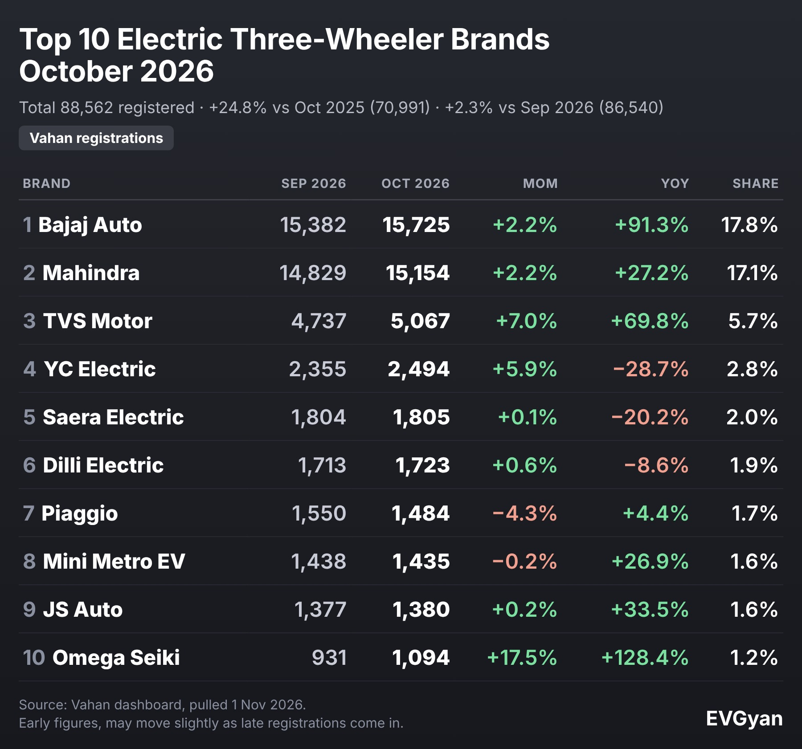

Representative image (AI-generated). Tables and charts: EVGyan, built from Vahan data

India registered **88,562 electric three-wheelers in October 2026**, up 24.8% on October 2025 and 2.3% on September. It missed the all-time monthly high in our Vahan data by just **131 vehicles**: December 2025 stands at 88,693.

*(Vahan retail registrations, data as of 1 November 2026. October is provisional and may rise 2% to 4% as late entries arrive. The three-wheeler count here covers e-rickshaws, e-carts and electric autos, passenger and goods.)*

Three-wheelers are the quiet giant of Indian EVs. They are 25.0% of all EV registrations, and 62.6% of every three-wheeler registered in October was electric. That share is inflated by e-rickshaws, which are electric by nature, but it still shows how far this segment has already travelled. For the full picture across segments, see our [October 2026 EV overview](/blogs/india-ev-sales-october-2026).

## Top 10 electric three-wheeler brands, October 2026

| Rank | Brand | Oct 2026 | Sep 2026 | MoM | YoY | Share |
|---|---|---|---|---|---|---|
| 1 | Bajaj Auto | 15,725 | 15,382 | +2.2% | +91.3% | 17.76% |
| 2 | Mahindra | 15,154 | 14,829 | +2.2% | +27.2% | 17.11% |
| 3 | TVS Motor | 5,067 | 4,737 | +7.0% | +69.8% | 5.72% |
| 4 | YC Electric (Yatri) | 2,494 | 2,355 | +5.9% | −28.7% | 2.82% |
| 5 | Saera Electric | 1,805 | 1,804 | +0.1% | −20.2% | 2.04% |
| 6 | Dilli Electric | 1,723 | 1,713 | +0.6% | −8.6% | 1.95% |
| 7 | Piaggio | 1,484 | 1,550 | −4.3% | +4.4% | 1.68% |
| 8 | Mini Metro EV | 1,435 | 1,438 | −0.2% | +26.9% | 1.62% |
| 9 | JS Auto | 1,380 | 1,377 | +0.2% | +33.5% | 1.56% |
| 10 | Omega Seiki | 1,094 | 931 | +17.5% | +128.4% | 1.24% |

## Bajaj and Mahindra: 571 vehicles apart

The top two are nearly level. Bajaj registered 15,725 and Mahindra 15,154, a gap of **571**. A year ago the order was reversed: Mahindra led with 11,911 against Bajaj's 8,221.

Bajaj has now been number one for three months in a row (August, September and October). Its three-wheeler registrations have almost doubled in a year, up 91.3%, and its share has gone from 11.58% to 17.76%. Mahindra grew 27.2%, which is healthy, but at that pace it loses ground to a rival growing three times as fast.

TVS Motor is a distant third with 5,067, but it grew 69.8% and is the only other big name moving at speed.

## The segment is really four businesses

"Three-wheeler" covers very different vehicles. Vahan splits them by class:

| Class | Oct 2026 | YoY | FY27 growth | Share of E3W |
|---|---|---|---|---|
| Passenger auto (L5) | 47,159 | +95.3% | +111.0% | 53.2% |
| E-rickshaw (passenger) | 27,529 | −25.8% | −20.0% | 31.1% |
| E-cart (goods e-rickshaw) | 6,912 | −1.1% | +1.7% | 7.8% |
| Goods (L5 cargo) | 6,867 | +164.0% | +101.9% | 7.8% |
| Personal | 95 | −45.4% | +0.2% | 0.1% |

Electric autos (L5) are now more than half of the segment, and cargo L5 vehicles grew 164.0% from a small base. E-rickshaws, the old workhorse, fell 25.8%.

One caution before anyone writes a story about e-rickshaws dying. Over the same months, e-rickshaw registrations fell while electric passenger autos rose sharply. Part of that can come from vehicles being registered under a different class, not only from changes in what buyers want. Vahan cannot tell us which. Read the two lines together, not apart.

## The tail is long, and the top is tightening

Registrations came from **558 different makers** in October, and 115 of them registered 100 or more vehicles. This is still the most fragmented EV segment in India. But the top is tightening: the top 3 brands now hold 40.6% of registrations, up from 33.3% a year ago.

The brands in the middle are mostly slipping. YC Electric (Yatri), Saera Electric and Dilli Electric all registered fewer vehicles than a year ago. Omega Seiki is the opposite story: up 128.4% to 1,094, and a jump from rank 25 to rank 10 in a year.

## One odd number from Delhi

Delhi registered 2,166 electric three-wheelers in October, down 57.3% from 5,074 a year ago, and down 70.7% across FY27 so far. While India's three-wheeler total grew, the capital's fell. Vahan does not show why, so we will not guess. Delhi's EV registrations in other segments grew, which makes this a three-wheeler-specific dip worth watching.

## What this means for you

- **If you are buying an e-auto for income:** the three biggest brands, Bajaj, Mahindra and TVS, are also the ones growing fastest. Resale value and service coverage are better where volumes are higher, so ask about both before you compare prices.
- **If you want a goods three-wheeler:** cargo L5 registrations jumped to 6,867, so more choice is arriving. We looked at [one fast-charging electric auto](/blogs/montra-super-auto-fx-15-minute-charging) recently, and the [expansion in e-rickshaws and buses](/blogs/electric-bus-three-wheeler-expansion-india) is worth a read.
- **If you track the market:** do not read too much into month-to-month moves between e-rickshaw and e-auto classes, for the reason given above.

## The EVGyan take

Three-wheelers do not get the headlines that scooters and cars do, but they are the segment where EVs have already won the argument. More than six in ten new three-wheelers are electric. The race now is between Bajaj and Mahindra, and the 571-vehicle gap says it is far from decided.

Next month's Vahan data will show whether Bajaj makes it four months at the top, and whether the segment finally clears December 2025's record of 88,693.
