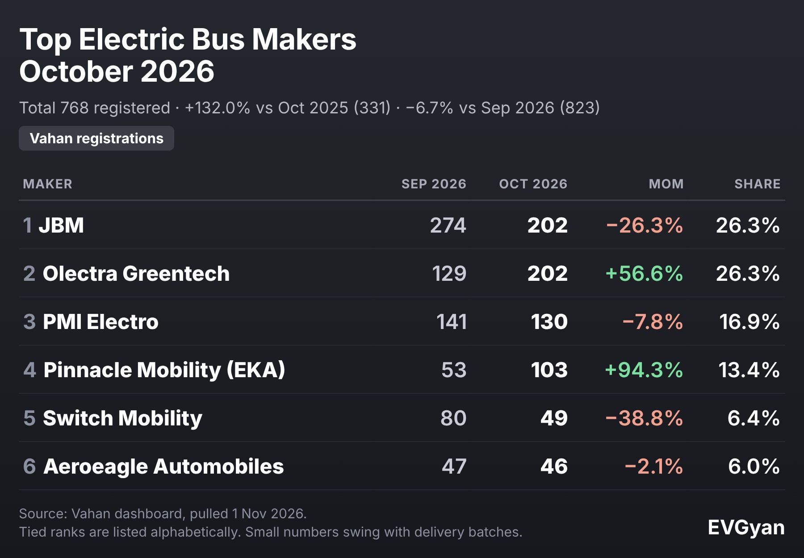

Representative image (AI-generated). Tables and charts: EVGyan, built from Vahan data

Two electric bus makers finished October 2026 on exactly the same number. **JBM registered 202 buses. Olectra Greentech registered 202 buses.** Between them they account for 404 of the month's 768 electric bus registrations.

That total is 132.0% above the 331 of October 2025, but 6.7% below September's 823. It is the third-biggest month of 2026, behind August (910) and September.

*(Vahan retail registrations, data as of 1 November 2026. October is provisional and may rise as late entries arrive. Bus numbers are small, so we quote absolute figures first. Tied ranks are listed alphabetically.)*

## Top electric bus makers, October 2026

| Rank | Maker | Oct 2026 | Sep 2026 | Oct 2025 | MoM | Share |
|---|---|---|---|---|---|---|
| 1 | JBM | 202 | 274 | 35 | −26.3% | 26.3% |
| 2 | Olectra Greentech | 202 | 129 | 140 | +56.6% | 26.3% |
| 3 | PMI Electro | 130 | 141 | 107 | −7.8% | 16.9% |
| 4 | Pinnacle Mobility (EKA) | 103 | 53 | 8 | +94.3% | 13.4% |
| 5 | Switch Mobility | 49 | 80 | 29 | −38.8% | 6.4% |
| 6 | Aeroeagle Automobiles | 46 | 47 | 0 | −2.1% | 6.0% |

Just behind the top six, Veera Vidyuth Vahana registered 9 buses and Azad India Mobility 8. Tata Motors registered 4.

## How the tie happened

JBM and Olectra got to 202 from opposite directions. JBM slipped from 274 in September, while Olectra jumped 56.6% from 129. Over the financial year the picture is also close: JBM leads April to October with **1,094** registrations against Olectra's **1,011**, a gap of 83 buses.

PMI Electro stays third in October with 130 and 761 for the year. These three have been the names at the top all year, and between them they hold 69.5% of the month's registrations.

## A year ago, one maker held 42%

October 2025 looked very different. Olectra alone had 140 of 331 registrations, a 42.3% share, and the top three held 85.2% between them. Now the top three hold 69.5%, and the biggest share is 26.3%.

The market has spread out for two reasons.

- **JBM's volume went from 35 to 202.** That one change moved its share by 15.7 percentage points.
- **Newer names are arriving.** Pinnacle Mobility (EKA) registered 103 buses against 8 a year ago, and Aeroeagle Automobiles added 46 after registering none in October 2025.

Switch Mobility went the other way in the month, falling from 80 to 49, though its year-on-year number is still up from 29.

## Month by month in 2026

| Month | Electric bus registrations |
|---|---|
| March | 558 |
| April | 347 |
| May | 381 |
| June | 712 |
| July | 550 |
| August | 910 |
| September | 823 |
| October | 768 |

The line is jagged, and it should be. Buses are bought in batches by city transport bodies, so a big delivery to one city can swing a maker's monthly number by a hundred or more. Look at three-month stretches, not single months. From April to October, India registered **4,491** electric buses, 64.1% more than the same stretch of last year.

## One in 13 new buses is now electric

Out of 9,852 buses of all fuels registered in October, 768 were electric. That is **7.8%**, or about one in 13. A year ago it was 3.7%, closer to one in 27.

The all-fuel bus market grew 10.8% in the same period, from 8,895 to 9,852. So electric buses are not just riding a bigger market. They are taking a bigger share of it. Delhi registered 73 electric buses in the month, up from 26 a year ago, though down from 186 in September.

For the wider push behind these numbers, read our report on [220 electric buses for three Gujarat cities](/blogs/electric-bus-three-wheeler-expansion-india).

## Also in commercial EVs: goods carriers hit a new high

Electric goods carriers registered **4,139** in October, the best month on record in our data, up 167.6% from 1,547 a year ago.

- **Tata Motors:** 1,732 (41.8% share)
- **Euler Motors:** 1,271 (30.7% share)
- **Mahindra:** 536 (12.9% share)

Euler's year-on-year growth is a small-base effect, so the absolute number is the story: 1,271 goods vehicles registered in one month.

## What this means for you

If you ride a city bus, the change you will notice first is air and noise, not price. The numbers say your next city bus has a better chance of being electric than ever: 7.8% of new buses, double last year's share. If you run a fleet or a school, you now have four makers registering 100 or more buses a month to choose from, which means real price and service competition.

## The EVGyan take

October's tie is a nice headline, but the bigger story is the end of one-maker dominance. In 2025, one company held 42% of the market. In October 2026, no one holds more than 26.3%. When a market spreads out like this, buyers get better terms and manufacturers have to earn the next order.

Watch the next two months. Even two average months, at about 640 buses each, would take FY27 past 5,700 electric buses.
