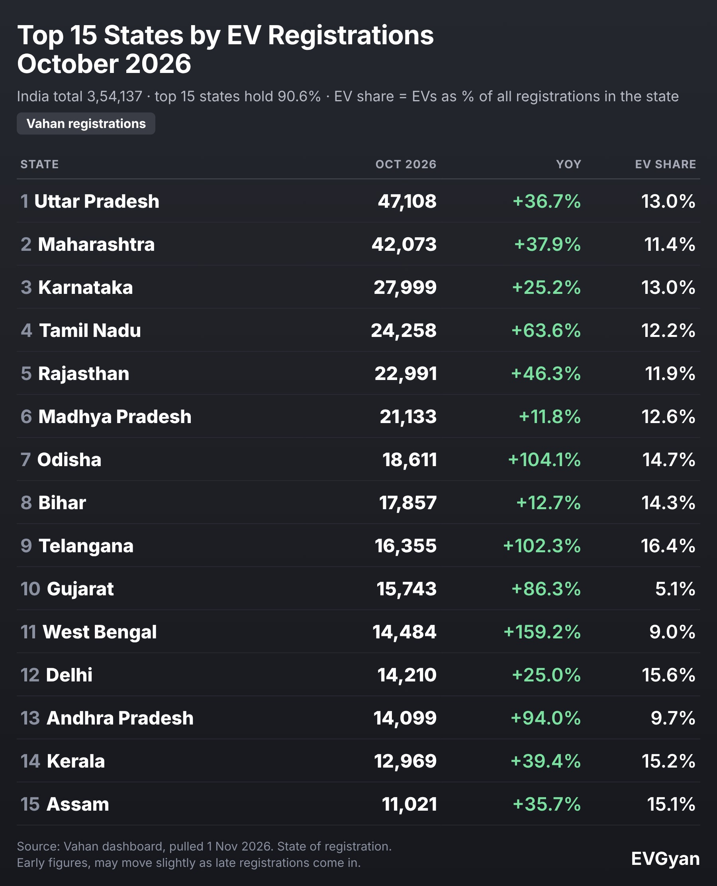

Representative image (AI-generated). Tables and charts: EVGyan, built from Vahan data

**Uttar Pradesh registered 47,108 EVs in October 2026**, more than any other state, with Maharashtra next at 42,073. Together the two account for 89,181 registrations, which is one in every four EVs registered in India (25.2%).

But the biggest state is not the fastest, and it is not the one where EVs are most popular. India has three different EV leaderboards, and different states win each. Here are all three.

*(Vahan retail registrations, data as of 1 November 2026. October is provisional and may rise 2% to 4% with late entries. State means the state where the vehicle was registered, not where it runs. State coverage follows the Vahan public report.)*

## Leaderboard 1: Who registers the most EVs

| Rank | State | Oct 2026 | Sep 2026 | MoM | YoY | FY27 growth | EV share |
|---|---|---|---|---|---|---|---|
| 1 | Uttar Pradesh | 47,108 | 44,859 | +5.0% | +36.7% | +26.1% | 13.0% |
| 2 | Maharashtra | 42,073 | 39,265 | +7.2% | +37.9% | +59.4% | 11.4% |
| 3 | Karnataka | 27,999 | 29,097 | −3.8% | +25.2% | +58.5% | 13.0% |
| 4 | Tamil Nadu | 24,258 | 27,192 | −10.8% | +63.6% | +86.2% | 12.2% |
| 5 | Rajasthan | 22,991 | 17,778 | +29.3% | +46.3% | +71.7% | 11.9% |
| 6 | Madhya Pradesh | 21,133 | 19,693 | +7.3% | +11.8% | +41.0% | 12.6% |
| 7 | Odisha | 18,611 | 16,090 | +15.7% | +104.1% | +125.0% | 14.7% |
| 8 | Bihar | 17,857 | 18,979 | −5.9% | +12.7% | +48.6% | 14.3% |
| 9 | Telangana | 16,355 | 14,283 | +14.5% | +102.3% | +107.1% | 16.4% |
| 10 | Gujarat | 15,743 | 12,677 | +24.2% | +86.3% | +80.0% | 5.1% |
| 11 | West Bengal | 14,484 | 13,503 | +7.3% | +159.2% | +128.4% | 9.0% |
| 12 | Delhi | 14,210 | 14,990 | −5.2% | +25.0% | +14.7% | 15.6% |
| 13 | Andhra Pradesh | 14,099 | 10,521 | +34.0% | +94.0% | +124.7% | 9.7% |
| 14 | Kerala | 12,969 | 17,447 | −25.7% | +39.4% | +54.0% | 15.2% |
| 15 | Assam | 11,021 | 10,541 | +4.5% | +35.7% | +32.2% | 15.1% |

The top 5 states registered 1,64,429 EVs, or 46.4% of India's total. The top 10 hold 71.8%, and the top 15 hold 90.6%.

Uttar Pradesh is the volume king, but its lead is thinning. Its share of national EV registrations slipped from 14.07% a year ago to 13.3%. Over FY27 so far, UP is up 26.1%. Among the top 15 states only Delhi, at 14.7%, is growing slower over the same stretch.

## Leaderboard 2: Who is growing the fastest

Compared with October 2025, these big states grew the most:

1. **West Bengal:** +159.2% to 14,484
2. **Odisha:** +104.1% to 18,611
3. **Telangana:** +102.3% to 16,355
4. **Andhra Pradesh:** +94.0% to 14,099
5. **Gujarat:** +86.3% to 15,743

Four of them have more than doubled their registrations over April to October compared with a year ago: West Bengal (+128.4%), Odisha (+125.0%), Andhra Pradesh (+124.7%) and Telangana (+107.1%). Part of this is a regional story. East India registered 56,546 EVs in October, up 64.8% in a year and 86.8% over FY27, the fastest of the six main regions.

The slowest big states are Madhya Pradesh (+11.8%) and Bihar (+12.7%). Both still registered more than 17,000 EVs, so this is slower growth on a large base, not a collapse.

## Leaderboard 3: Where EVs are most popular

This ranking asks a different question: out of every new vehicle registered in the state, how many were electric?

| Rank | State | EV share, Oct 2026 | Oct 2025 | EV registrations |
|---|---|---|---|---|
| 1 | Telangana | 16.4% | 7.8% | 16,355 |
| 2 | Delhi | 15.6% | 9.9% | 14,210 |
| 3 | Kerala | 15.2% | 9.4% | 12,969 |
| 4 | Assam | 15.1% | 12.3% | 11,021 |
| 5 | Odisha | 14.7% | 6.7% | 18,611 |
| 6 | Tripura | 14.3% | 17.3% | 848 |
| 7 | Bihar | 14.3% | 6.7% | 17,857 |
| 8 | Karnataka | 13.0% | 8.7% | 27,999 |
| 9 | Uttar Pradesh | 13.0% | 5.6% | 47,108 |
| 10 | Goa | 12.6% | 8.7% | 1,155 |

*(Only states with 5,000 or more total registrations in October are ranked.)*

Telangana's EV share more than doubled in a year, from 7.8% to 16.4%. India as a whole stood at 11.2%.

The most striking gap sits at the other end. **Gujarat registered 15,743 EVs, up 86.3%, but they were only 5.1% of its 3,10,065 total registrations.** About 19 of every 20 new vehicles there were not electric, which leaves a big market with the most room to grow. Haryana is in the same position at 5.0%.

## Regions at a glance

| Region | Oct 2026 | Share of India | YoY | FY27 growth |
|---|---|---|---|---|
| North | 1,01,799 | 28.8% | +38.1% | +33.8% |
| South | 96,289 | 27.2% | +54.7% | +77.5% |
| West | 59,031 | 16.7% | +47.7% | +63.9% |
| East | 56,546 | 16.0% | +64.8% | +86.8% |
| Central | 27,997 | 7.9% | +11.2% | +41.4% |
| North-East | 12,416 | 3.5% | +30.8% | +29.9% |

North is still the largest region by volume. South is the one to watch: it registers almost as many EVs, and it has been growing more than twice as fast over FY27 (+77.5% against +33.8%).

## What moved month on month

Rajasthan jumped 29.3% in a month to 22,991, and Andhra Pradesh jumped 34.0%. Kerala moved the other way, falling 25.7% from 17,447 to 12,969, and Tamil Nadu fell 10.8%. One month does not make a trend, and festive buying patterns differ by state, so treat these as questions to ask rather than answers.

## What this means for you

- **If you live in Telangana, Delhi, Kerala or Assam:** EVs are already normal on your roads. Used-EV markets, charging and service networks tend to be better developed where adoption is high. See our report on [Delhi's 14,225 charging points](/blogs/delhi-ev-charging-points-target).
- **If you live in Gujarat, Haryana or Punjab:** you are early. Expect more launches and dealer openings as brands chase these markets.
- **If you are choosing what to buy:** state numbers say little about brands. For that, read our [two-wheeler](/blogs/electric-two-wheeler-registrations-october-2026) and [car](/blogs/electric-car-registrations-october-2026) rankings.

## The EVGyan take

Think of Uttar Pradesh as India's EV market in volume and Telangana as the one showing where the rest are headed. Telangana, Odisha, Bihar and Uttar Pradesh all more than doubled their EV share in a year, and if that pace holds, the share leaderboard will look very different a year from now. For the national view, our [October 2026 EV overview](/blogs/india-ev-sales-october-2026) has the full segment-wise picture.

State-by-segment and state-by-brand splits are not available in public Vahan data, so we can say who registers the most, not who sells what where.
