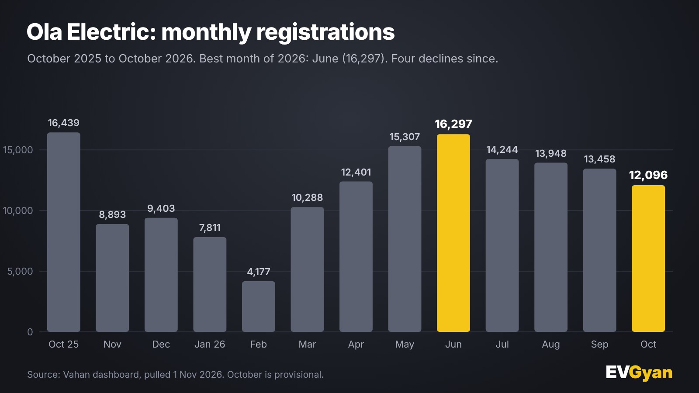

Chart: EVGyan, built from Vahan data

Ola Electric registered **12,096 scooters in October 2026**, 10.1% fewer than September and 26.4% fewer than October 2025. In the same month, India's electric two-wheeler market grew 48.4% to a record 2.24 lakh. Ola is the only brand in the top 10 that went backwards on both counts.

It is still number five. But the list of reasons to feel comfortable about that is getting shorter.

*(Vahan retail registrations, data as of 1 November 2026. October is provisional and may rise 2% to 4% with late entries. Vahan counts what customers registered, not what a company dispatched, so a company's own figures can differ.)*

## Ola's numbers, side by side

| | October 2026 | September 2026 | October 2025 |
|---|---|---|---|
| Registrations | 12,096 | 13,458 | 16,439 |
| Market share | 5.40% | 6.45% | 10.89% |
| Rank | 5 | 5 | 5 |

Over FY27 so far (April to October), Ola registered **97,751** scooters against 1,28,090 in the same stretch of last year, a fall of 23.7%. Its share of the market over those seven months is 7.24%, compared with 16.19% a year earlier.

Compare that with the other brands in the top 10. TVS grew 94.5% year on year, Hero MotoCorp (Vida) 81.4%, BGauss 80.5%, River 272.8%. Even Ather, whose growth has been the slowest of the leaders at 5.1%, still registered more scooters than a year ago.

## The slide in one chart

Ola's year has two halves. The first half was a recovery. After a low of **4,177** in February, it climbed each month to **16,297** in June, its best month of 2026.

The second half has been a steady fall: 14,244 in July, 13,948 in August, 13,458 in September and 12,096 in October. That is **four monthly declines in a row**, and a 25.8% drop from the June high.

To put the longer view in numbers, Ola's best month in our Vahan data is January 2025, at 24,923. October's 12,096 is less than half of that.

## Where the share went

Ola lost 5.5 percentage points of market share in a year, from 10.89% to 5.40%. Here is who gained and who lost over the same period:

- **TVS Motor:** +6.4 points
- **Hero MotoCorp (Vida):** +2.4 points
- **River:** +1.8 points
- **Ather Energy:** −5.8 points
- **Ola Electric:** −5.5 points

Ather's share fell more than Ola's, but the two are not the same story. Ather's registrations still grew 5.1%, so its share fell because the market grew faster. Ola's registrations themselves shrank.

The Ola and Hero Vida comparison is the sharpest. In October 2025, Ola registered 16,439 and Vida 16,499. A year later Vida registered 29,936, which is nearly 2.5 times Ola's 12,096.

## How close is the chasing pack?

| Rank | Brand | Oct 2026 |
|---|---|---|
| 4 | Hero MotoCorp (Vida) | 29,936 |
| 5 | Ola Electric | 12,096 |
| 6 | Greaves Electric (Ampere) | 10,839 |
| 7 | River | 6,796 |
| 8 | BGauss | 5,554 |

Ola leads Greaves by **1,257** registrations. Greaves grew 16.3% over September and 39.9% over last year. If those two trends continue for a few more months, number five could change hands. River is further back, but it grew 20.3% over September. Our [electric two-wheeler report](/blogs/electric-two-wheeler-registrations-october-2026) has the full top 10.

## What the data cannot tell us

Vahan shows how many scooters were registered. It does not show why. We cannot tell from this data whether the cause is supply, demand, pricing, availability in specific cities or something else, and we will not guess. What the data does show clearly is the direction: four months down, in a market going up.

## What this means for you

If you are considering an Ola scooter, 12,096 registrations a month means it is still among the five most-bought electric scooters in India, and a large number of owners are on the road. That is useful when you look for reviews, resale prices and service feedback in your own city. Ask owners near you before you decide, whichever brand you are comparing.

If you are comparing across brands, the fastest-growing ones, TVS and Hero, are also the ones that are [expanding capacity](/blogs/tvs-electric-scooter-capacity-expansion) quickly, so waiting times can be a factor. See how [TVS and Bajaj compare](/blogs/tvs-vs-bajaj-electric-october-2026) at the top.

## The EVGyan take

A growing market can hide a shrinking player for a while. October shows that it cannot do it forever. When the whole segment grows 48.4% and one brand falls 26.4%, that brand has a fight on its hands, not a market problem.

Ola still has a cushion, a big base of customers and the festive weeks of November ahead. The first number to watch is simple: does November break the four-month slide? We will publish it in the first days of December, next to the [full October overview](/blogs/india-ev-sales-october-2026).
