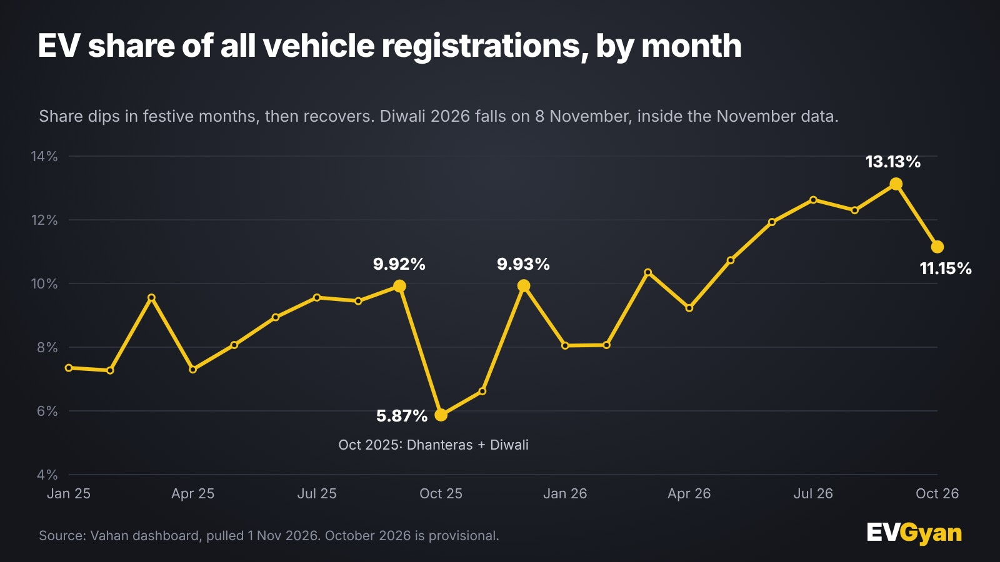

Representative image (AI-generated). Tables and charts: EVGyan, built from Vahan data

If you only read the percentages, October 2026 looks like a weak month for EVs. EV share of all registrations fell to **11.2%** from 13.1% in September. Year-on-year growth cooled from 76.4% to 44.6%. Cars and buses both dipped.

Now read the volume. India registered **3,54,137 EVs**, the highest month in our Vahan data. Volume did not fall. The percentages moved because of what petrol vehicles did, and because of where Diwali sits on the calendar.

*(Vahan retail registrations, data as of 1 November 2026. October is provisional and may rise 2% to 4% with late entries.)*

## Three numbers that look weak, and what is behind each

### 1. "EV share fell from 13.1% to 11.2%"

Share is a ratio, and it can fall when the bottom number grows faster than the top one. Look at what moved between September and October:

| | Sep 2026 | Oct 2026 | Change |
|---|---|---|---|
| EV registrations | 3,37,923 | 3,54,137 | +4.8% |
| Petrol registrations | 17,74,019 | 23,05,438 | +30.0% |
| All vehicles, all fuels | 25,74,548 | 31,75,302 | +23.3% |
| EV share | 13.13% | 11.15% | −1.98 points |

EVs grew. Petrol grew six times faster, because Navratri (from 11 October) and Dussehra (20 October) sent buyers to showrooms. The EV share is the victim of a bigger festive surge on the other side.

### 2. "Growth slowed from 76.4% to 44.6%"

The comparison base changed. Compare any EV number with a year earlier and you are comparing with a very different month in 2025.

October 2025 was already a festive month. Dhanteras and Diwali both fell inside it, and EV registrations that month were 2,44,888, up 27.9% on September 2025's 1,91,532. A bigger base gives a smaller percentage for the same absolute gain.

A fairer comparison is the average of October and November 2025, which is 2,36,723 a month. Against that, October 2026 is **49.6% higher**.

### 3. "Cars and buses went down"

Electric cars registered 36,710, down 4.4% from September's record 38,397, while all car registrations jumped for the festive month. Electric buses registered 768, down 6.7%, but bus numbers swing with delivery batches. Look at the penetration by segment:

| Segment | EV share, Oct 2025 | Sep 2026 | Oct 2026 |
|---|---|---|---|
| Two-wheelers | 4.7% | 11.6% | 9.7% |
| Three-wheelers | 52.2% | 64.1% | 62.6% |
| Four-wheelers | 3.6% | 8.7% | 7.3% |
| Buses | 3.7% | 7.7% | 7.8% |
| Goods carriers | 1.5% | 3.7% | 4.0% |

The segments that depend on retail festive buying (scooters, bikes, cars) slipped on share. Buses and goods carriers, which are bought by fleets and not by families on Dhanteras, held or gained. That pattern is what you would expect from a festive effect, not from a loss of EV demand.

## What happened last year

We can test the Diwali theory against last year's data. Here is the monthly EV share from August 2025 to December 2025:

| Month | EV share | All vehicles registered |
|---|---|---|
| Sep 2025 | 9.92% | 19,31,085 |
| **Oct 2025** (Dhanteras and Diwali) | **5.87%** | 41,70,511 |
| Nov 2025 | 6.62% | 34,51,433 |
| Dec 2025 | 9.93% | 21,46,970 |

In October 2025, the all-vehicle total more than doubled from September (+116.0%) and EV share fell by 4.05 points to 5.87%. It stayed low in November. By December, once the festive rush was over, share was back at 9.93%. That is almost exactly where it had been in September, at 9.92%.

So last year's festive dip was temporary. The flood of petrol buyers pushed EV share down for two months, and then it came back.

The 2026 dip so far is smaller: 1.98 points, against 4.05 last year. And this October did not yet include Diwali, which falls on **8 November 2026**, with Dhanteras on 6 November.

## What to expect in November

We do not forecast numbers, but last year's pattern gives us something to watch.

- **EV share could dip again.** November holds both Dhanteras and Diwali, and the all-vehicle total should jump again.
- **EV registrations should stay strong.** Last November was 2,28,558, and this year's base is much higher. October's 3,54,137 is already 54.9% above that.
- **The recovery month is December**, if last year's pattern repeats.

We will publish November's data in the first days of December, with the same three numbers: share, volume and growth against Nov 2025.

## The bigger picture: FY27 is strong

Take away the single month and the trend is clear. From April to October FY27, EV registrations reached **21,67,248**, up 57.2% on the same period of FY26. The year-to-date EV share is 11.6%, up from 8.1% a year ago.

The whole market, meanwhile, fell 23.9% in October against the Diwali-inflated October 2025 (31,75,302 against 41,70,511). Non-EV registrations fell 28.1%. EVs, even on a tough base, grew 44.6%.

## What this means for you

- **If you read a headline saying EV sales are weak,** check whether it is quoting share or volume. The volume is the record.
- **If you are buying around Diwali,** expect heavy footfall at petrol and EV showrooms. Ask for written delivery dates, and do not assume that a discount on a petrol model makes it cheaper over five years.
- **If you track EV share,** wait for December before judging the trend. The festive months are the noisy ones.

## The EVGyan take

A ratio can fall while the thing it measures grows. That is what happened in October 2026. EV registrations set a record, petrol registrations set a bigger one, and the percentage went down. Anyone calling it an EV slowdown is reading the wrong line of the table.

For the segment-wise numbers behind this, see our [October 2026 EV overview](/blogs/india-ev-sales-october-2026). To see how the two-wheeler leaders did in the same month, read [TVS vs Bajaj](/blogs/tvs-vs-bajaj-electric-october-2026).
