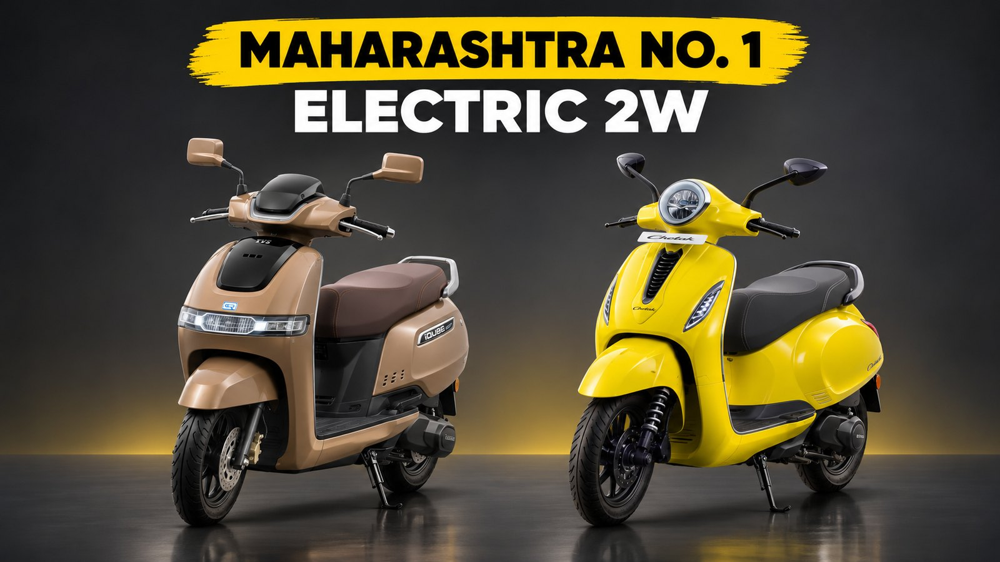
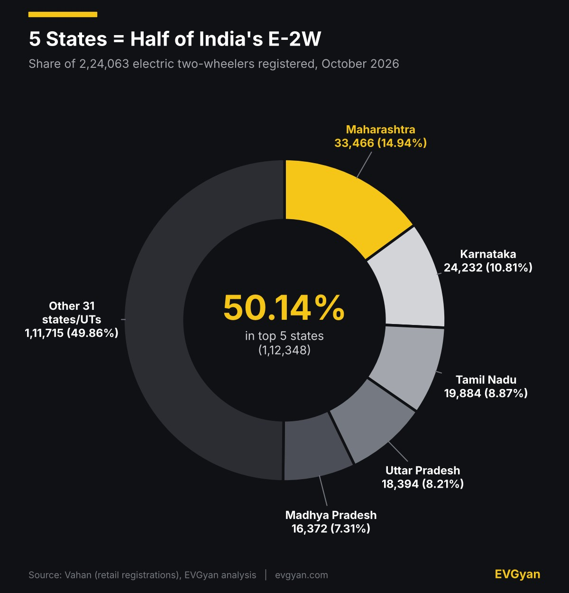
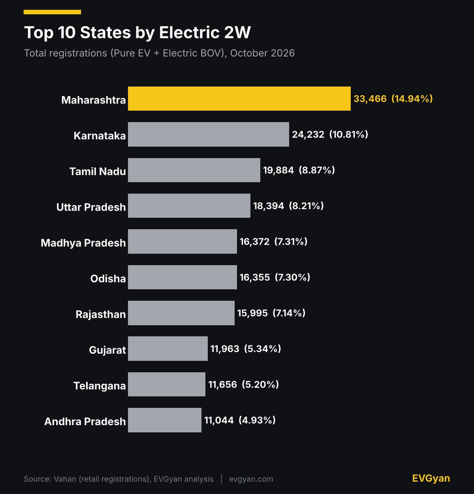
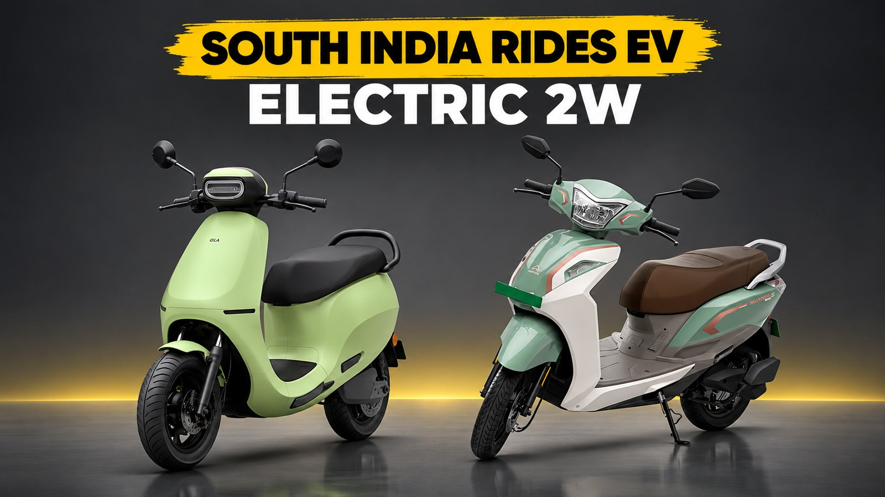

Representative image (AI-generated). Charts and tables: EVGyan, built from Vahan data

Maharashtra registered **33,466 electric two-wheelers in October 2026**, more than any other state. That is 14.94% of the 2,24,063 registered across India in the month, and 9,234 more than second-placed Karnataka.

This is the state-wise cut of Vahan data, so it answers a different question from our [brand ranking](/blogs/electric-two-wheeler-registrations-october-2026). Not who sells the most, but where people are actually buying. If you were looking for electric two-wheeler sales by state for October 2026, the ranking is below.

*(These are Vahan retail registrations, not factory sales. This state report adds up to 2,24,063, while our brand-wise report counted 2,23,886. They are two separate Vahan pulls and the 177 gap is 0.08%. Vahan does not split scooters from motorcycles, so everything here covers both.)*

## Five states hold half the market

The chart below says it in one picture: the top five states take just over half of India's electric two-wheelers, and the other 31 states and union territories share the rest.

Stretch it to ten states and the share reaches 80.05%. Ten states crossed 10,000 registrations each, and 19 crossed 1,000. Maharashtra registered about 1.4 times Karnataka's number and 1.68 times Tamil Nadu's, so nobody else is in its league on volume.

Want the brand side of this? [TVS led Bajaj by 11,365 EVs in October](/blogs/tvs-vs-bajaj-electric-october-2026), and [Ola was down 26.4% in a year](/blogs/ola-electric-sales-october-2026).

## The real race is behind the top three

Look at ranks 5 to 7. Madhya Pradesh, Odisha and Rajasthan sit within 377 registrations of each other, and MP beats Odisha by just 17. A few hundred extra deliveries in November can reshuffle all three.

Uttar Pradesh, India's most populous state, is fourth rather than first. Even so, UP, Madhya Pradesh, Odisha and Rajasthan together registered 67,116 electric two-wheelers, or 29.95% of the market, and none of the four is in the south. Odisha has been climbing for a while: ET's analysis of Vahan data, [reported by Angel One](https://www.angelone.in/news/economy/india-s-ev-adoption-rises-odisha-delhi-tamil-nadu-record-strong-growth), put its EV share of two-wheeler registrations at 17% in March to June 2026, up from 9.5% in 2025.

The five southern states, Karnataka, Tamil Nadu, Telangana, Andhra Pradesh and Kerala, registered 75,981 together, or 33.91%. Volume and penetration are different races, though. [EVreporter's January to May 2026 numbers](https://evreporter.com/electric-2ws-capture-over-8-of-indias-2w-market-marketkerala-records-19-ev-penetration-in-2w-sales-jan-2026-may-2026/) had Kerala at 19.36% EV penetration in two-wheeler registrations and Karnataka at 18.87%, against 13.28% for Maharashtra. Maharashtra wins on units, the south wins on share (that data excludes low-speed models). That gap between interest and purchase is what we looked at in [India's E2W gap](/blogs/electric-scooter-market-structure-2026).

## Ranks 11 to 15

| Rank | State | Registrations | Share |
|---|---|---|---|
| 11 | Kerala | 9,165 | 4.09% |
| 12 | Delhi | 8,051 | 3.59% |
| 13 | West Bengal | 5,473 | 2.44% |
| 14 | Bihar | 5,028 | 2.24% |
| 15 | Chhattisgarh | 4,706 | 2.10% |

Arunachal Pradesh, Ladakh and Nagaland show zero electric two-wheelers for October on Vahan. One more Telangana note: the state moved to the national Vahan 4.0 portal in March 2026, and [evindia.online reported](https://evindia.online/news/telangana-vahan-integration-ev-sales-data-recovered) that its March and April data was only back-filled on 11 May, so a list built before that date shows Telangana smaller than it was.

## What this means for you

If you live in Maharashtra, Karnataka or Tamil Nadu, you are in the three biggest electric two-wheeler markets. Together they registered 77,582 in a month, or 34.63% of India. More buyers usually means more showrooms and service centres nearby, which is why brands like [River are racing to 1,000 showrooms](/blogs/river-mobility-showrooms-expansion) and [Vida is filling its factory](/blogs/hero-vida-record-year-2026). Still, ask for the exact nearest service centre before you book.

If you are in Madhya Pradesh, Odisha, Rajasthan or Uttar Pradesh, you are no longer in a test market. Each registered between 15,995 and 18,394 electric two-wheelers in October. State policies change the on-road price, so check your state's current EV policy page before you pay. Dhanteras is on 6 November and Diwali on 8 November, so ask dealers about festive offers this week.

Want the video version? We broke down October's EV numbers on our [EV Gyan YouTube channel](https://www.youtube.com/watch?v=K-FdjtltLXw).

## The EVGyan take

October's state numbers show a market that is big in a few places and spreading in many. Five states holding half is concentrated, yes. But UP, MP, Odisha and Rajasthan alone are already close to 30%, and demand is outrunning supply at makers like [Ather](/blogs/ather-cant-meet-scooter-demand) and [Bajaj](/blogs/bajaj-chetak-production-80000-target).

The festive weeks fall in November, and we explained in [the Diwali shift](/blogs/ev-share-october-2026-diwali-shift) why October's EV share looked lower than it was. Next month's table will show whether Maharashtra's 9,234 lead over Karnataka holds. For the national picture, see [India EV sales in October 2026](/blogs/india-ev-sales-october-2026).
