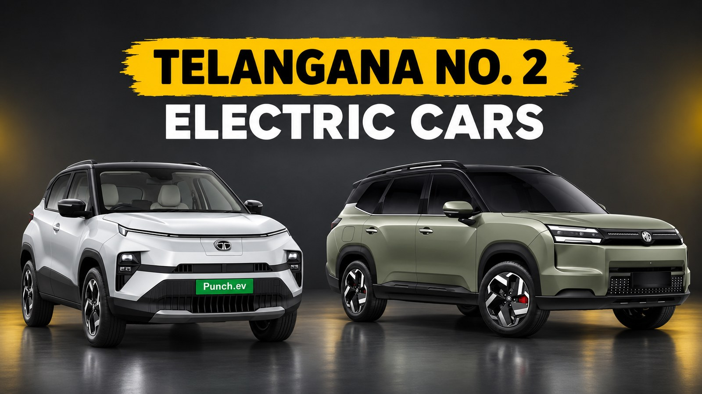
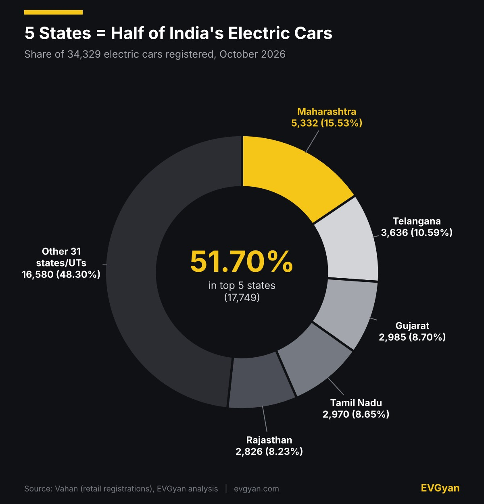
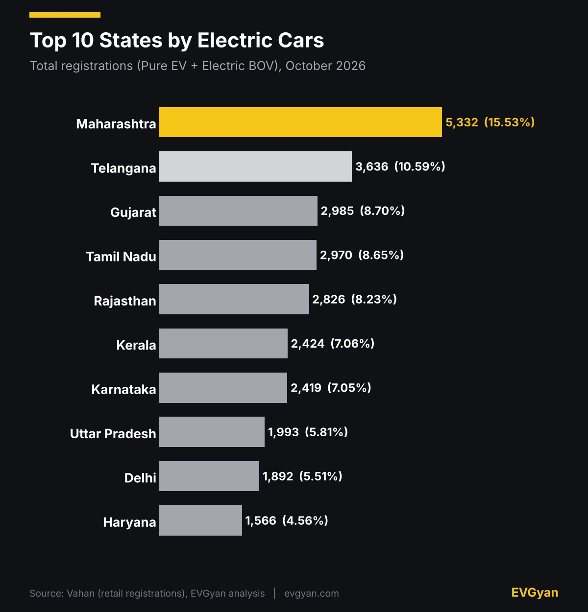
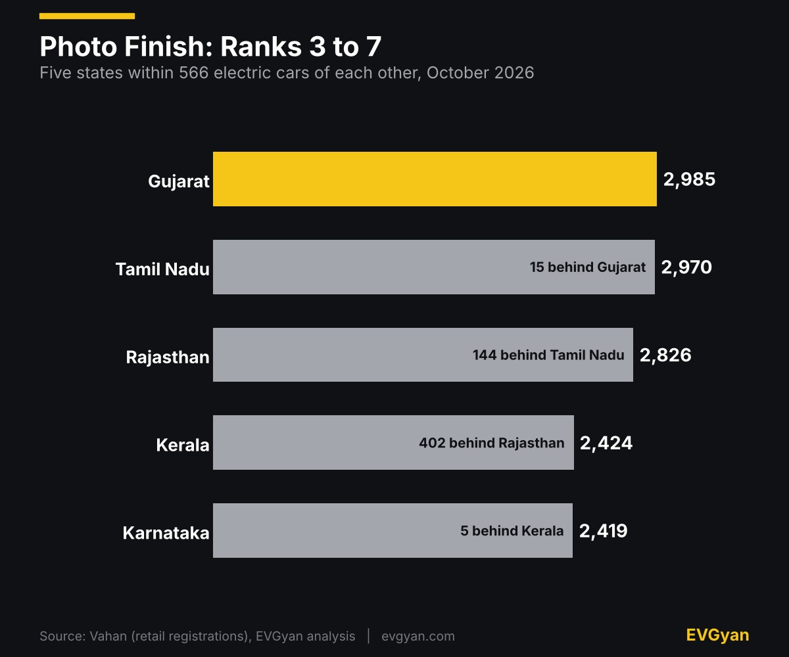
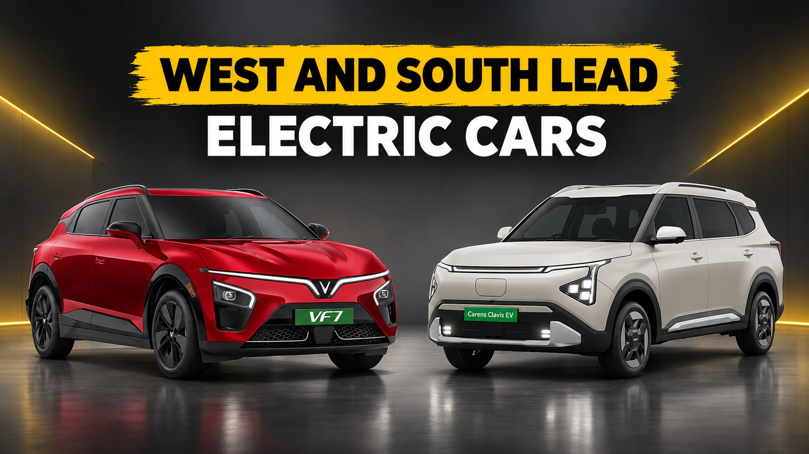

Representative image (AI-generated). Charts and tables: EVGyan, built from Vahan data

Maharashtra registered **5,332 electric cars in October 2026**, the most of any state. But the bigger story is who sits behind it. Telangana registered 3,636, a clear No. 2 and 651 cars ahead of Gujarat in third.

This is the state-wise cut of Vahan data, so it shows where electric cars are actually landing, not which brand is winning (that is in our [October car registrations report](/blogs/electric-car-registrations-october-2026)). If you were searching for electric car sales by state for October 2026, the ranking is below.

*(These are Vahan retail registrations, not factory sales. This state-wise report adds up to 34,329 electric cars, while our brand-wise report counted 36,708. They are two separate Vahan pulls and the state-wise one is 2,379 lower, or 6.5%. Use this article for state ranking and share, and the brand article for the national total.)*

## Maharashtra leads, Telangana is the real story

Maharashtra's 5,332 is 15.53% of the total and about 1.5 times Telangana's number. Nobody is close to it. Telangana, though, holds 10.59%, and it did not get there in one month. [Autocar Pro reported on 7 September](https://www.autocarpro.in/analysis-sales/telangana-springs-a-surprise-to-be-no-2-electric-car-buying-state-after-maharashtra-134571) that Telangana had become the No. 2 electric passenger vehicle state in January to August 2026 with 21,537 units, up 100% from 10,768 a year earlier. Karnataka, third in that count with 20,440, is only seventh in our October data.

The donut below shows how top-heavy the market is: five states take just over half of all electric cars, and the other 31 states and union territories share the rest.

Take the top ten and the share is 81.69%. Eleven states crossed 1,000 electric cars in the month, and 23 crossed 100.

## A photo finish for ranks 3 to 7

Look at the middle of the table. Gujarat, Tamil Nadu, Rajasthan, Kerala and Karnataka all finished within 566 registrations of each other, so one good week of deliveries can reshuffle them. Rajasthan in fifth is worth a second look: it is ahead of Kerala, Karnataka, Uttar Pradesh and Delhi.

Karnataka and Kerala are the two that slipped. [EVreporter's FY 2025-26 numbers](https://evreporter.com/state-wise-electric-car-penetration-in-india-in-fy-2025-26/) gave Karnataka 24,201 electric cars, 11% of the national total, and Kerala 20,226, or 9.2%. In October both are at about 7.05%. One festive month is not a full year, so do not over-read it, but both are well below their FY26 share.

Group the states and the map is clear. Five southern states, Telangana, Tamil Nadu, Kerala, Karnataka and Andhra Pradesh, registered 12,833 electric cars (37.38%). Maharashtra, Gujarat and Rajasthan in the west added 11,143 (32.46%). These eight states together make 23,976 registrations, or 69.84% of the country. For the brand side of this demand, read how [Tata's supply is catching up with bookings](/blogs/tata-ev-supply-catching-up-demand-2026) and what [Tata plans against the MG Windsor](/blogs/tata-kuno-mg-windsor-ev-rival).

## Ranks 11 to 15

| Rank | State | Registrations | Share |
|---|---|---|---|
| 11 | Andhra Pradesh | 1,384 | 4.03% |
| 12 | Odisha | 908 | 2.65% |
| 13 | Punjab | 872 | 2.54% |
| 14 | West Bengal | 725 | 2.11% |
| 15 | Madhya Pradesh | 712 | 2.07% |

Lakshadweep and Mizoram show zero electric cars for October on Vahan.

Delhi is only ninth with 1,892 (5.51%), yet it is one of the most EV-friendly car markets by share. ET's analysis of Vahan data, [reported by Angel One](https://www.angelone.in/news/economy/india-s-ev-adoption-rises-odisha-delhi-tamil-nadu-record-strong-growth), put Delhi's EV share of car registrations at 13.6% in March to June 2026, and Telangana's at 12.3%. Delhi is a smaller market in volume, with Haryana right behind it, and the two together make 3,458 (10.07%). The capital also [beat its 2026 charging target early](/blogs/delhi-ev-charging-points-target).

## What this means for you

If you are buying in Maharashtra, Telangana, Gujarat, Tamil Nadu or Rajasthan, you are in the five biggest electric car markets, so you will usually find more showrooms, more test drives and more used-car chatter around you. In Uttar Pradesh, Delhi, Haryana or Andhra Pradesh, volumes are smaller but real, and dealers there often fight harder for each sale. State road tax and registration rules differ, so check your state's current EV policy page before you compare on-road prices. Dhanteras is on 6 November and Diwali on 8 November, so ask about festive offers this week. Waiting for a 7-seater? Our [Tata Safari EV story](/blogs/tata-safari-ev-launch-january-2027) has the latest.

Want the video version? We broke down October's EV numbers on our [EV Gyan YouTube channel](https://www.youtube.com/watch?v=K-FdjtltLXw).

## The EVGyan take

Electric cars are as concentrated as electric two-wheelers: five states hold 51.70% of cars, against 50.14% of two-wheelers in [our state-wise two-wheeler report](/blogs/electric-two-wheeler-sales-by-state-october-2026). But the names are different. Madhya Pradesh and Odisha are top-six states for two-wheelers and 15th and 12th for cars. Telangana, Gujarat and Rajasthan punch above their two-wheeler rank in cars.

The festive weeks fall in November, so next month's table will show whether Telangana's 651-car lead over Gujarat survives and who wins the 3 to 7 scramble. For the full picture, see [India EV sales in October 2026](/blogs/india-ev-sales-october-2026) and how [September's car numbers](/blogs/electric-car-sales-september-2026) compare.
