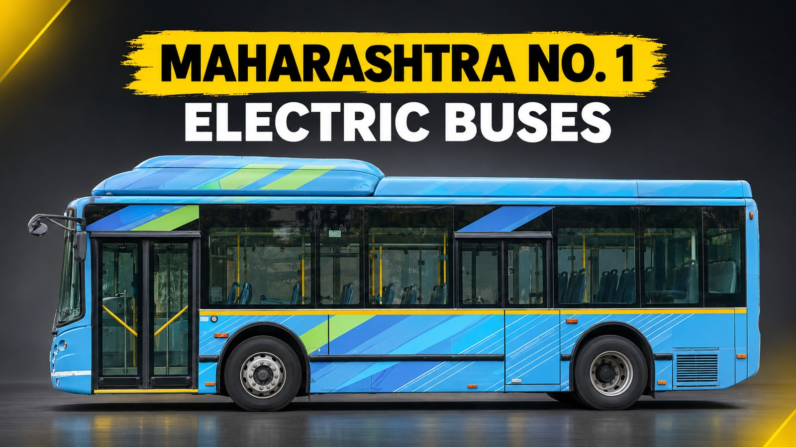
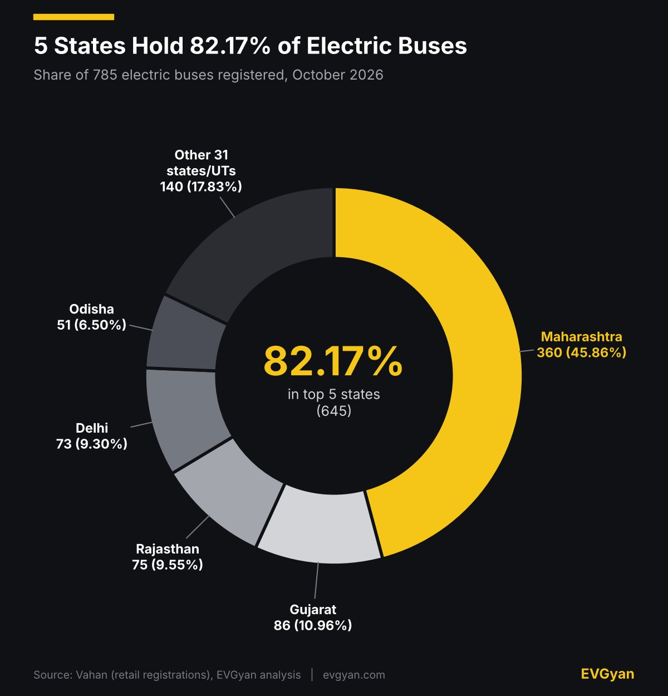
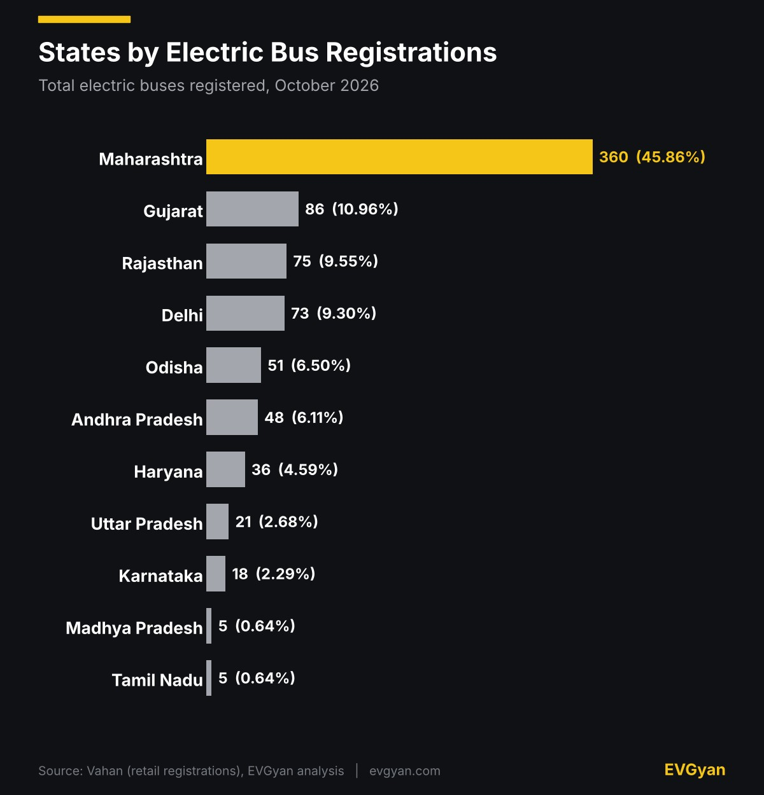
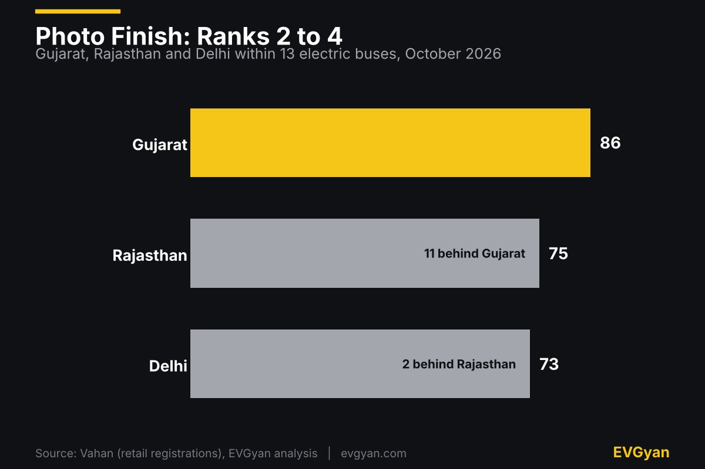
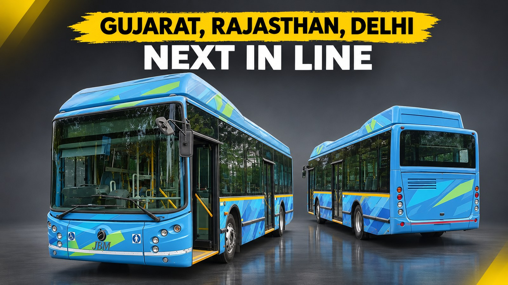

Representative image (AI-generated). Charts and tables: EVGyan, built from Vahan data

Maharashtra registered **360 of India's 785 electric buses in October 2026**. The other 35 states and union territories share the remaining 425, and only 14 of them registered any bus at all.

This is the state-wise cut of Vahan data, so it shows where electric buses are going to work, not which maker is winning (our [bus maker ranking](/blogs/electric-bus-registrations-october-2026) covers that). If you were searching for electric bus sales by state for October 2026, the ranking is below.

*(These are Vahan registrations, not factory sales. This state-wise report adds up to 785 electric buses, while our brand-wise report counted 768. They are two separate Vahan pulls and the state-wise one is 17 higher, or 2.2%. Bus numbers are small, so a handful of buses moves a rank.)*

## Maharashtra is in a league of its own

Maharashtra's number is about 4.2 times Gujarat's, the state in second place. The donut shows how top-heavy the market is: five states take more than four of every five electric buses, and the other 31 share what is left.

The state's transport corporation is part of the reason, and also part of the frustration. [The Hitavada reported on 1 April](https://www.thehitavada.com/Encyc/2026/4/1/delay-persists-in-msrtc-e-bus-rollout-nagpur-division-still-far-behind-target.html) that MSRTC has ordered 5,150 electric buses, of which about 1,200 had been received. The paper blamed supply constraints at the maker, Olectra Greentech, and said the deadline had slipped to December 2026. A big order that is only a quarter filled means Maharashtra's numbers have room to climb.

## Who is behind Maharashtra

Only 15 states and union territories registered any electric bus in October, and 21 registered none. The bar chart has the full order for the top group.

Rajasthan's place in the top three likely has a clear source. [Autocar Pro reported in July](https://www.autocarpro.in/news/eka-mobility-deploys-first-phase-of-876-e-bus-order-in-rajasthan-under-e-bus-scheme-133463?amp=1) that EKA Mobility, with Chartered Speed, won an order for 876 electric buses across eight Rajasthan cities under PM e-Bus Sewa, and the first batch was flagged off in Jaipur. EKA's Pinnacle Mobility registered 103 buses nationally in October, as we showed in the [maker ranking](/blogs/electric-bus-registrations-october-2026).

Gujarat is a PM e-Bus Sewa story too; we covered [220 electric buses for Gujarat](/blogs/electric-bus-three-wheeler-expansion-india) earlier. Andhra Pradesh has also planned 1,050 e-buses across 12 cities under the same scheme, [according to Swarajya](https://swarajyamag.com/amp/story/news-brief/andhra-pradesh-fast-tracks-electric-bus-infrastructure-with-1050-e-buses-planned-across-12-cities-under-pm-e-bus-sewa-scheme), so more may be coming.

## A photo finish for ranks 2 to 4

Gujarat, Rajasthan and Delhi finished within 13 buses of each other, so the order can change in a single month.

Delhi's 73 is a number to watch. [Swarajya reported on 10 October](https://swarajyamag.com/news-brief/delhi-to-induct-200-electric-buses-on-october-14-fleet-to-touch-7000) that the city would add 200 electric buses on 14 October and take its fleet to 7,000. Vahan shows 73 for the whole month, so the two figures do not line up. We cannot tell from Vahan alone whether registration timing or something else explains the gap, so November's number will say more.

## The long tail

| State or UT | Registrations | Share |
|---|---|---|
| Kerala | 3 | 0.38% |
| Bihar | 2 | 0.25% |
| Himachal Pradesh | 1 | 0.13% |
| Puducherry | 1 | 0.13% |

Madhya Pradesh and Tamil Nadu are tied on 5 each. Small numbers like these show where a first order is still to come, not where a market has failed.

## What this means for you

If you ride city buses in Maharashtra, Gujarat, Rajasthan, Delhi, Odisha or Andhra Pradesh, an electric bus may already run on your route, and these are the states where the numbers are. Elsewhere, many routes will stay diesel or CNG for now. Much of this demand comes through state and city tenders, so check your own city's e-bus plans.

Want the video version? We broke down October's EV numbers on our [EV Gyan YouTube channel](https://www.youtube.com/watch?v=K-FdjtltLXw). If you also follow heavier vehicles, see our report on [electric trucks and battery-swap stations](/blogs/electric-truck-battery-swap-infra-india).

## The EVGyan take

Electric buses are more concentrated than two-wheelers or cars. Five states hold 82.17% of buses, against about 50% for [two-wheelers](/blogs/electric-two-wheeler-sales-by-state-october-2026) and [cars](/blogs/electric-car-sales-by-state-october-2026). That makes sense: buses are bought through state and city tenders, so a few big orders decide the map.

The test for the next few months is delivery. Maharashtra's 5,150-bus order, Rajasthan's 876 and Delhi's fleet target all depend on makers shipping on time. For the full October picture, see [India EV sales in October 2026](/blogs/india-ev-sales-october-2026).
