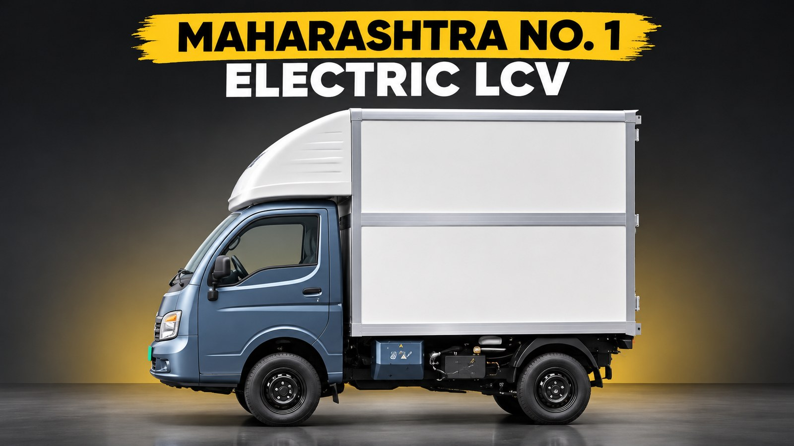
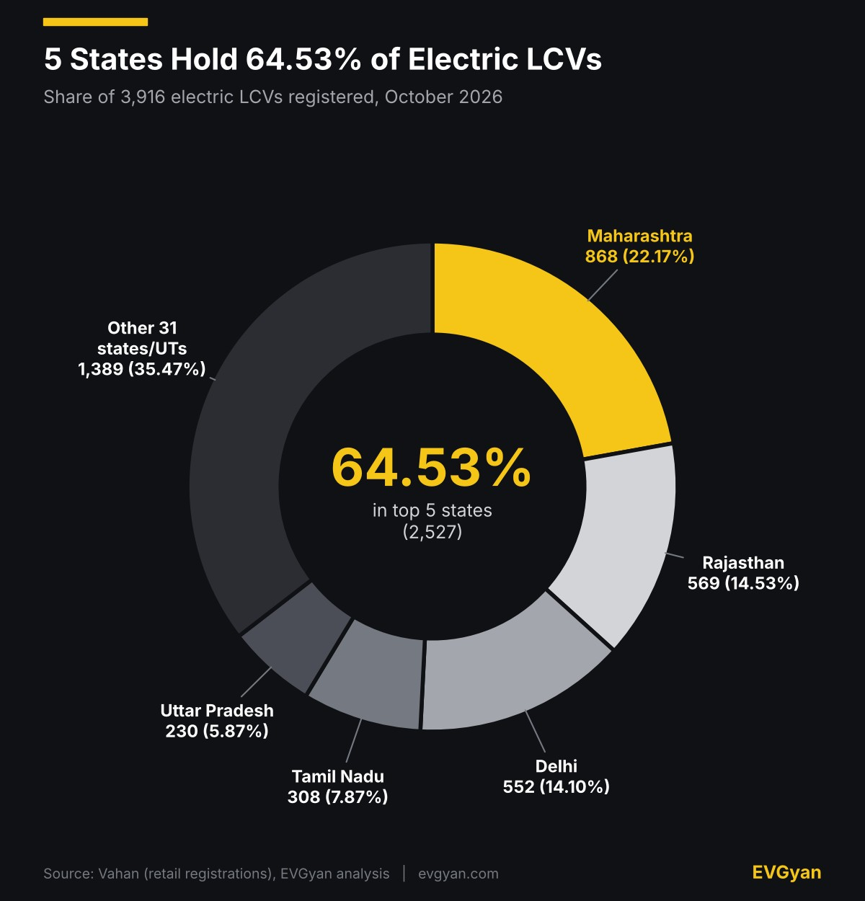
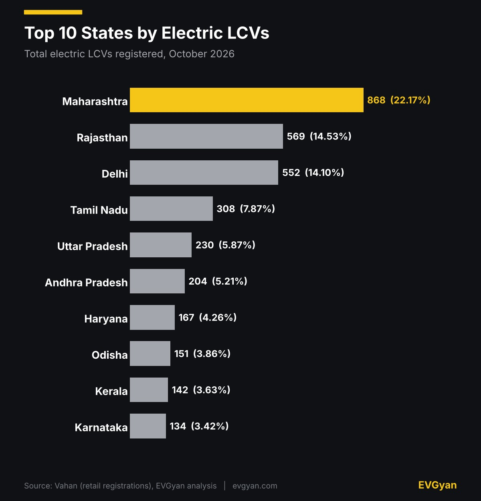
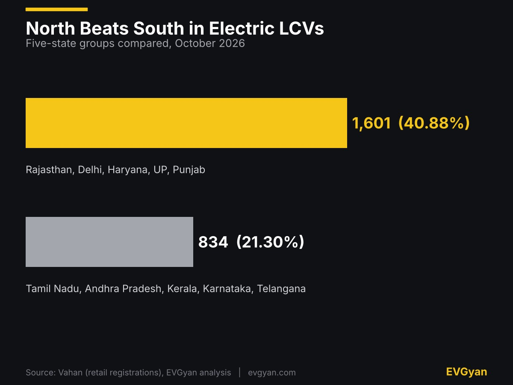
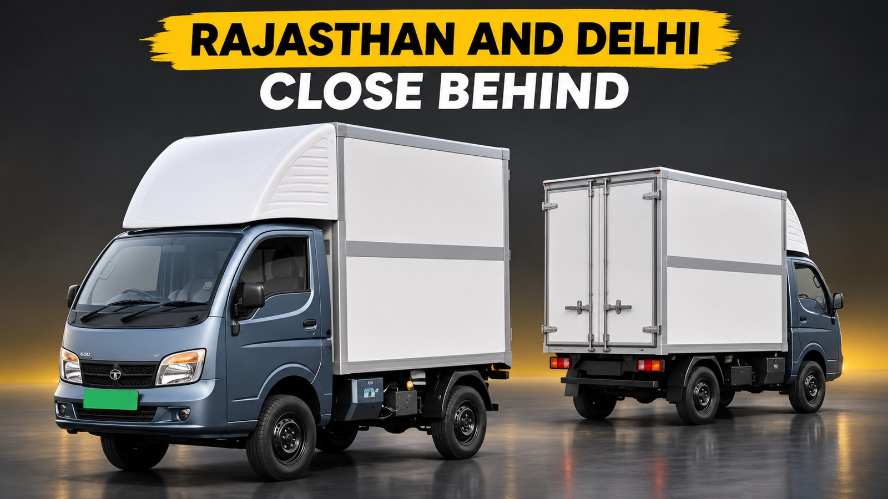

Representative image (AI-generated). Charts and tables: EVGyan, built from Vahan data

Maharashtra registered **868 of India's 3,916 electric LCVs in October 2026**, the most of any state. But look at who is next: Rajasthan (569) and Delhi (552) are only 17 registrations apart, and both are far ahead of every southern state.

This is the state-wise cut of Vahan data for electric light commercial vehicles, the small goods carriers you see doing last-mile delivery in the city. It does not include heavy trucks, and it is a different question from which brand is selling the most. If you were searching for electric LCV sales by state for October 2026, the ranking is below.

*(These are Vahan registrations, not factory sales. LCV means light goods vehicles. Heavy trucks and electric three-wheeler goods carriers are counted separately.)*

## Maharashtra leads, but not by a mile

Maharashtra's share is 22.17%, about 1.5 times Rajasthan's. That is a smaller lead than it has in buses, where it holds almost half the market (see our [electric bus report by state](/blogs/electric-bus-sales-by-state-october-2026)). In LCVs the market is spread across more states. Five states take just under two-thirds, and the other 31 share the rest.

The chart below has the ranking for the top ten. Eleven states crossed 100 electric LCVs in the month.

## Rajasthan and Delhi are the real story

Delhi is a city-state and Rajasthan is a big, spread-out state, yet they finish level. EVreporter's January to July 2026 data, published on 11 August, shows why this is not a one-month fluke. [It reported](https://evreporter.com/?p=33335) that Delhi had the highest e-LCV share of goods carriers at 9.9% (1,118 units), followed by Rajasthan at 6.5% (1,678) and Odisha at 6%. The national share was 3.7% of 3,74,730 goods carriers.

In Rajasthan, Tata Motors led with 790, ahead of Mahindra's 441 and Euler's 391. In Delhi, Euler led with 530 against Tata's 341. Nationally, Tata Motors had 6,282 e-LCVs in January to July and Euler Motors 3,753.

One thing to check before comparing: October's national total of 3,916 is almost double EVreporter's January to July monthly average, which works out to about 2,000. That can mean a strong festive month, or that the two sources count LCVs differently. We would not read too much into it until November's data is in.

## North beats south, unlike cars

Our [state-wise car report](/blogs/electric-car-sales-by-state-october-2026) had the south ahead. In LCVs it is the opposite, and the chart shows the gap between five northern and western states and five southern ones.

Tamil Nadu is the only southern state in the top five. Telangana registered just 46, though that state moved to a new Vahan portal earlier this year and its numbers have been patchy, as we noted in the [two-wheeler state report](/blogs/electric-two-wheeler-sales-by-state-october-2026).

## Ranks 11 to 15

| Rank | State | Registrations | Share |
|---|---|---|---|
| 11 | Madhya Pradesh | 106 | 2.71% |
| 12 | Punjab | 83 | 2.12% |
| 13 | Meghalaya | 77 | 1.97% |
| 14 | Gujarat | 67 | 1.71% |
| 15 | West Bengal | 53 | 1.35% |

Meghalaya at 13th, ahead of Gujarat, is a surprise. The state cabinet approved a new EV policy at the end of July with a ₹25,000 purchase incentive and a registration fee waiver, [according to EastMojo](https://eastmojo.com/meghalaya/2026/07/28/meghalaya-approves-new-ev-policy-with-%E2%82%B925000-purchase-incentive/), but the report does not say which vehicles it covers, so we cannot link it to this number. Nine states and union territories registered no electric LCV at all.

## What this means for you

If you run a delivery or small-goods business in Delhi, Rajasthan or Maharashtra, you are in the three biggest electric LCV markets, which usually means more dealers, more charging options and more owners to ask. [TrucksBuses lists](https://www.trucksbuses.com/scv/pickups-and-mini-trucks/tata-ace-ev-electric/specifications) the Tata Ace EV from ₹11.41 lakh ex-showroom, but on-road prices vary by city and state incentive, so get the number for your own state before you compare it with a diesel mini truck. If your state is in the lower half of the table, ask the dealer about local charging support first.

Want the video version? We broke down October's EV numbers on our [EV Gyan YouTube channel](https://www.youtube.com/watch?v=K-FdjtltLXw). For heavier vehicles, read our report on [electric trucks and battery-swap stations](/blogs/electric-truck-battery-swap-infra-india).

## The EVGyan take

Commercial buyers do the maths on running cost, not on looks, so the map follows the fleets. A busy delivery vehicle needs a charger near its depot, which is why Delhi and Rajasthan can keep pace with Maharashtra.

The test is whether November's data shows October's high as a new normal or a festive spike. For the full October picture, see [India EV sales in October 2026](/blogs/india-ev-sales-october-2026), the [electric three-wheeler numbers](/blogs/electric-three-wheeler-sales-october-2026) and [why EV share dipped in the Diwali shift](/blogs/ev-share-october-2026-diwali-shift).
