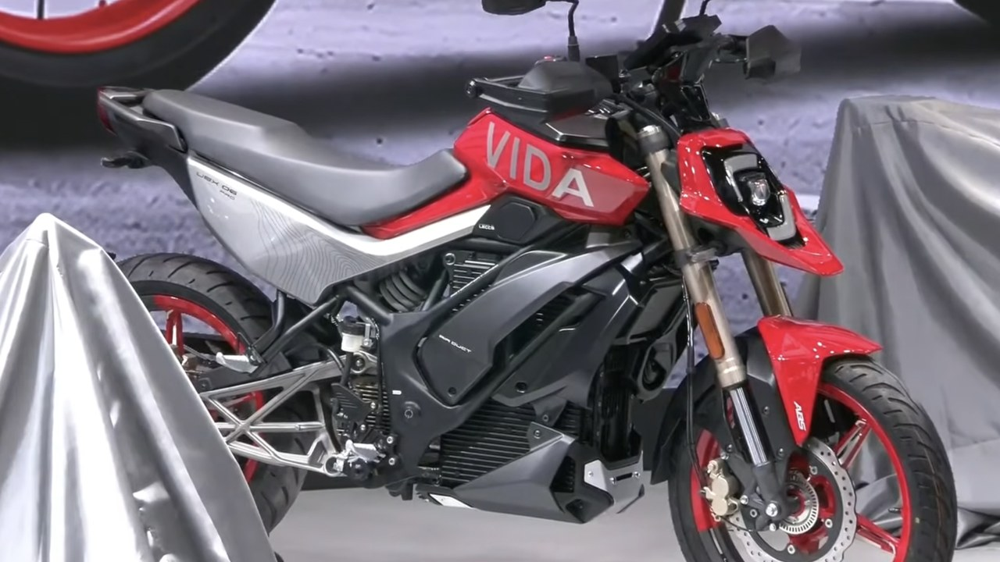
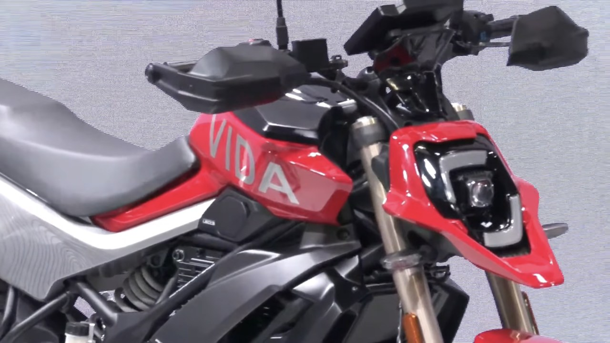

Image: EVGyan, from the EICMA 2026 live reveal

Hero MotoCorp has spent 25 straight years as the world's largest two-wheeler maker by volume. At EICMA 2026 in Milan on 3 November, it used that record to show its most un-Hero-like motorcycle yet: the Vida Ubex, the brand's first electric motorcycle.

Vida, Hero's EV arm, calls the Ubex a "naked urban explorer," built around supermoto styling cues: an aggressive stance, upside-down front forks, a single-piece seat, dual-tone wheels, hand guards, a round TFT display and LED lighting through and through. On stage, Hero's leadership called it "daring, agile, and unapologetically modern," built to go "beyond the everyday commute."

Image: EVGyan, from the EICMA 2026 live reveal

## No specs yet, and that's normal for an EICMA reveal

Here's the honest bit. Hero hasn't released a single hard number for the Ubex: no battery capacity, no motor output, no range, no top speed, no price. That's typical for a first EV reveal at a design-first show like EICMA. A design patent for a Ubex-style naked streetfighter surfaced in India earlier this year, which suggests the styling on stage is close to production-ready even while the powertrain is still being worked out. Back in August 2026, Hero's Emerging Mobility chief Kausalya Nandakumar told investors the company's electric motorcycle platforms, UBEX included, are targeted for "next year" meaning 2027, not this one.

## What this means for you

Don't expect to book one next week. The Ubex reads like a long-runway product, not an imminent launch. Vida's real volume business in India right now is its V-series scooters, moving close to 30,000 units a month as of September. The Ubex looks aimed first at the kind of rider EICMA draws: someone who wants a motorcycle that happens to be electric, not an EV that happens to look like one. Vida used the same event to start direct-to-consumer deliveries across 10 European countries, so a performance-styled EV motorcycle gives the brand something sharper to sell once that European network grows.

Image: EVGyan, from the EICMA 2026 live reveal

**The EVGyan take:** this is the clearest signal yet that Hero doesn't see "electric" as a scooter-only story. Putting a supermoto-styled motorcycle in front of EICMA's crowd, the toughest audience in global two-wheelers, is a statement of ambition even before a single spec is confirmed. We'll hold judgment on performance until Hero publishes real numbers, but the design intent alone makes the Ubex worth watching.

*Hero Vida showed the Ubex at its EICMA 2026 presentation in Milan on 3 November 2026.*
