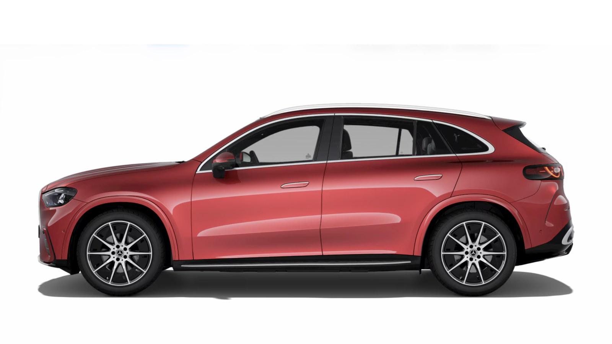
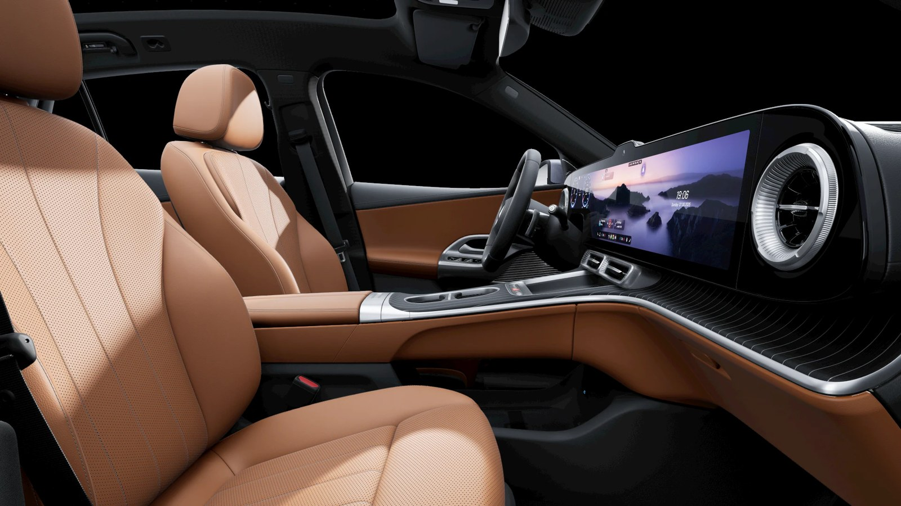
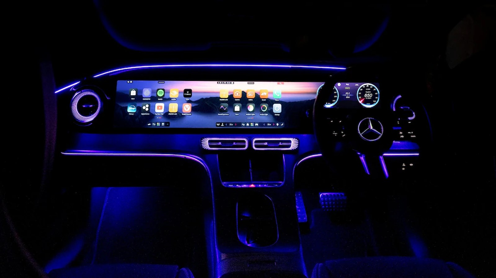
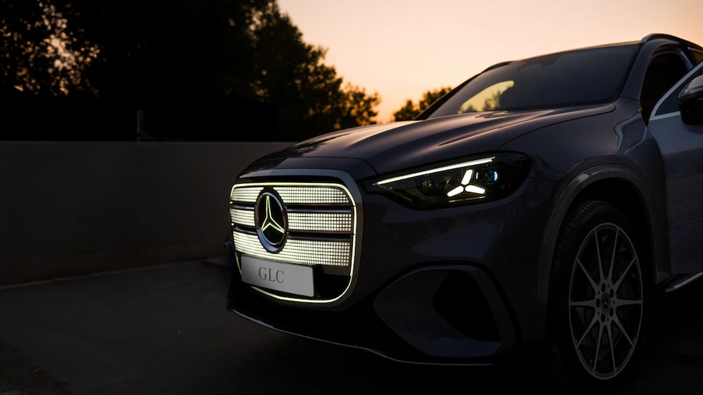
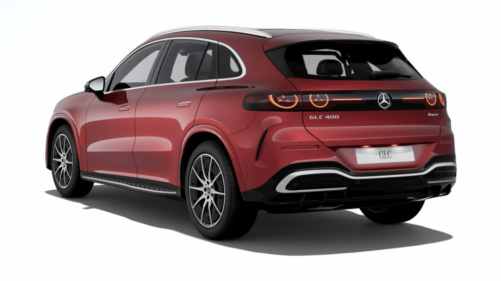
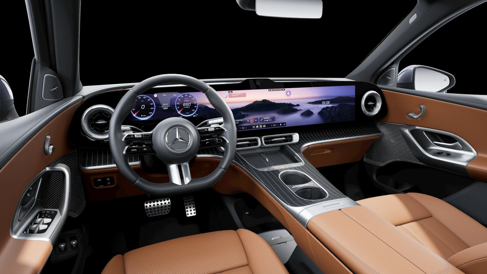
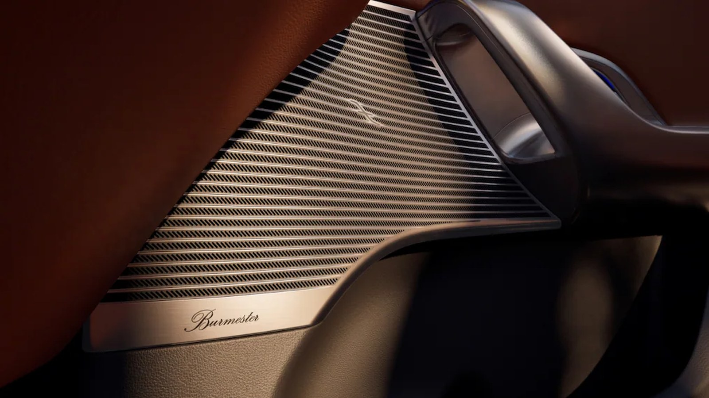

Image: Mercedes-Benz

Mercedes-Benz has launched the GLC Electric in India and the number on the price list is ₹78.50 lakh, ex-showroom. Almost everyone had pencilled in ₹80 lakh to ₹90 lakh. The actual Mercedes GLC Electric price came in under the bottom of that band, and ₹11.5 lakh under the top of it.

That gap is the real story. This is a 94kWh, dual-motor, 360kW SUV with a claimed 711km WLTP range, and it undercuts what the market expected a smaller, less powerful rival to cost. Deliveries begin in mid-November. India gets exactly one version, the GLC 400 4MATIC, assembled at Chakan near Pune.

## ₹78.50 lakh, and why that number matters

Price a luxury EV in India today and the reference points sit much higher. The BMW iX is ₹1.40 crore. The Kia EV9 is ₹1.30 crore. Mercedes' own EQS SUV runs ₹1.33 crore to ₹1.48 crore, and the Porsche Macan Electric starts at ₹1.22 crore (all ex-showroom, per CarDekho listings). The GLC Electric asks for roughly half of most of those, and it does not give up half the car to get there.

The sharper comparison is the Audi Q6 e-tron. Autocar India still lists it as upcoming for mid-2027 at an estimated ₹85 lakh to ₹95 lakh, with 306hp. Mercedes has arrived first, with 60 percent more power, for less money than its rival's estimate.

Then there is the petrol GLC sitting in the same showroom at around ₹77 lakh. Depending on which listing you trust, roughly ₹1.5 lakh to ₹2.5 lakh separates a 2.0-litre petrol SUV from a 490hp electric one. In a country where the EV version of a car usually carries a painful premium, that is the sort of pricing that makes people actually walk into a dealership.

## 4,856mm long, 1,913mm wide: it has outgrown the petrol GLC

Image: Mercedes-Benz

Park this next to the petrol GLC and the electric one is visibly the bigger car. Autocar India's India-spec listing puts the GLC Electric at **4,856mm long, 1,913mm wide and 1,652mm tall, on a 2,972mm wheelbase**. The petrol and diesel GLC on the same site reads 4,716 x 1,890 x 1,640mm with a 2,888mm wheelbase.

Run the subtraction and the electric car is **140mm longer, 23mm wider, 12mm taller, and rides on a wheelbase 84mm longer**. In a segment where facelifts usually move numbers by 10mm or 20mm, that is a proper jump, and almost all of the extra wheelbase goes where you want it: rear legroom. EVO India, which has driven it, says back-seat space is better than the petrol GLC's.

One honest note on the length. Global listings quote 4,845mm and a 1,644mm height for the same car, so treat the last centimetre as a rounding difference between markets rather than a different body. Width and wheelbase are identical everywhere, and those are the two numbers that decide how a car feels on the road.

Image: Mercedes-Benz

Road presence comes from the proportions, not just the size. Because there is no engine to package, the front overhang is short and the cabin sits further forward, which is why the bonnet looks stubby and the body looks pushed out to the corners. The wheels fill the arches, the shoulder line is high, and the glasshouse is shallow. It reads as a bigger, heavier car than the petrol GLC even before you notice the badge.

Two numbers matter for Indian roads. Ground clearance is 148mm per EVO India, which sounds low until you remember the air suspension is standard and lifts the body by around 25mm when you need it. And the 4.5-degree rear-axle steering pulls the turning circle down to 11.2 metres, which for a car approaching 4.9 metres is genuinely useful in a basement parking lot.

Boot space is 570 litres, stretching to 1,740 litres with the rear seats down, plus a 128-litre frunk. The petrol GLC's boot is actually bigger at 620 litres, so you lose 50 litres behind the seats, but the frunk hands back 128. Net, you carry more.

## A grille with 942 pixels, and tail lamps shaped like the star

Image: Mercedes-Benz

The face is the part people will argue about. That large rounded grille is not a grille at all, it is a lit panel carrying **942 individually controlled pixels** around a backlit star, flanked by split LED headlamps with a three-element daytime running signature. At night it is unmistakable from a hundred metres. In daylight, with the lights off, it looks closer to a chrome-ringed classic Mercedes radiator than anything the EQ cars ever wore, which seems to be exactly the point after the feedback those got.

Image: Mercedes-Benz

Down the sides, the door handles sit flush with the body and the wheel-arch cladding is deliberately slim, so the car does not look plastic-clad the way crossovers often do. India-spec cars come with the AMG design pack as standard, which brings the AMG grille treatment, 20-inch AMG alloys and aluminium running boards. Internationally the wheels go up to 21 inches.

Image: Mercedes-Benz

The rear is the cleverest angle. Each tail lamp houses star-shaped elements inside circular outlines, joined across the tailgate by a gloss-black band and a lit strip, with a solid three-dimensional star badge in the middle and "GLC 400" and "4MATIC" script underneath. The tailgate itself is steeply raked with a roof spoiler on top, and the bumper carries a silver insert that keeps the whole thing from looking slab-sided.

Six colours are listed for India: Sheer Blue, Obsidian Black, Lavender Silver, and three MANUFAKTUR shades in Patagonia Red Metallic, Opalite White Bright and Alpine Grey Solid. The red in these pictures is the Patagonia Red, and it is the one that makes the lighting work hardest.

## 490hp, 711km and a 22-minute charge

The hardware explains why this car was supposed to cost more.

The GLC Electric runs an 800V architecture with a 94kWh usable battery. Two motors drive all four wheels for a combined 360kW, which works out to roughly 490hp, and 800Nm. Mercedes claims 0-100kph in 4.3 seconds and a 210kph top speed. Claimed range is 711km on the WLTP cycle.

Charging is where the 800V setup earns its keep. Peak DC rate is 330kW, which Mercedes says can add up to 303km of range in about 10 minutes. EVO India, which has already driven the car, quotes a claimed 10-80 percent in 22 minutes.

## A 39.1-inch screen and a cabin built to show off

Image: Mercedes-Benz

The dashboard is one 39.1-inch MBUX Hyperscreen at 7680 x 1260 pixels, which Mercedes calls its biggest screen yet. It runs MB.OS on Android, with Google Maps and a built-in ChatGPT assistant. Physical controls survive on the steering wheel and centre console, which is a relief.

Image: Mercedes-Benz

The SKY CONTROL panoramic roof has 162 embossed stars across 64 ambient colours. The rest of the list reads the way it should at this price: auto park, Level 2 ADAS, ventilated front seats, wireless charging, over-the-air updates, and a second row that folds down electrically.

Image: Mercedes-Benz

The Burmester system carries 15 speakers, 670W and Dolby Atmos, and the speaker grilles are worked into the door trim rather than bolted on.

Image: Mercedes-Benz

## Built in Pune, and that is the whole trick

None of this pricing works without local assembly.

The GLC Electric is the first locally built Mercedes on the MB.EA-M platform, rolling down the same Chakan line that builds the company's petrol and diesel cars. Mercedes put another ₹200 crore into that plant in 2026, taking its cumulative investment to ₹3,200 crore. It also reached India about six months after European sales started, which the company says makes it its fastest global model to arrive here as a locally assembled car.

Buyers get either a free AC wallbox or 2,500kWh of MB.CHARGE public credits valid for 24 months, usable across more than 22,000 charging points in India.

Early interest looks healthy. Mercedes reported over 550 expressions of interest within 36 hours of registrations opening, though the company is careful to say those are not confirmed bookings. For context, the petrol GLC has found nearly 22,000 Indian buyers since 2016. This is the brand's volume SUV going electric, not a halo experiment.

## Where the asterisks are

Three things deserve a cold look.

That 711km figure is WLTP, measured in Europe. EVO India's reviewer put the realistic number "in the region of 500km", which is still excellent, but it is not 711. Second, 330kW charging is wasted potential in a country where chargers above 240kW are rare; the car is ready for infrastructure India has not built yet. Third, this is a heavy SUV at roughly 2.5 to 2.7 tonnes, and there is no cheaper, lower-output variant to drop into if ₹78.50 lakh is a stretch.

## What this means for you

If you were waiting for the BMW iX3 in 2027 or the Audi Q6 e-tron after that, you now have to justify waiting another year for something that may cost more. The GLC Electric is here, it is being built in Pune, and service runs through a dealer network Mercedes has spent decades building.

If you are cross-shopping the petrol GLC, do the running-cost sum before you decide. At a gap of roughly ₹1.5 lakh to ₹2.5 lakh, home charging alone closes that difference inside a couple of years for most owners. Our [October electric car registrations breakdown](/blogs/electric-car-registrations-october-2026) shows how quickly the premium end of this market is moving.

**The EVGyan take:** Mercedes has done something Indian EV buyers have been asking for since the EQS arrived, which is to stop treating electric as a luxury tax on top of a luxury car. ₹78.50 lakh for 490hp, 711km claimed and a Pune-built body is the most car-per-rupee anyone is offering in the luxury EV space right now. BMW and Audi have had their pricing homework handed back to them. The one honest caveat is that 711km is a lab number, so plan around 500km and you will not be disappointed. For buyers who were waiting for a luxury EV that made financial sense alongside its petrol twin, the waiting is over. See also our look at [Tata's Safari EV timeline](/blogs/tata-safari-ev-launch-january-2027) for how the home-grown end of the SUV market is responding.

*Mercedes-Benz launched the GLC 400 4MATIC Electric in India on 4 November 2026 at ₹78.50 lakh ex-showroom, with deliveries from mid-November.*
