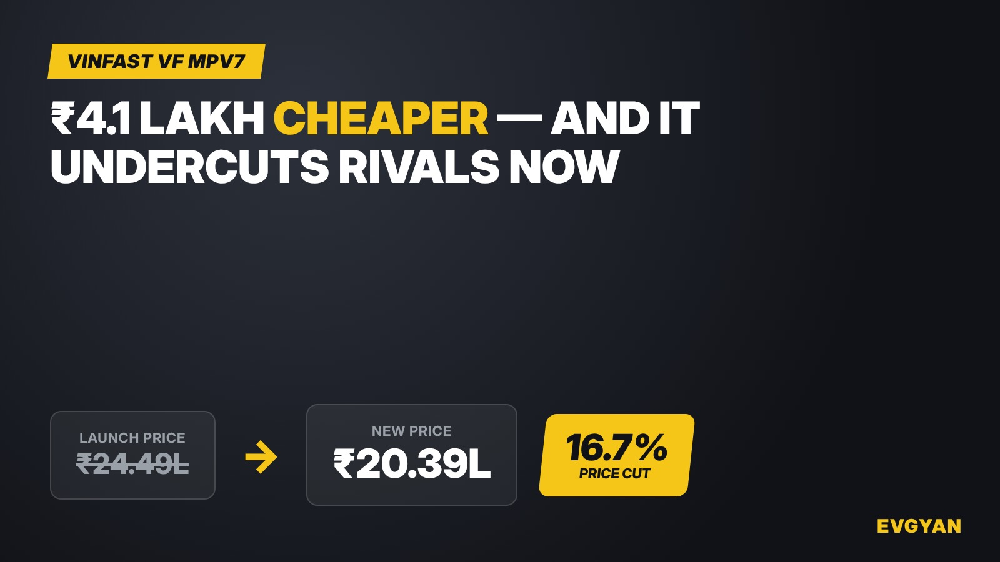

VinFast has cut the price of its seven-seater electric MPV, the VF MPV7, by ₹4.1 lakh — from ₹24.49 lakh to ₹20.39 lakh, ex-showroom, according to Autocar India. That works out to a 16.7% drop, and it's arrived under seven months after the car launched in April at ₹24.49 lakh, a figure confirmed by 91Wheels and Rushlane at the time.

VinFast sells the MPV7 in India as a single, fully loaded variant, so the cut applies across the board — there's no cheaper, stripped-down trim being quietly introduced instead.

## Why ₹20.39 lakh changes the math

Autocar India doesn't report an official reason from VinFast, but points to a slow start in showrooms since launch. Whatever the cause, the new price puts the MPV7 in a different fight. At ₹24.49 lakh, it was competing with the fully loaded, top-spec trims of rival seven-seaters. At ₹20.39 lakh, Autocar India notes it now undercuts those same top trims outright, while VinFast's ownership schemes add further incentives on top.

That's a meaningful shift for a car that was being compared on price almost as much as on spec sheet. A ₹4 lakh-plus cut is the kind of number that moves a car from "nice but pricey" to "worth a test drive" for a lot of family-SUV shoppers.

Chart: EVGyan

## The car behind the price

The MPV7 isn't a small cut-rate EV. It runs a 60.13kWh battery for a claimed 517km range (ARAI-rated), with a single front-mounted motor making 204hp and 280Nm — enough for a sub-9-second 0-100kph run and a 140kph top speed. Charging tops out at 80kW DC and 6.9kW AC. Seven seats, one battery size, one price: VinFast has kept the MPV7's spec sheet simple, and now it's made the price simpler to swallow too.

## What this means for you

If the MPV7 was on your shortlist but felt like a stretch at ₹24.49 lakh, it's worth another look now. A ₹20.39 lakh seven-seater EV with a 517km claimed range and sub-9-second acceleration is a genuinely different proposition to cross-shop against — just go in with eyes open that VinFast's after-sales and resale network in India is still young compared to established rivals, and that "undercuts rivals' top trims" is a comparison against fully loaded versions, not base models.

**Sources:** [Autocar India](https://www.autocarindia.com/car-news/vinfast-vf-mpv7-prices-slashed-by-over-rs-4-lakhs-441235), [91Wheels](https://www.91wheels.com/news/vinfast-vf-mpv-7-launched-at-rs-24-49-lakh-ex-show-in-india-details-inside), [Rushlane](https://www.rushlane.com/vinfast-vf-mpv-7-launch-price-rs-24-49-lakh-517-km-range-7-seater-12544201.html)
