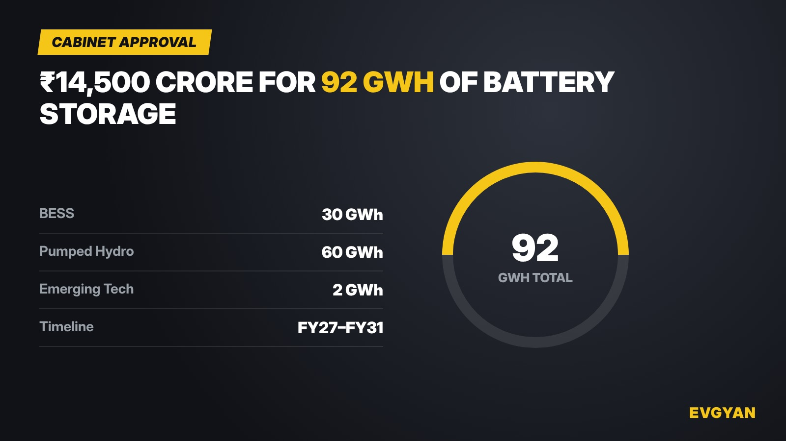

The Union Cabinet has cleared ₹14,500 crore in viability-gap funding (VGF) to build 92 GWh of grid-scale energy storage between FY27 and FY31, according to Business Standard. The money is split three ways: 30 GWh of battery energy storage systems (BESS), 60 GWh of pumped-storage hydro, and 2 GWh for emerging storage technologies. Projects built under the scheme will also need to meet a minimum 40% domestic content requirement.

Chart: EVGyan, built from the scheme's reported figures

## Why this matters beyond the grid

This isn't an EV scheme on paper, but it is one in practice. Grid-scale battery storage and EV batteries draw from the same cell-manufacturing base, the same lithium and nickel supply chains, and often the same factories. A government-backed demand floor for 30 GWh of stationary BESS gives India's battery makers — the same companies chasing PLI-ACC cell contracts for EVs — a second, steadier customer to build capacity against.

The scale has grown over time. An earlier proposal floated in May 2026 had pencilled in a larger ₹15,000 crore, 112 GWh version of a similar scheme. What the Cabinet has actually approved now is smaller on both counts, but still represents one of India's largest single commitments yet to storage that doesn't run on diesel or coal.

## The 40% domestic content question

Government storage schemes have increasingly tied funding to local manufacturing, and this one follows that pattern. A 40% domestic content floor doesn't by itself guarantee Make-in-India cells win every contract, but it does mean imported-cell projects face a real cost disadvantage competing for this money — a signal domestic players in the BESS and EV battery space will read closely.

## The EVGyan take

India's renewable energy targets keep running into the same wall: solar and wind generate power when the sun shines and the wind blows, not necessarily when the grid needs it. Storage is the fix, and 92 GWh — even phased out to FY31 — is a meaningful step toward closing that gap. For the EV industry specifically, every rupee that goes into scaling domestic battery manufacturing for grid storage is a rupee that also lowers the cost curve for the cells going into the scooter or car in your driveway.

**Sources:** [Business Standard](https://www.business-standard.com/amp/industry/news/cabinet-clears-14-500-cr-funding-scheme-for-battery-energy-storage-systems-126110401014_1.html) (primary, approval figures), [Whalesbook](https://www.whalesbook.com/news/English/energy/Indias-indian-rupee15000-Crore-Storage-Push-A-Grid-Stability-Gamble/6a1a2c7f05f03b9a55ad70a1) (May 2026 proposal, for the "scaled down from" context)
