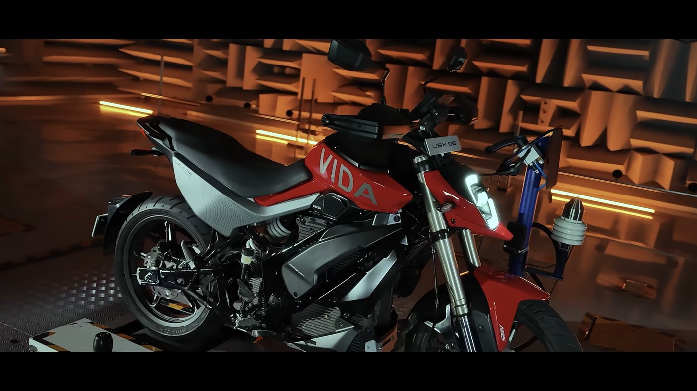
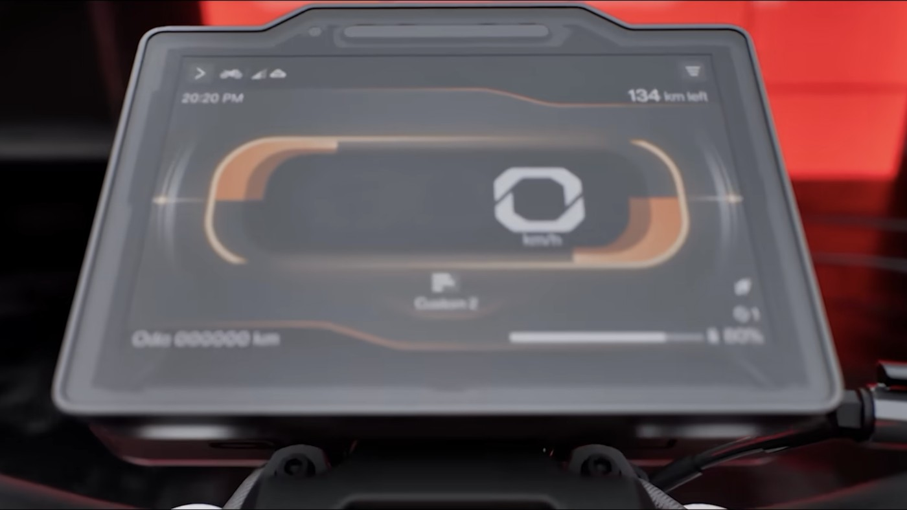
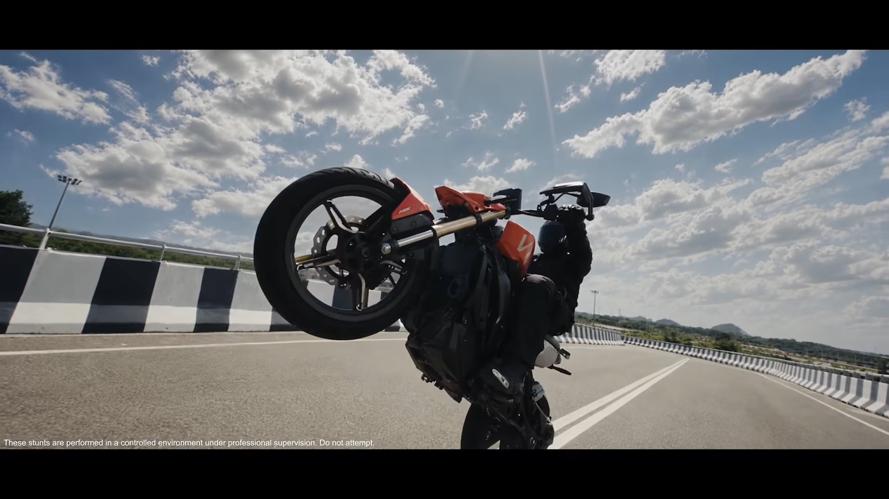

Representative image (AI-generated)

Vida's first electric motorcycle finally has a badge you can read, and the most useful number at its Milan reveal was sitting on its own dashboard: 134 km of range remaining at 80% charge.

The bike is the **Vida UBX 06 Pro**, shown by Hero MotoCorp's EV brand at EICMA 2026. That dashboard reading is the only range figure anyone has, because Hero has still not published an official spec sheet for it.

## This is not a show-floor mock-up

Vida said the UBX 06 was displayed "in production-ready form". Those are Vida's words, not ours, and the video Hero put out with the reveal backs them up. One sequence shows the bike strapped down inside an anechoic NVH test chamber with measurement rigs clamped to it. Another has it being ridden hard on a high-speed test track.

Image: EVGyan, from Hero's official UBX 06 reveal video

Design concepts do not get put through NVH testing. Bikes headed for a showroom do.

The hardware reads production as well. Gold upside-down forks, a rear monoshock, a finished silver trellis linkage on the swingarm, discs at both ends with an ABS tone ring on the front wheel, 17-inch alloys on road tyres, handguards, mirrors, indicators and a number plate holder. Even the small details are done, including a keyed lock on the tank marked "vault open" that points to storage where a fuel tank normally sits.

The cockpit is a wide colour TFT. Hero's own video holds on it long enough to read everything: the time, a "Custom 2" ride mode, a trip reading of 000000 km, a battery bar sitting at 80%, and up in the right corner, **134 km left**. There is a parking control and cruise-control markings on the switchgear next to it.

Image: EVGyan, from Hero's official UBX 06 reveal video

## About that 134 km figure

Be careful with this one. 134 km at 80% puts a full charge at about 168 km (134 ÷ 0.8 = 167.5). That is our own arithmetic off Hero's own screen, not a number Hero has claimed.

It is also a trip-computer estimate on a prototype, not a certified figure. Battery capacity, motor output, top speed, kerb weight and price are all blank, and the roughly 5 kWh battery and 14 kW peak power figures doing the rounds are industry estimates, not Vida's. Expect real-world range well under 168 km, the way it always goes.

What is visible is more reliable. The pack is fixed, not swappable, sitting low in the frame as a large finned enclosure, and the motor sits near the swingarm pivot driving the rear wheel by chain. Look at the side panels and you will find them labelled "Air Duct", so Vida is cooling something on purpose.

## Who it has to beat: the 125-150cc crowd

Going by its size, its road tyres and the performance it is pitched at, the UBX 06 Pro is aimed squarely at the 125-150cc petrol commuter-plus segment. That puts two electric bikes directly in its path, and both are already on sale.

- **Oben Rorr EVO** — ₹99,999 ex-showroom as an introductory price for the first 10,000 buyers, ₹1.25 lakh after that. 3.4 kWh LFP pack, 180 km IDC range, 9 kW peak, 110 km/h top speed.
- **Matter Aera** — from about ₹1.83 lakh ex-showroom. 5 kWh pack, 172 km claimed range, 10 kW, 105 km/h, and India's only geared electric motorcycle with a 4-speed box.

Hero has not said a word about price, so there is nothing to compare on that front yet. But these two set the bar the UBX has to clear: roughly ₹1-1.85 lakh, 170-180 km of claimed range, and 9-10 kW.

## UBX 06 Pro or VXZ: which one lands first

Vida brought three electric motorcycles to Milan: the UBX 06, the Dirt.E MX7 off-roader, and Project VXZ, developed with California's Zero Motorcycles. Hero's Emerging Mobility chief Kausalya Nandakumar has said the electric motorcycle platforms are targeted for 2027, without naming an order.

The VXZ is the bigger, faster one, the bike that would take Hero into Ultraviolette F77 territory rather than commuter territory. We have written that one up separately: [Hero's Vida VXZ concept at EICMA 2026](https://evgyan.com/blogs/hero-vida-vxz-eicma-2026).

Put the two road bikes side by side, though, and the order looks settled. The UBX 06 Pro has a production badge, a test-chamber video and road-legal hardware on it. The VXZ is still being called a *project*. The UBX gets to market first.

Image: EVGyan, from Hero's official UBX 06 reveal video

## What this means for you

If you are holding out for an electric motorcycle in India, 2027 is the realistic year and this is the one to track. We covered [the EICMA reveal itself here](https://evgyan.com/blogs/hero-vida-ubex-electric-motorcycle-eicma).

It is worth knowing what it is walking into. In October 2026, India registered 3,631 electric motorcycles against 2,23,886 electric two-wheelers overall (Vahan). That is 1.6% of the segment. Next to scooters, electric bikes are still a rounding error.

**The EVGyan take:** that tiny number is exactly why this one matters. Ultraviolette, Oben and Revolt have been splitting a few thousand electric motorcycle buyers a month between them. Vida registered 29,936 electric two-wheelers in October on its own, and Hero is building toward 45,000 Vida units a month in FY27. When a company with that kind of reach runs a finished electric motorcycle through an NVH chamber and out onto a test track, 3,631 stops looking like a ceiling.
