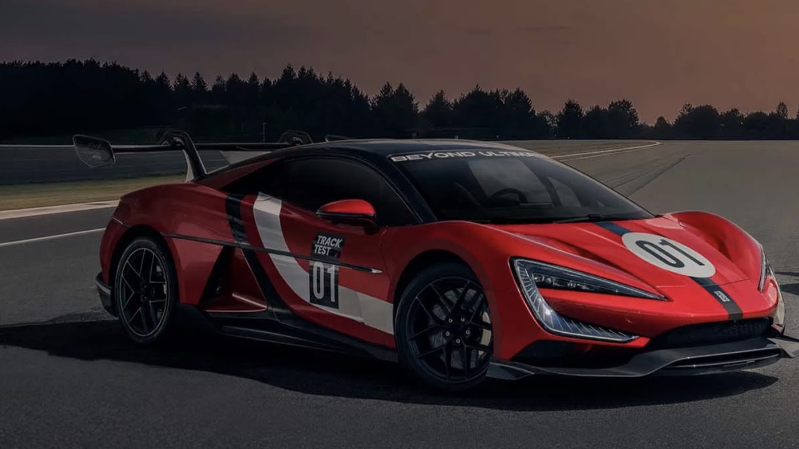

On 1 November 2026, a red Yangwang U9 Xtreme went down a closed stretch of the E11 outside Abu Dhabi at 503.17 km/h. That is 312.65 mph. No production car had ever been timed past 500 km/h before, and the one that finally did it runs on batteries.

The FIA has recognised the run. Two Guinness World Records went with it, one for the fastest production car and one for the fastest electric production car.

## Petrol spent two decades not doing this

The 500 km/h line has been sitting there a long time, and the combustion world kept getting close to it without clearing it.

- **Bugatti Chiron Super Sport 300+** — 490.48 km/h in 2019. The one everybody quotes. Bugatti itself said at the time it wasn't an official record.
- **Koenigsegg Agera RS** — 447.19 km/h in 2017, done the strict way, averaged across a pass each way.
- **SSC Tuatara** — claimed 508.73 km/h in 2020, then withdrew it when the data fell apart. Its verified best is 474.8 km/h.
- **Rimac Nevera R** — 431.45 km/h, and until now the quickest EV anybody had taken seriously.

Against the Chiron's 490.48 km/h, the U9 Xtreme is 12.69 km/h faster. That is not a rounding error at this end of the speedometer. Every extra km/h up here costs a brutal amount of power, because drag climbs with the square of speed.

Koenigsegg has said for years that the Jesko Absolut could theoretically see 500. It has never gone out and tried.

## Four motors, 1,200 volts, 30,000 rpm

The Xtreme is not a tuned U9. It is a different machine under the skin.

Four motors, one per wheel, each peaking at 555 kW. Combined that is 2,220 kW, or a shade over 3,000 PS. The standard U9 makes 1,287 PS, so this is more than double. Power to weight works out at 1,217 PS per tonne. Each motor spins to 30,000 rpm.

The part that makes it work is the electrical architecture. The U9 Xtreme runs 1,200 volts, where almost every fast EV on sale, the standard U9 included, runs 800. Higher voltage means less current for the same power, which means less heat in the cables and the motors. BYD says the 1,200V setup throws off up to 67% less heat than an 800V one doing the same job.

The battery is BYD's own Blade pack, LFP, built for 30C discharge. At 20% state of charge it can still hand over about 1,800 kW. A car that runs out of battery grunt at the end of a 7 km straight does not set this record.

## The honest bit

This was a single-direction run. The traditional way to settle a top speed argument is two passes in opposite directions, averaged, so a tailwind can't flatter you. Koenigsegg's 447.19 km/h was done that way. Bugatti's 490.48 was not.

So it is a one-way number, and anyone who tells you that makes it meaningless is being silly, but anyone who tells you it is directly comparable to a two-way average is also wrong. The FIA recognised it, Guinness logged it as single direction, and both of those things are true at once.

Worth noting the car didn't get there on the first go either. Runs on 31 October topped out around 490 km/h. The team changed the rear wing angle, retuned the suspension software and adjusted tyre pressures overnight before the two runs on 1 November. Marc Basseng drove.

## What this means for you

Nothing, directly. Thirty of these will be built, each costs more than 20 million yuan, about $3 million, and India is not getting one.

What matters is where the parts go next. The 1,200V architecture is the headline. Charging speed on normal EVs is throttled by heat, and halving the current for the same power is exactly how you stop a pack cooking during a fast charge. BYD has a habit of taking what it learns at the top and pushing it down the range faster than anyone expects, and it already sells cars in India.

A Chinese brand that was making cheap sedans fifteen years ago now owns the production car speed record outright. That part is worth sitting with for a second.
