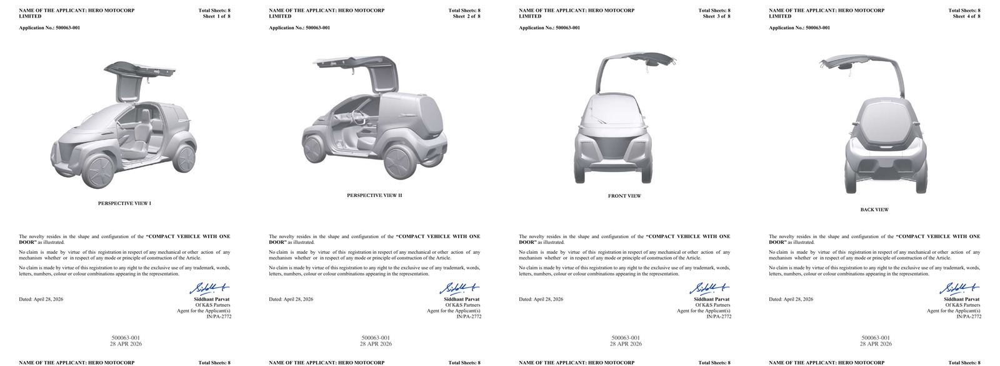

Hero MotoCorp has registered the design of the Vida NEX 3 in India, and the filing runs to 8 drawing sheets. The application is titled "Compact Vehicle With One Door" — which tells you most of what is unusual about this thing before you even see a picture.

The paperwork was filed on 28 April 2026 under application number 500063-001, in Hero MotoCorp Limited's own name. The drawings have only surfaced publicly now, more than six months later.

## What the 8 sheets actually show

A design registration has to cover the article from every side, so the filing gives us a complete walkaround that Hero has never shown off a stage: perspective views one and two, front, back, left side, right side, top and bottom.

Put together, they describe a machine that is roughly a quarter the footprint of an ordinary hatchback:

- **2 seats, in a line.** Driver in front, passenger directly behind, the way a scooter seats two. Not side by side.
- **1 door.** A single gullwing panel on the side that lifts upward and takes a chunk of the roof with it.
- **4 wheels**, pushed right out to the corners, with small-diameter alloys and tall sidewalls.
- A pod-shaped body with a lot of glass and a very short bonnet.

## Why it seats people front-to-back

The in-line seating is the whole idea, not a compromise. Two people sitting one behind the other need a cabin barely wider than a single seat, and width is what makes a car hard to park and hard to filter through traffic. Hero is effectively building a scooter that keeps the rain off.

That also explains the single door. Narrow the body enough and a second door on the other side stops being worth the weight, the cost and the hole in the structure.

## The honest bit

A design registration protects a shape. It is not a production announcement, and it is not a launch date.

Hero first showed the NEX 3 at EICMA in 2025 as a concept, and in the year since there has been no price, no battery capacity, no range figure, no motor output and no confirmed timeline. The company has been open that it is exploring micro-mobility rather than entering the passenger car business.

What the filing does tell you is that Hero spent money to lock the shape down in India specifically. Companies do not usually pay to protect a design they have already walked away from.

It also fits a pattern. The Vida NEX 2, the self-balancing electric trike, went through the same process earlier this year. Hero is quietly building a patent wall around an entire Novus Labs family — NEX 1, NEX 2, NEX 3 — while saying very little in public about any of it.

## What this means for you

Nothing you can buy yet. But if a 2-seat, weatherproof, four-wheeled EV ever arrives from Hero at anywhere near a premium-scooter price, it changes the daily commute maths for a lot of people who currently get wet twice a year and sweat the rest of it.

Watch the regulations as much as the patents. India's quadricycle category is where a vehicle like this would have to live, and that category has never found its buyer. The NEX 3 only matters if Hero can price it like a two-wheeler instead of a small car.
