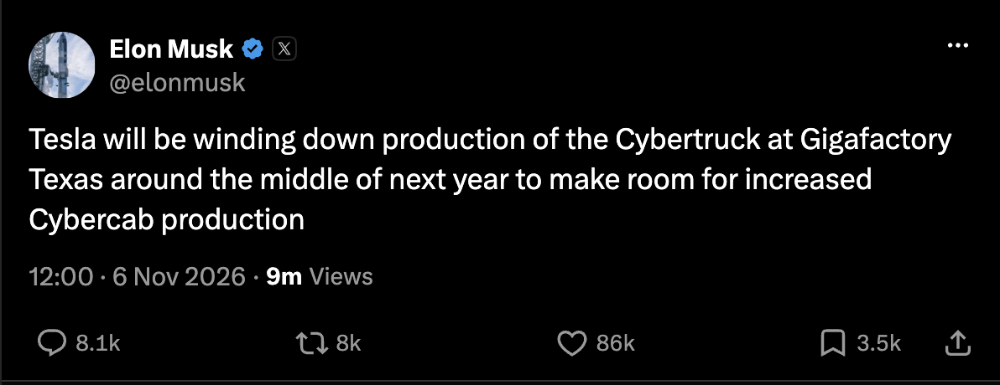
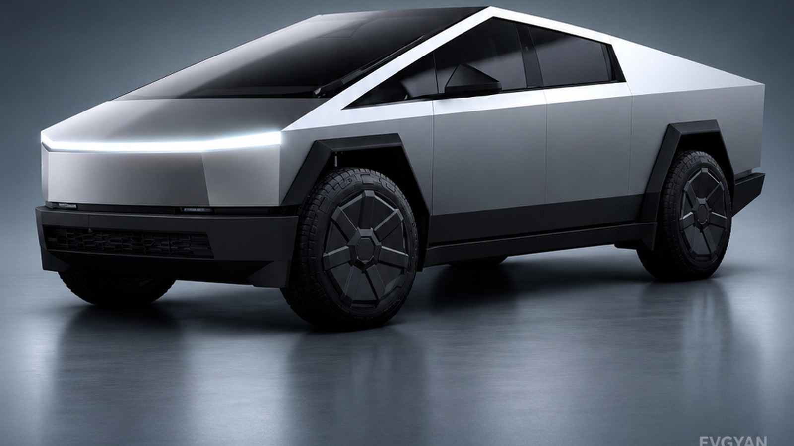

Tesla is stopping the Cybertruck. Elon Musk confirmed on 6 November that production at Gigafactory Texas winds down around the middle of 2027, and the floor space goes to the Cybercab instead.

The line was tooled for 250,000 trucks a year. In roughly three years of selling, industry estimates put total deliveries at about 70,000. That is the whole story in two numbers.

## How far off the plan it landed

Tesla never breaks out Cybertruck numbers. It folds them into an "Other Models" bucket with the Model S, Model X and Semi, which is itself a tell.

That bucket delivered 8,295 units in the third quarter of 2026, down 48% year on year and the weakest it has been since 2021. Model S and X production stopped in April 2026, so most of what is left in there is Cybertruck. Annualised, you get something near 30,000 a year against a line built for 250,000.

Price did not help. The truck was announced in 2019 at $39,900. There is no version anywhere near that today — the cheapest orderable Cybertruck is the Premium all-wheel-drive at $92,490, with the Cyberbeast at $102,490. Both went up in the last few months.

Nor did the buyer mix. US registration data showed SpaceX alone bought 1,279 Cybertrucks in the final quarter of 2025. Add Musk's other companies and you are at roughly a fifth of US registrations that quarter going to vehicles he also controls.

## The Cybercab is the actual point

This is not Tesla retreating from manufacturing. It is Tesla moving a factory away from a vehicle nobody wanted and towards one it thinks millions will use.

The Cybercab is the two-seat, steering-wheel-free robotaxi built on Tesla's "unboxed" assembly process, which puts the body together in modules instead of running one shell down a single line. It already has its own line at Giga Texas; 463 of them were registered in Texas by late October. Giving it the Cybertruck's floor space is how Tesla gets from hundreds to volume.

Seen that way, a 250,000-unit line stops being wasted capacity the moment something else fills it.

## The honest bit

The Cybertruck is a commercial failure by Tesla's own target, and no amount of framing changes that. Stainless steel panels that are hard to form, a shape that does not fit European or most right-hand-drive rules, a price that tripled from the promise, a run of recalls early on. Tesla pulled it from Australia and New Zealand two weeks before this announcement.

Ford reached the same conclusion about the F-150 Lightning. Electric pickups turned out to be a much smaller market than both companies budgeted for.

## What this means for you

In India, directly, nothing. The Cybertruck was never sold here — it is left-hand drive only and would not have cleared our dimension and lighting rules anyway.

The useful read for an Indian buyer is about Tesla's attention. Tesla registered 291 vehicles in India in October 2026, against 40 in the same month last year. That is growth off a tiny base, and it is all Model Y. A company clearing a factory for a cheap, high-volume, two-seat EV is a company thinking about markets where cars are small and people are many. India is on that list. A $100,000 stainless steel pickup never was.
