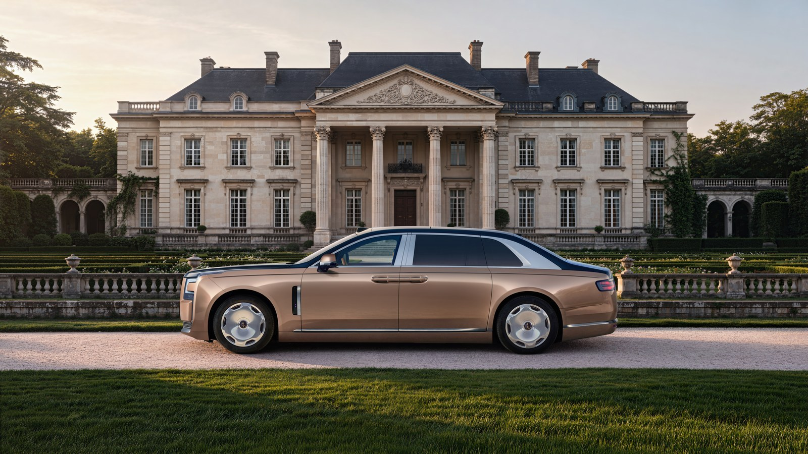
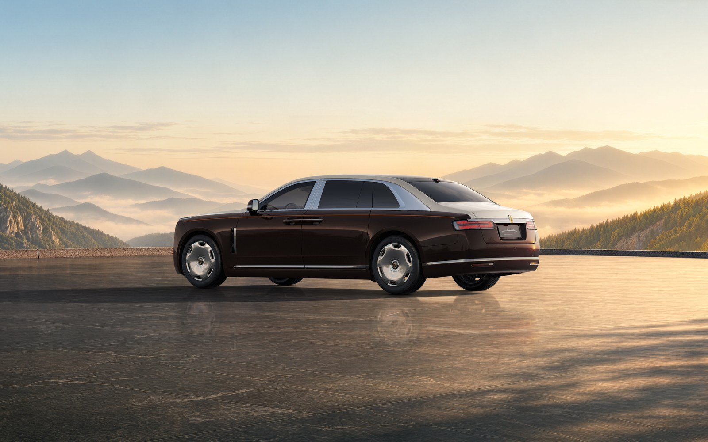
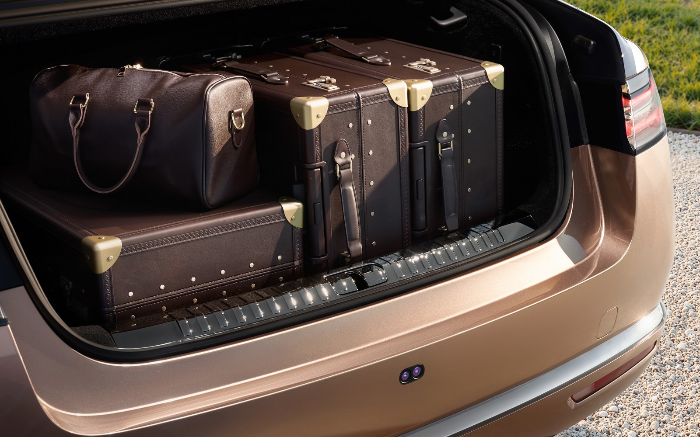

BYD says its new Yangwang Altior will do over 1,000 km on a single charge, and that it can spin on the spot like a tank. Only 399 people will ever get to try it.

The Yangwang Altior is BYD's attempt at the Rolls-Royce end of the market. It was shown for the first time in Abu Dhabi, a rare launch for the brand outside China. The pre-sale price is 2.08 million yuan, which is over $300,000, and BYD has not made it final yet. Deliveries start in the second quarter of 2027.

## Size and looks

This is a big car. It is 5,600 mm long, 2,030 mm wide and 1,590 mm tall, on a 3,500 mm wheelbase. That wheelbase is longer than many Indian hatchbacks are in total.

BYD took three years on the design and borrowed the shape of an ancient Chinese bronze cooking vessel, the ding. The rear doors are coach-style and swing open to 90 degrees. There are 12 lighting elements that animate when the owner walks up, and three wheel designs, all 21-inch. Even the front badge is, reportedly, 24-carat gold.

## What the numbers say

- Range: over 1,000 km, on China's CLTC cycle (about 621 miles)
- Charging: 10 to 70% in roughly five minutes, on BYD's megawatt-class Flash Charging
- Battery: second-generation Blade pack. No kWh figure yet
- Motors: four, one at each wheel, on the e4 platform shared with the Yangwang U8 and U9
- Booking amount: 300,000 yuan
- Editions: Executive and Bespoke. The first Bespoke car, called Shanhe Dingyun, will be built in limited numbers

BYD has not published a power figure. A four-motor Yangwang U7 filing at 1,000 kW is doing the rounds as a reference, but that is not an Altior number. Treat any horsepower claim as unconfirmed.

## Tank turn and the back seat

Four independent motors let the car rotate in its own length. BYD has shown this trick since the U8, and it still works as a party piece, because no German or British luxury sedan can do it.

The rest is aimed at whoever sits behind the driver. Zero-gravity rear seats with massage and a one-touch relaxation mode. 1,209 mm of rear legroom. Fridges in the front and rear, a 21.4-inch screen overhead and a 39-speaker Dynaudio system. The DiSus body control reads the road with a front camera and sets the suspension before the bump arrives. The boot holds 532 litres.

For driver assistance there is a 4 nm Xuanji A3 chip and BYD's God's Eye A system, with parking-space-to-parking-space navigation.

## What this means for you

You cannot buy this car in India, and the 399-unit cap settles that.

What it shows is where BYD is pointing. This is the same company that sells the Sealion 7 here, and it has just walked into the Gulf and asked Rolls-Royce buyers for 2.08 million yuan. Yangwang's total sales were 3,546 units in the first ten months of 2026, so this is a flag, not a volume play. For another side of the brand's ambition, read our story on the [Yangwang U9 Xtreme hitting 503.17 km/h](/blogs/yangwang-u9-xtreme-top-speed-record).

## The EVGyan take

The spec that matters is not the gold badge. It is five minutes from 10% to 70%.

A 1,000 km CLTC claim is a soft number and BYD knows it, because real-world range always lands well short of CLTC. A five-minute charge on a megawatt charger is a hardware claim, and BYD is building that charger network itself. If that stack works on a car this heavy, it will turn up one day on cars people actually buy. That is the part India should watch.
