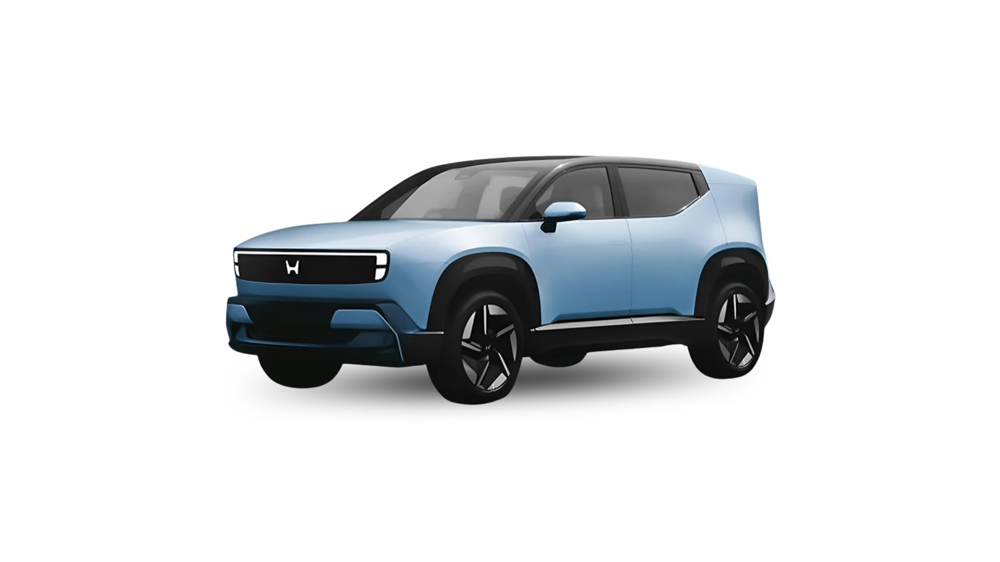
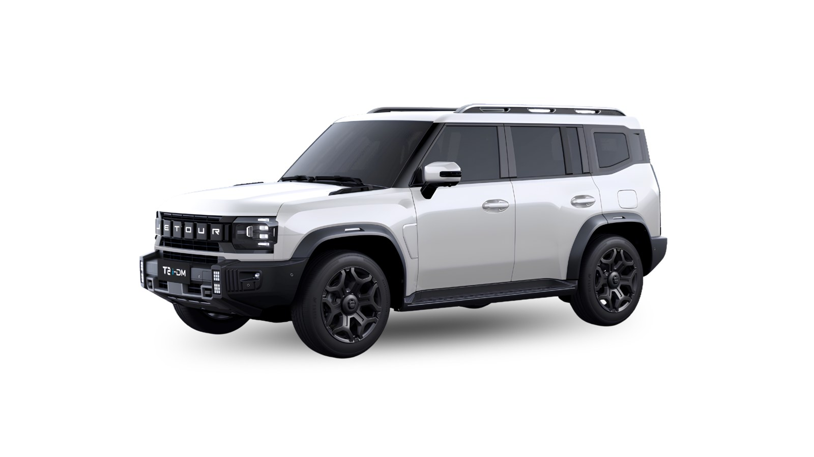
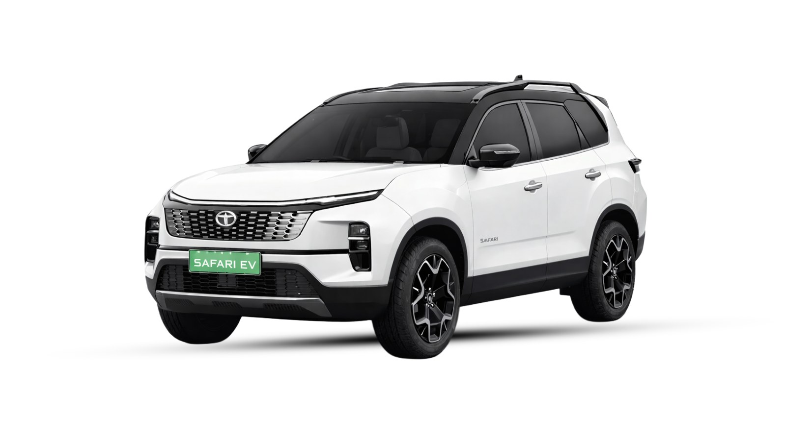
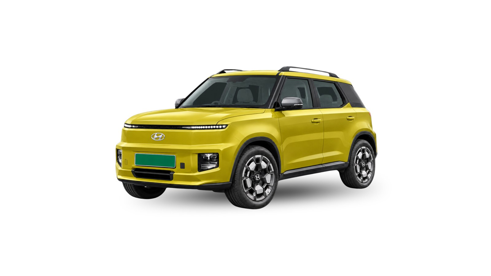
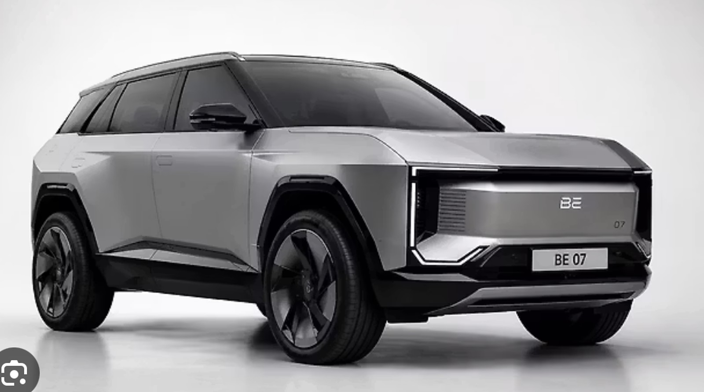
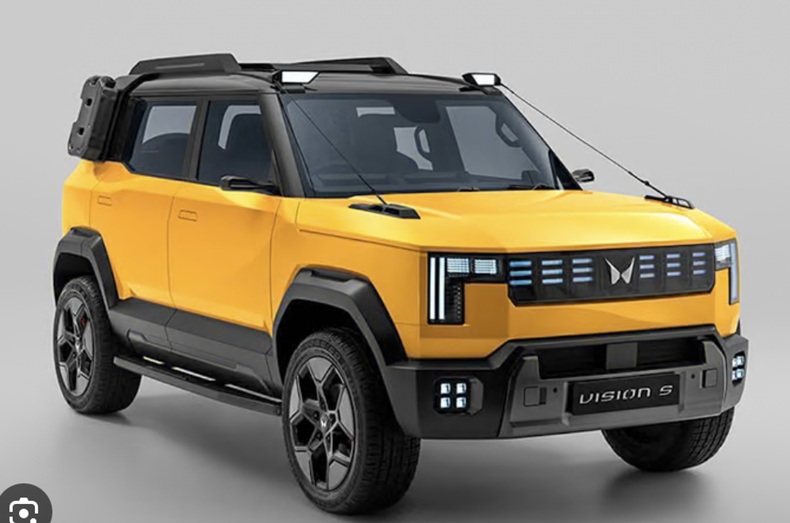
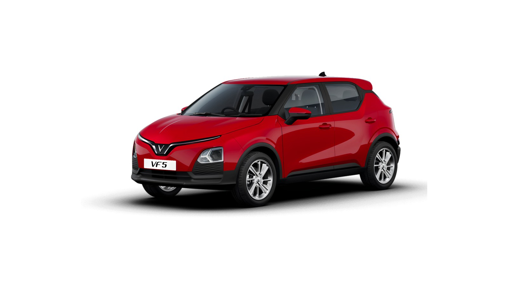

Seven new cars are lining up for Indian EV buyers over the next few months. The cheapest are expected from ₹10 lakh, and the most expensive could cross ₹50 lakh. Prices below are our expected ex-showroom estimates, and launch timing can slip, so treat them as a guide until each company confirms.

## 1. Honda Alpha

**Expected price:** ₹16 – 25 lakh | **Timeline:** reveal on 2 December 2026, sale likely in 2027

This is Honda's first electric car for India, a midsize SUV that will be built here. Its battery is expected to be in the 65 – 75kWh range. It will take on the Creta Electric, Mahindra BE 6 and Maruti e Vitara.

## 2. JSW Combat

**Expected price:** ₹30 – 50 lakh | **Timeline:** debut on 4 December 2026, sale next year

A small clarification first: the Combat is a plug-in hybrid, not a pure EV. It is based on the Jetour T2, seats 5 and has a boxy, rugged look. Reports suggest a claimed electric-only range of about 90km, with a petrol engine for longer trips. It targets buyers looking at the Fortuner and Jeep Meridian.

## 3. Tata Safari EV

**Expected price:** ₹22.5 – 30 lakh | **Timeline:** around January 2027, though some reports say earlier

Tata's first three-row electric SUV is expected to use the same 65kWh and 75kWh batteries as the Harrier EV. Rear-wheel drive should be standard, with dual-motor AWD on higher variants. It will compete with the Mahindra XEV 9S.

## 4. Hyundai Ioniq P

**Expected price:** ₹10 – 15 lakh | **Timeline:** early 2027

Hyundai has trademarked the Ioniq P name in India, but has not confirmed it for this car. It is a compact electric SUV that will sit below the Creta Electric, likely with standard-range and long-range versions and Level 2 ADAS. Rivals are the Punch EV, Nexon EV and MG Windsor.

## 5. Mahindra BE 7

**Expected price:** ₹25 – 30 lakh | **Timeline:** 2027

The BE 7 was first talked about for late 2026, but Mahindra has pushed it to 2027. It uses the INGLO platform and will sit above the BE 6, with 59kWh and 79kWh batteries expected, the same as Mahindra's other born-electric SUVs.

## 6. Mahindra Vision S

**Expected price:** ₹10 – 17 lakh | **Timeline:** 2027

The Vision S is a sub-4-metre SUV on Mahindra's new NU_IQ platform, with a long 2,665mm wheelbase for its size. The platform supports petrol, diesel, hybrid and electric, so an EV version is one of the options and not the only one. Many expect it to become a small Scorpio.

## 7. VinFast VF5

**Expected price:** ₹10 – 14 lakh | **Timeline:** not confirmed, 2027 is likely

VinFast has not announced the VF5 for India yet, but test cars and a design patent point that way. Globally it comes with a 29.6kWh or 37.23kWh battery, and the bigger pack is rated at up to 326km. It would fight the Tata Punch EV and Tiago EV.

## What this means for you

If your budget is under ₹15 lakh, the Ioniq P, Vision S and VF5 are the ones to watch, but none is due before 2027. If you want a bigger family EV, the Safari EV arrives first. Wait for official prices before booking anything, since estimates and final prices can differ by a few lakh.

*All prices are expected ex-showroom and may change at launch.*
