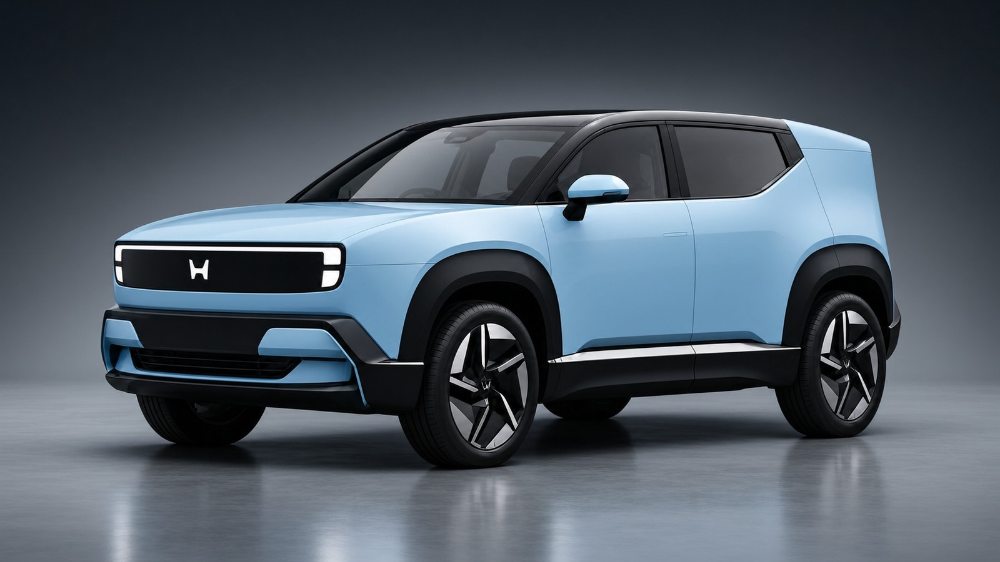
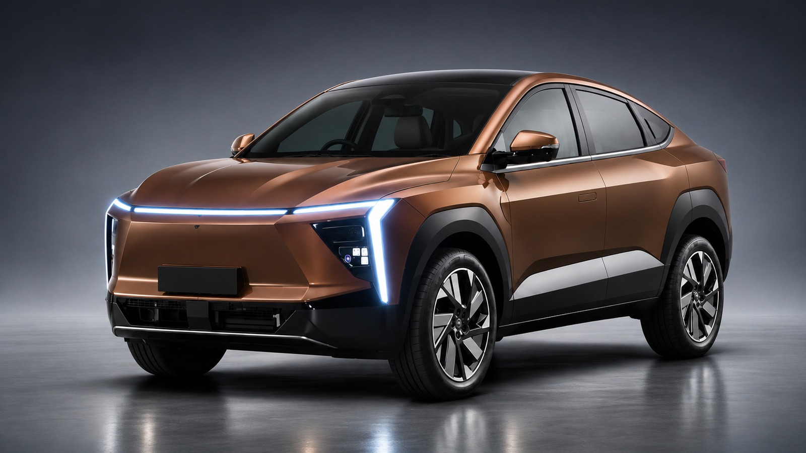
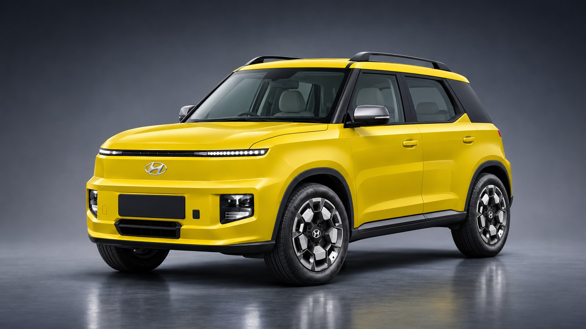
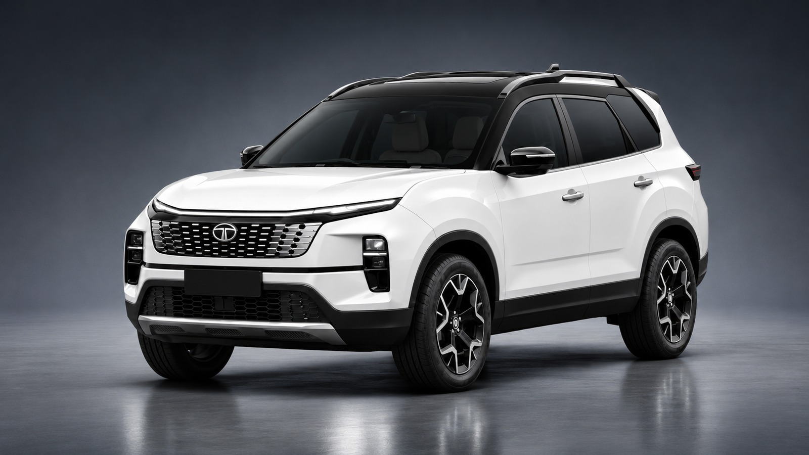
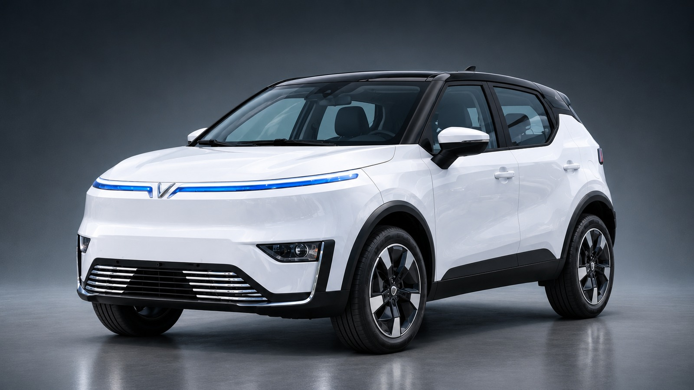
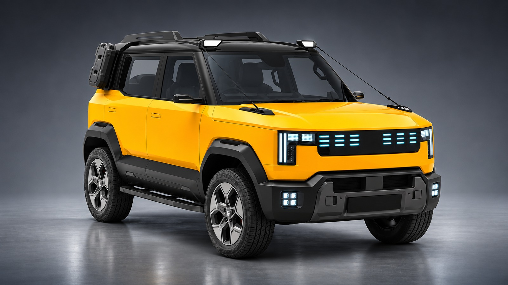
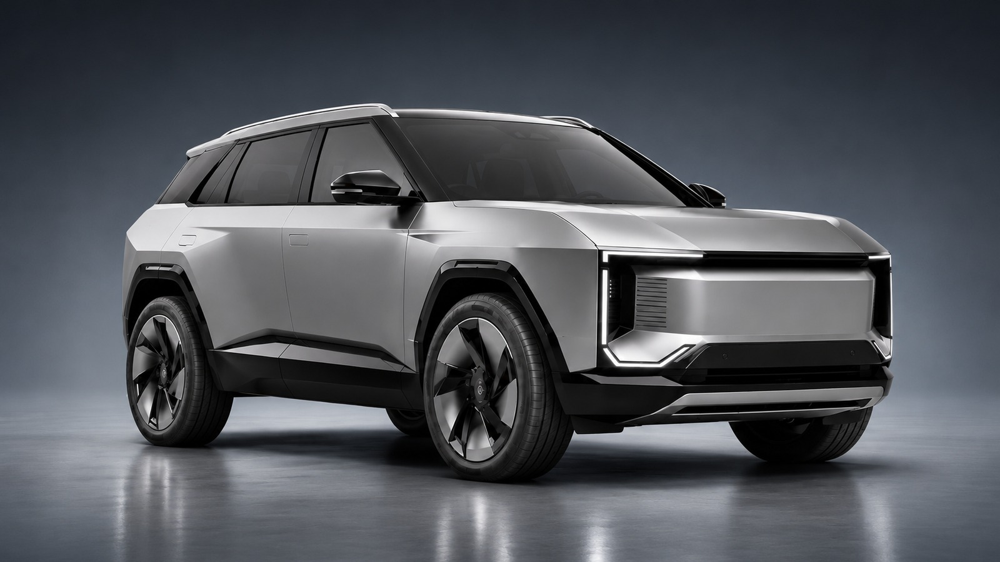

Seven new electric cars are lined up for India between now and the middle of 2027. The cheapest is expected to start near ₹11 lakh and the priciest tops out around ₹32 lakh, so there is something here whether you are buying your first EV or shopping for a three-row family SUV.

One thing before the list. Every price below is an expected ex-showroom figure, not an official one. Launch dates slip all the time in this business, so treat the timeline as a guide until each company actually puts out a price list.

## 1. Honda Alpha

**Expected price:** ₹16 – 25 lakh | **Timeline:** world premiere 2 December 2026, showrooms in 2027

Honda has sold cars in India for nearly three decades without a single EV. The Alpha ends that run. It is a midsize electric SUV built at Honda's Tapukara plant in Rajasthan, and India gets the world premiere before anyone else. Battery details are still under wraps, though a single-motor, front-wheel-drive setup with packs in the 65-75kWh range is what the industry expects. It will go up against the Creta Electric, the Mahindra BE 6 and the Tata Sierra EV. More on it here: [Honda Alpha electric SUV for India](/blogs/honda-alpha-electric-suv-india).

## 2. Mahindra XEV 9e Sporteq

**Expected price:** ₹22.5 – 32 lakh | **Timeline:** 8 December 2026

This is the one you will be able to buy first. The XEV 9e coupe-SUV is already on sale from ₹21.90 lakh with 59kWh and 79kWh batteries, claiming 542km and 656km. The Sporteq is the same car with a sharper variant list: new colours, cosmetic changes, extra features, and the 70kWh middle battery that Mahindra already offers in the BE 6 Sporteq and the XEV 9S. Mahindra's MAIA software suite is expected to come along with it. Think of it as the XEV 9e getting its mid-life kick rather than a brand-new model.

## 3. Hyundai Ioniq P

**Expected price:** ₹13 – 15 lakh | **Timeline:** 16 January 2027

Hyundai has an EV for India at last, and it is a small one. The Ioniq P is a sub-4-metre electric SUV developed for this market, built at Sriperumbudur in Tamil Nadu, with a boxy tall-boy shape in the Exter and Inster mould. Two battery options are expected so Hyundai can cover both a value buyer and a long-range one. Its rivals are the Nexon EV, the Punch EV, the Kia Syros EV and the MG Windsor. Full details: [Hyundai Ioniq P, the small EV for India](/blogs/hyundai-ioniq-p-india-small-ev).

## 4. Tata Safari EV

**Expected price:** ₹22.5 – 30 lakh | **Timeline:** January 2027

Tata's first three-row EV, and the car that kicks off its 2027 line-up. The Safari EV uses the acti.ev+ platform that already sits under the Harrier EV, so expect the same 65kWh and 75kWh packs, rear-wheel drive on the lower variants and dual-motor all-wheel drive higher up. The Harrier EV claims up to 627km, and the Safari should land a little below that because it is heavier. Six and seven-seat layouts are both on the cards. Its direct rival is the Mahindra XEV 9S. [What we know about the Safari EV](/blogs/tata-safari-ev-launch-january-2027).

## 5. VinFast VF5

**Expected price:** ₹11 – 14 lakh | **Timeline:** January 2027 expected

The cheapest car on this list. VinFast revealed the updated VF5 globally on 17 November 2026 with bigger battery packs and a claimed range of about 370km, and test cars have already been doing the rounds in India. The VF5 is a sub-4-metre crossover, and it matters because VinFast builds in Tamil Nadu, which keeps the price honest. It will take on the Tata Punch EV and the Tiago EV. [VF5 facelift battery and range details](/blogs/vinfast-vf5-facelift-battery-range-india).

## 6. Mahindra Vision S

**Expected price:** ₹13 – 18 lakh | **Timeline:** by June 2027

Mahindra has confirmed three new models by June 2027, and the production Vision S is one of them. It is a boxy sub-4-metre SUV on the new NU_IQ platform with a 2,665mm wheelbase, which is long for its size, and it has already earned the "baby Scorpio" nickname on the internet. Read the fine print though. NU_IQ takes petrol, diesel, hybrid and electric, and the first version is widely expected to arrive with engines. The electric Vision S is the follow-up act, not the opening one.

## 7. Mahindra BE 7

**Expected price:** ₹22 – 30 lakh | **Timeline:** by June 2027

The BE 7 was once penciled in for late 2026 and has since moved to 2027. It sits above the BE 6 on the INGLO platform and swaps the coupe roofline for a squared-off family shape, which buys back the headroom and boot space the BE 6 gives up. Mahindra has not confirmed batteries or range, but the 59kWh and 79kWh packs used across its born-electric range are the obvious candidates.

## What this means for you

If your budget stops at ₹18 lakh, the Ioniq P and the VF5 are the two to watch, and both show their hand in January. The Vision S belongs on that shortlist only if you are willing to wait for the electric version.

If you want a big family EV, the Safari EV is the first real arrival of 2027, and the XEV 9e Sporteq gets there a month earlier if you are open to a coupe-SUV. Honda's Alpha is the wildcard: a new brand in the segment usually means sharper pricing from everyone else.

## The EVGyan take

Three of these seven are confirmed for a 60-day window, which is the busiest stretch the Indian EV market has seen. Two of the seven are Mahindras, and that tells you who is setting the pace right now.

The more interesting shift is at the bottom of the table. For two years the EV conversation in India has been about ₹20 lakh-plus SUVs. The Ioniq P and the VF5 drag it back under ₹15 lakh, and that is the price band where volumes actually live. Hold your booking until December and January, because once Honda and Hyundai show their numbers, everybody else's price list becomes negotiable.

*All prices are expected ex-showroom figures and may change at launch.*
