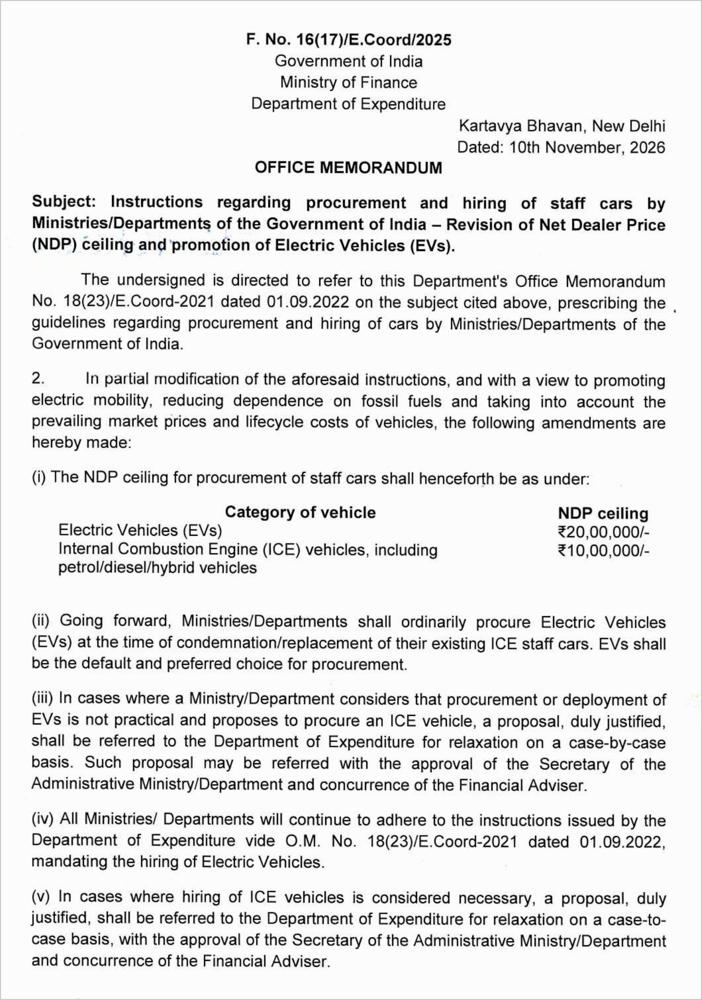

A central ministry can now buy an electric staff car with a Net Dealer Price of up to ₹20 lakh, but a petrol, diesel or hybrid one only up to ₹10 lakh. That is the core of a new order on government staff cars, and it makes EVs the first pick for every ministry and department of the Government of India.

The order is an Office Memorandum (OM) from the Department of Expenditure, the arm of the Ministry of Finance that controls how the Centre spends money. It is dated **10 November 2026**, carries file number F. No. 16(17)/E.Coord/2025, and was issued from Kartavya Bhavan in New Delhi. It comes into force with immediate effect.

## What exactly changed

The OM changes three things: how much a ministry may pay for a staff car, which kind of car it should buy first, and how hard it is to choose a petrol, diesel or hybrid car instead. It partly modifies the department's earlier staff car order, OM No. 18(23)/E.Coord-2021 of 1 September 2022.

The price limit is set as a Net Dealer Price (NDP) ceiling, which is the dealer's price for the car, not the on-road price a private buyer sees.

- **Electric staff car:** NDP ceiling of ₹20,00,000
- **Petrol, diesel or hybrid staff car:** NDP ceiling of ₹10,00,000

Hybrids are put in the same bucket as petrol and diesel cars. In the government's books, a hybrid is still an internal combustion engine (ICE) car, and it gets half the budget a full EV gets.

The memo gives its own reasons in plain terms. It wants to promote electric mobility, cut dependence on fossil fuels, and account for current market prices and the lifecycle cost of a vehicle. That last point matters. An EV costs more to buy, but far less to run per kilometre, and a government car does a lot of kilometres.

Here is page 1 of the memorandum, so you can read the wording yourself:

## How big is the jump?

Big. Under the Department of Expenditure's staff car compendium of 1 September 2022, the ceiling was ₹6 lakh NDP, and the car had to be bought through the Government e-Marketplace (GeM). Before that, a 2014 order had capped it at ₹4.75 lakh.

So for an EV, the limit has gone from ₹6 lakh to ₹20 lakh, about 3.3 times. Even petrol and diesel cars get a higher ₹10 lakh cap now, but the gap between the two is the real message. A department choosing between a ₹9 lakh petrol sedan and a ₹16 lakh electric SUV no longer has to argue its way to the EV. The rule has already done it.

## EV first, petrol, diesel or hybrid only with paperwork

The second change is about the default. From now on, when a ministry's old ICE staff car is condemned or due for replacement, it should "ordinarily" buy an EV in its place. The memo calls EVs the "default and preferred choice".

Petrol, diesel and hybrid cars are not banned. But a ministry that wants one has to clear three steps:

1. Write a proposal explaining why an EV is not practical for that use
2. Get it approved by the Secretary of the ministry and agreed by its Financial Adviser
3. Send it to the Department of Expenditure, which decides on relaxation case by case

The same three steps apply to hiring. If a department feels it must hire a petrol, diesel or hybrid car, it has to justify that too. On hiring, the memo also tells ministries to keep following the 2022 instructions, which it describes as mandating the hiring of EVs.

Everything else stays as it was: all other terms on entitlement, procurement and hiring of cars under the 2022 order and later instructions remain unchanged, and buying still follows the General Financial Rules (GFR), 2017. The order was issued with the approval of Secretary (Expenditure) and signed by Director Avinash K. Nilankar. It went to all ministries and departments, their Financial Advisers, the Comptroller and Auditor General and UPSC, with a note to NIC to put it on the department's website.

## Which cars fit under ₹20 lakh?

Plenty of the EVs people actually buy. Take the MG Windsor EV. Its variants are listed between roughly ₹14 lakh and ₹18.6 lakh ex-showroom, so on price alone even the long-range Windsor Pro sits under the new ₹20 lakh ceiling. Many other electric compact SUVs and hatchbacks also fall in this band.

Under the old ₹6 lakh limit, buying any of these outright was out of reach, which is why the government's earlier EV push leaned on hiring and leasing.

## The road so far

This is not the government's first push. In December 2018, the Department of Expenditure asked ministries in Delhi to replace their hired petrol and diesel cars with EVs. Before that, in 2017, EESL ordered 10,000 electric cars to replace government vehicles, with 500 due in the first lot. Those early EVs had a real range of around 100 to 120 km and small motors, and many officials avoided them.

Earlier in 2026, on 27 May, the same department brought in the "one officer, one official car" rule to stop officers using extra vehicles while holding additional charge. The new EV order fits the same pattern: tighter spending rules, but a clear exception for cleaner cars.

## The EVGyan take

This is the government putting its own money where its policy is. For years, ministries were told to go electric while their own price rules made it nearly impossible to buy a decent EV. A ₹20 lakh ceiling fixes that mismatch in one line.

The shift will be gradual, not overnight. The rule kicks in only when an old car is condemned or replaced, so the fleet will turn electric over the normal replacement cycle. Charging points at government offices will decide how smooth it feels for the drivers and officers who use these cars every day.

But the 2017 problem is gone. Many of today's EVs claim more than 300 km on a charge, and there is a real choice of models in the ₹12 to ₹20 lakh band. For EV makers, the central government becomes a steady buyer that cannot easily pick petrol any more. And for anyone still saying EVs are "not ready", the Finance Ministry has just made EV the default for the central government's own staff cars.
