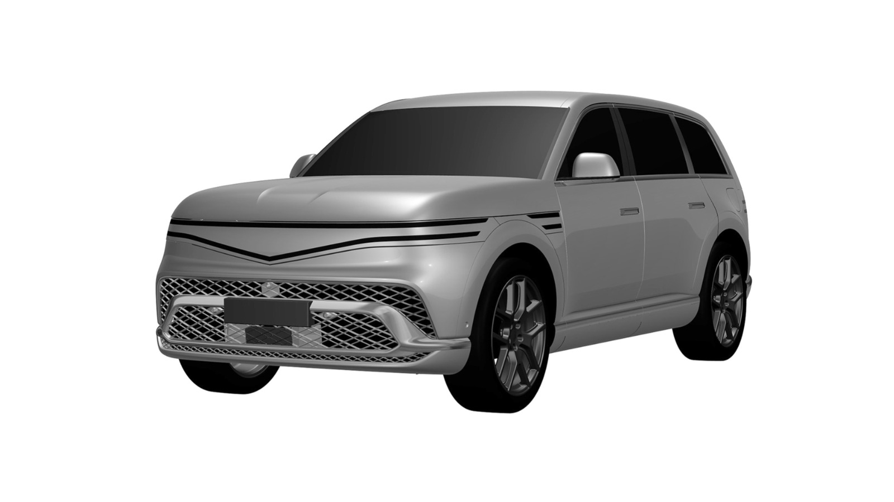
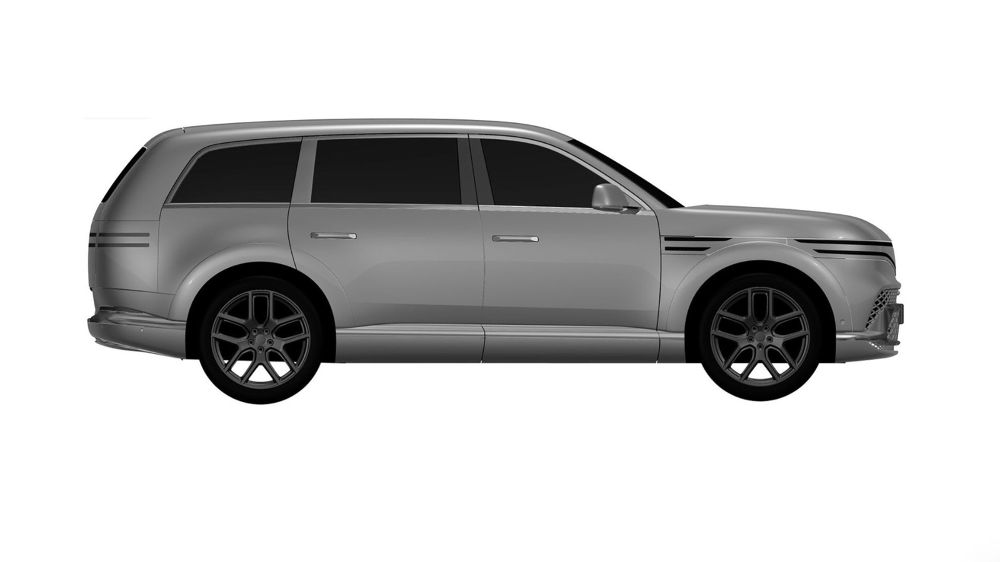

*Representative image (AI-generated)*

Hyundai's luxury brand has quietly registered the design of its biggest electric SUV in India. The Genesis GV90, a 5,285mm flagship running 657hp and a 123.5kWh battery, now carries an Indian design patent. It is the clearest signal yet of what Genesis intends to lead with when it finally opens shop here in 2027.

The filing covers the standard seven-seat GV90, not the four-seat Neolun version with its pillarless coach doors. The drawings also match the car Genesis showed the world in August 2026. No India-only softening of the bumpers, no shrunken wheels, nothing decontented.

## Bigger than a Maybach GLS

Start with the tape measure, because that is where this car makes its case.

The GV90 measures 5,285mm long, 2,030mm wide and 1,815mm tall, sitting on a 3,245mm wheelbase. Line it up against the Mercedes-Maybach GLS 600, which costs ₹3.35 crore ex-showroom in Delhi, and the Genesis comes out 77mm longer with 110mm more wheelbase. In a segment where the whole sales pitch happens in the second row, 110mm is not a rounding error.

Kerb weight is 3,030kg, which tells you how much battery sits under the floor. Wheels run from 22 to 24 inches. Two thin LED bars split the nose almost the full width of the car and repeat at the tail, the bonnet is a single clamshell piece, and the windows are frameless. This is a shape designed to be looked at while standing still.

## 657hp, and 22 minutes to 80 percent

Two motors share the work: 240kW at the front axle, 250kW at the rear. Together that is 490kW, or 657hp, with 800Nm of torque. Nothing Hyundai Motor Group has put into a production EV has made more.

The pack is 123.5kWh gross and roughly 115kWh usable, another group record. Genesis claims up to 500km per charge for the standard GV90. Korea's own certification cycle, which is tougher than most, first rated a 24-inch six-seater at 481km before a re-certification lifted the combined figure to 504km. An Indian rating will likely land somewhere in that band rather than near the 600km-plus numbers that WLTP-rated cars quote here.

Plug into a 350kW charger and Genesis claims 10 to 80 percent in 22 minutes. Very few chargers in India can actually hold that rate today, which is a separate problem worth its own article.

Each motor gets its own e-LSD, a first for the group. Underneath sit air springs running multiple chambers, adaptive dampers on dual valves, and rear-wheel steering that turns as much as 5 degrees. That last bit stops being a luxury the first time you reverse 5.3 metres of SUV into a Mumbai basement.

## A 23.6-inch screen that grows

The dashboard is built around a 23.6-inch OLED display that extends to 24.6 inches once the car is parked. Above it sits a 25-inch head-up display. Genesis fits 25 Bang & Olufsen speakers, massage seats, a panoramic glass roof and a heated windscreen.

Safety counts 12 airbags, one of them a roof airbag that Genesis says no passenger car has carried before.

## What this means for you

Order books opened in South Korea this month. The standard GV90 starts at 143,790,000 won there, rising to 193,640,000 won fully loaded, while the Neolun runs from 189,900,000 won to 245,600,000 won. Europe gets the car in the first half of 2027.

India is where it gets interesting. Hyundai confirmed at its Investors Day that Genesis lands here in 2027, and said the cars will be assembled locally instead of arriving fully built. That single decision does more for the price tag than any spec on this page. A locally assembled GV90 could plausibly sit in Maybach territory. A fully imported one would not come close.

Worth a reality check, though. The GV80 was patented in India back in 2024 and still has not launched. A patent protects a design; it does not book a showroom slot.

The company Genesis will be keeping is already forming. JLR plans electric Range Rovers for India in 2027, and [Mercedes has already launched the GLC Electric at ₹78.50 lakh](/blogs/mercedes-glc-electric-price-india). Against that, India registered just 868 luxury EVs in the whole of October, out of [36,708 electric cars in total](/blogs/electric-car-registrations-october-2026).

So the segment Genesis wants is still small enough to fit inside one showroom. Several brands are filing for the same 2027 window anyway, and [the list of electric cars headed here](/blogs/upcoming-electric-cars-india-launch-timeline) keeps getting longer at both ends of the price ladder.
