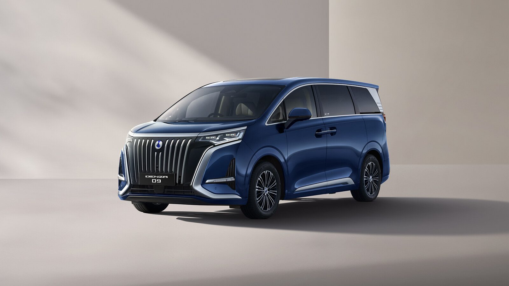
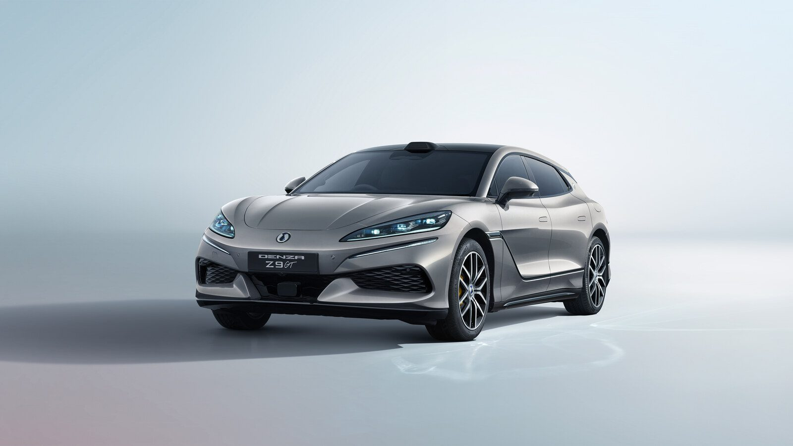

BYD's luxury brand has arrived in India, and it has skipped the warm-up act entirely. Denza opened here on 13 November with two cars that share a badge and almost nothing else: the D9, a seven-seat electric MPV at ₹90 lakh, and the Z9 GT, an 1,156 PS electric shooting brake at ₹1,56,80,000. Both prices are ex-showroom.

Both cars come in fully built from outside India. Both are sold in a single, fully loaded variant. Bookings for either one open today at ₹10 lakh.

## The D9 is the one that will do the work

The D9 is a 5,250mm long MPV built around its second row, and that row is the sales pitch. The captain seats get 10-way power adjustment, 10-point massage, heating, ventilation, memory and powered leg rests. Open the centre armrest and there is a fridge that both cools and heats, from -6°C to 50°C. Passengers get their own touchscreens in the armrest, the sliding doors open at the press of a button, and there are four 50W wireless charging pads spread across the cabin.

Under the floor sits a 115.07 kWh second-generation Blade battery, good for a claimed 730km on the NEDC cycle. A single front motor makes 340 kW and 365 Nm, enough for 0-100 kph in 8.5 seconds. Denza quotes a 10-97 percent DC charge in nine minutes, which is a lab figure that will depend entirely on what you plug into.

More on the MPV here: [Denza D9 launched at ₹90 lakh](/blogs/denza-d9-india-launch-price-specs).

## The Z9 GT is the one that will get photographed

The Z9 GT is a different animal. Three motors, one at the front and two at the rear, combine for 850 kW and 1,210 Nm. That is 1,156 PS, 0-100 kph in a claimed 2.7 seconds, and a top speed of 270 kph. The battery is a 122.49 kWh Blade pack with a claimed 670km NEDC range.

The party trick is BYD's e³ system, which controls each wheel independently. The Z9 GT can crab walk sideways, spin a 360-degree compass turn on the spot and squeeze into a 5.35m turning radius, which is tighter than plenty of hatchbacks. Air suspension, a 17.3-inch centre screen, a 13.2-inch passenger screen, a 20-speaker Devialet system and an onboard karaoke mic come as standard, because at this price nothing is optional.

Full breakdown here: [Denza Z9 GT launched at ₹1.57 crore](/blogs/denza-z9-gt-india-launch-price-specs).

## What you get beyond the car

Both models carry a six-year or 1,50,000km vehicle warranty and an eight-year or 1,60,000km warranty on the high-voltage electric powertrain. Every booking also brings an 11 kW home charger, fitted at your place, plus six years of roadside assistance.

Denza will not share floor space with BYD. The brand gets its own showrooms, starting with Gurugram, Mumbai, Ahmedabad, Bengaluru, Chennai and Hyderabad.

## The EVGyan take

India's luxury EV shelf has been a European shelf for a long time, with a Tesla or two at the edges. BYD is walking into it with a name most Indian buyers have never heard, and asking ₹90 lakh to start. That is a tall order, and the first few months will be slow.

But look at what the money buys. A 730km MPV with a massaging second row and a fridge, or a 1,156 PS estate that turns on the spot, both built by the company that already supplies battery cells to half the industry. BYD has spent four years in India proving the hardware works, most recently with the [Sealion 7 crossing 5,000 deliveries](/blogs/byd-sealion-7-deliveries-india). Denza is the company finding out whether Indian buyers will pay European money for Chinese engineering.
