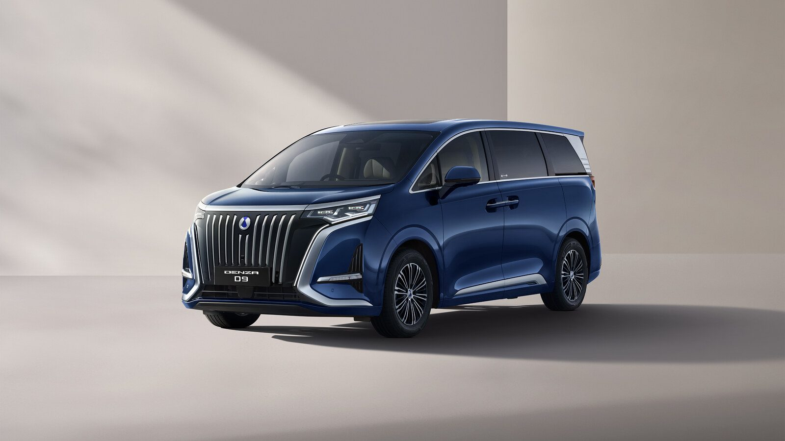
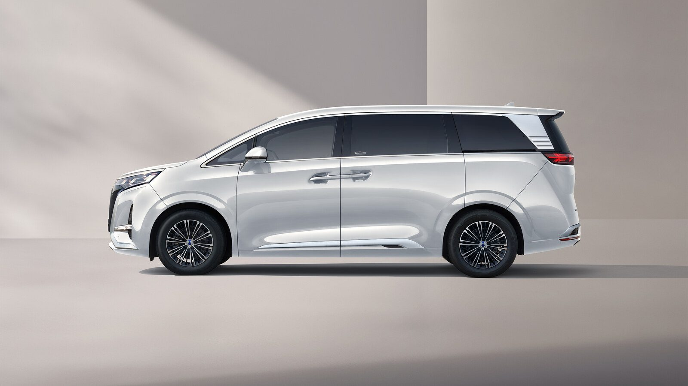
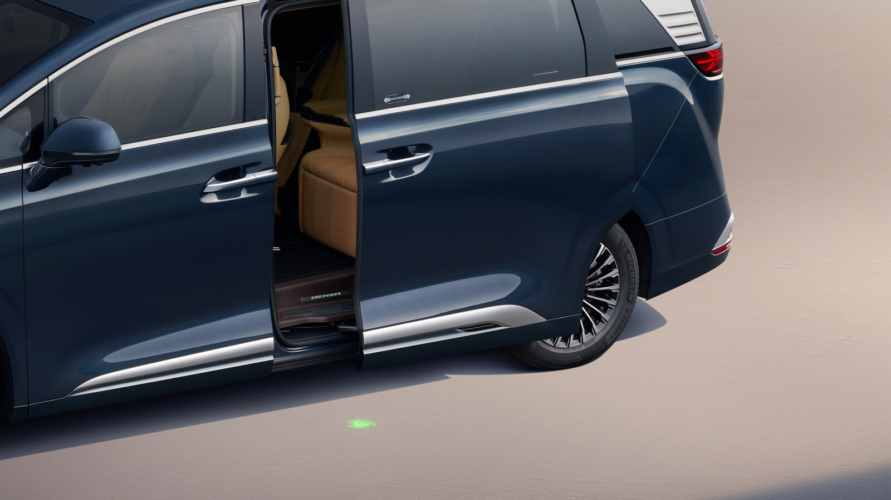
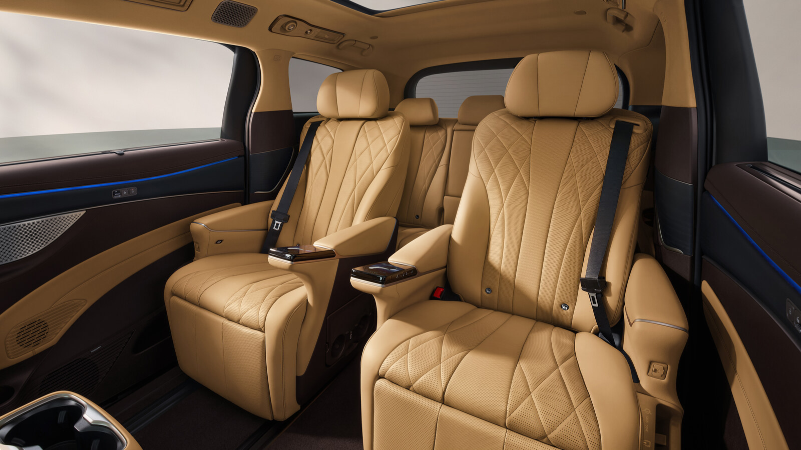
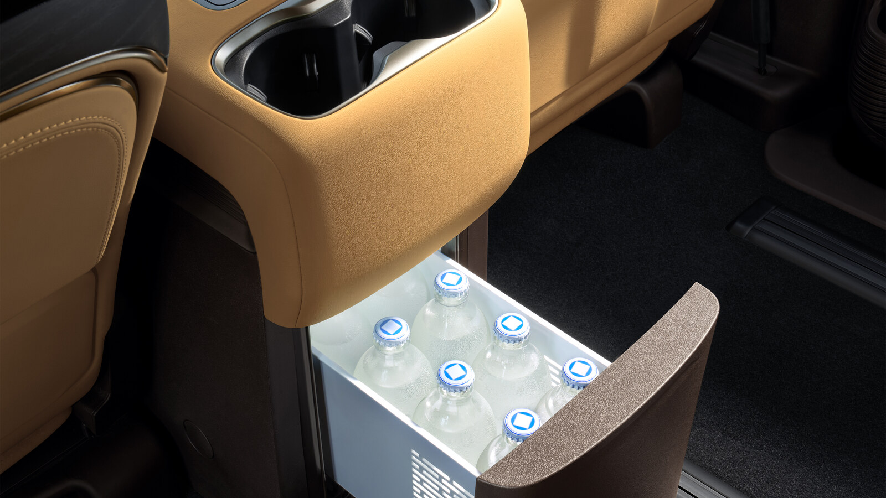
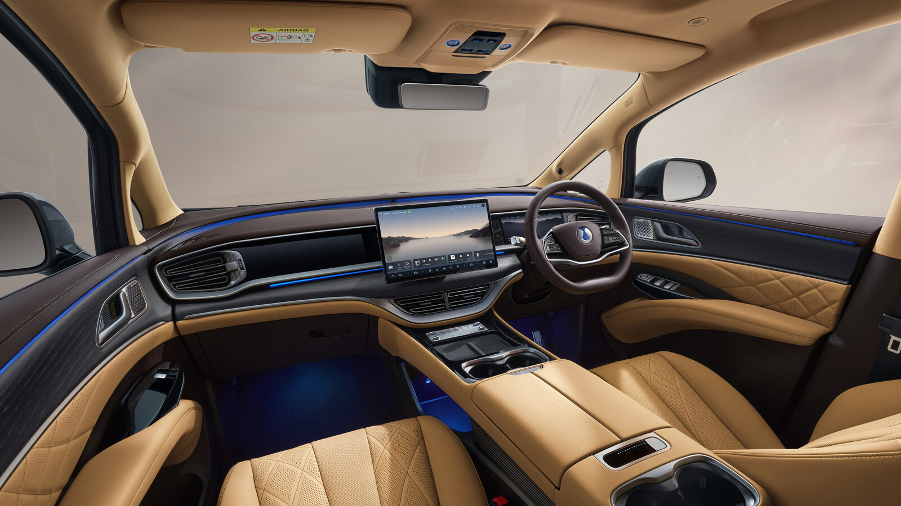

₹90 lakh buys you a lot of second row. The Denza D9 has landed in India at that price, ex-showroom, and almost everything interesting about this 5,250mm electric MPV happens behind the driver.

This is BYD's luxury brand making its first move in India, and the D9 is the sensible half of it. One variant, fully loaded, brought in as a completely built unit. Bookings are open at ₹10 lakh.

## Price, variant and what comes with it

There is no variant chart to study. Denza sells the D9 in a single front-wheel-drive specification at ₹90 lakh ex-showroom, and customer deliveries start from launch.

The ownership package is where the number softens a little. Every car gets a six-year or 1,50,000km vehicle warranty, an eight-year or 1,60,000km warranty on the high-voltage electric powertrain, six years of roadside assistance and an 11 kW home charger with installation thrown in.

## 115.07 kWh, 730 km and a nine-minute charging claim

The D9 runs a 115.07 kWh second-generation BYD Blade battery, the same lithium iron phosphate chemistry BYD has built its safety reputation on. Denza claims 730km on the NEDC cycle.

Treat that number the way you would treat any NEDC figure. NEDC is an old, gentle test, and a 2,915kg MPV in Indian traffic with the air conditioning fighting a May afternoon will not see 730km. Expect a real-world figure well short of it, though even a conservative reading leaves you with a genuine long-distance car.

Charging is where Denza makes its boldest claim: 10 to 97 percent on DC in nine minutes. That is the headline, and it is the company's own figure. It also needs charging hardware of a class that essentially does not exist on Indian highways yet, so plan your life around the 11 kW three-phase AC charging instead, which is what the included home charger delivers. The car also does V2L, so it can run external equipment off the battery, and it carries a heat pump air conditioning system along with intelligent battery temperature management.

## 340 kW through the front wheels

A single permanent magnet synchronous motor drives the front axle, making 340 kW and 365 Nm. Denza quotes 0-100 kph in 8.5 seconds.

Eight and a half seconds in a car this size is brisk enough and deliberately unexciting, which is correct for the brief. Nobody buys a seven-seat limousine to chase lap times. There are four driving modes, Eco, Normal, Sport and Snow, and the suspension is the part worth more attention: MacPherson struts up front, multi-link at the rear, and dual-valve DiSus-C intelligent damping that adjusts to the road. Brakes are ventilated discs at both ends, and the car rides on 18-inch wheels wearing 235/60 Bridgestones.

## A nose you will have an opinion about

The D9 does not do subtle. The front is dominated by a tall grille filled with vertical chrome slats, flanked by slim LED headlamps with adaptive front lighting, LED daytime running lights and cornering lights. At the back, a full-width light bar joins the tail lamps.

Useful details sit all over it. The second-row doors slide open on their own. The tailgate is powered with position memory. The mirrors fold when you lock the car, heat themselves, defrost, remember their position and carry blind spot indicators. The wipers are frameless and rain-sensing, the glass is heat-insulating and double-layer acoustic, and a 1.1 square metre panoramic glass roof with an electric sunshade sits overhead. Four colours are offered: Whale Sea Blue, Arctic White, Cosmos Black and Starry Night Grey.

## The second row is the whole point

Seven seats in a 2+2+3 layout, leather throughout, knitted fabric headliner. The front seats get 8-way power adjustment, 4-way lumbar, memory, heating, ventilation and massage, which in most cars would be the headline.

Here they are the warm-up. The second-row captain seats get 10-way power adjustment, 10-point massage, memory, heating, ventilation and powered leg rests. There are fold-out tables. There is Boss Mode, which lets the person in the second row shove the front passenger seat forward for more space. And there is a refrigerator in the centre armrest that both cools and heats, running from -6°C to 50°C.

The third row is not an afterthought either. It gets 4-way power adjustment and 40:60 split-folding backrests, so the boot can grow from 689 litres to 2,436 litres. Four ISOFIX anchor points are spread across the cabin.

## Screens in all three rows

The driver gets a 15.6-inch floating touchscreen and a 10.25-inch 3D LCD instrument cluster. Second-row passengers get their own LCD screens built into the centre armrest. Apple CarPlay and Android Auto are both in, along with 4G, over-the-air updates, a six-zone voice assistant, Bluetooth, digital and NFC keys, remote start and remote climate control.

Audio comes from a 16-speaker Devialet system. Climate control is three-zone with independent vents for the second and third rows, and the air purifier pairs a CN95 filter and activated carbon with a negative ion generator. Charging points are everywhere: four 50W wireless pads, two in front and two in the second row, plus six USB ports.

A built-in driving recorder uses the car's cameras to capture footage as you drive, and a 3D transparent surround-view system helps when you are threading 5.25 metres through a basement car park.

## Nine airbags and a long list of acronyms

Airbags cover the front row, the sides of the first and second rows, the gap between the front occupants, and full-length curtains down both flanks. Front and second-row belts are pretensioned, the third row gets emergency-locking belts, and every seat has a belt reminder. There is a direct TPMS, crash-sensing automatic unlocking, door open warning, and both fatigue and distraction monitoring for the driver.

The driver assistance list runs through adaptive cruise, intelligent cruise, forward collision warning, automatic emergency braking, blind spot detection, front and rear cross traffic alert and braking, rear collision warning, emergency lane keeping assist and traffic sign recognition. Stability is handled by ESC, traction control, EBD, hill hold, hill descent, roll movement intervention and a coordinated regenerative braking system.

## The numbers

| Specification | Denza D9 |
| --- | --- |
| Price (ex-showroom) | ₹90 lakh |
| Battery | 115.07 kWh, 2nd-gen BYD Blade |
| Claimed range | 730 km (NEDC) |
| Motor | 340 kW, 365 Nm, front-wheel drive |
| 0-100 kph | 8.5 seconds |
| AC charging | 11 kW three-phase |
| Length / width / height | 5,250 / 1,960 / 1,900 mm |
| Wheelbase | 3,110 mm |
| Boot space | 689 - 2,436 litres |
| Kerb weight | 2,915 kg |
| Turning radius | 5.85 m |
| Seating | 7, in 2+2+3 |

## What this means for you

At ₹90 lakh the D9 is shopping in a strange corner of the market. The obvious rivals are the Toyota Vellfire and the Mercedes-Benz V-Class, both of which burn petrol or diesel, and the MG M9, which is electric and cheaper. Against the first two, the D9 offers a far more loaded cabin and no fuel bill. Against the M9, it is asking for a meaningful premium and justifying it with battery size, range and that second row.

The honest caveat is the badge. Denza is new here, the dealer network starts at six cities, and a ₹90 lakh car with a thin service footprint asks for patience. If you are the kind of buyer who spends more time in the second row than the first, though, very little else in India is built this specifically for you.

The other half of Denza's India debut is a very different car: [the Z9 GT, at ₹1.57 crore](/blogs/denza-z9-gt-india-launch-price-specs). Both were launched together, and [the full launch story is here](/blogs/denza-d9-z9-gt-india-launch).
