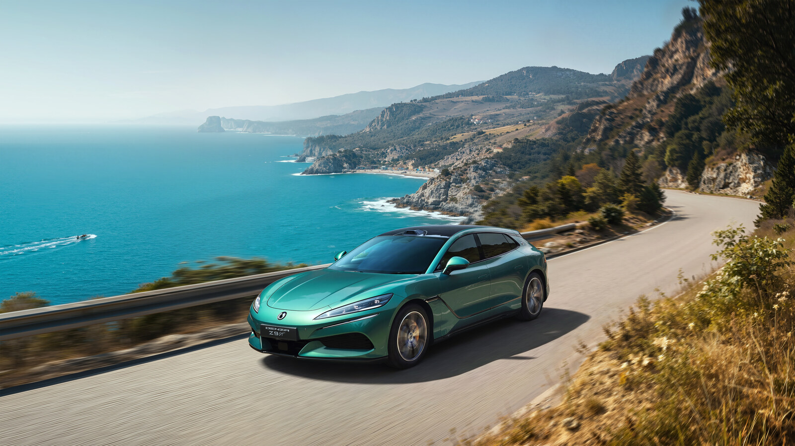
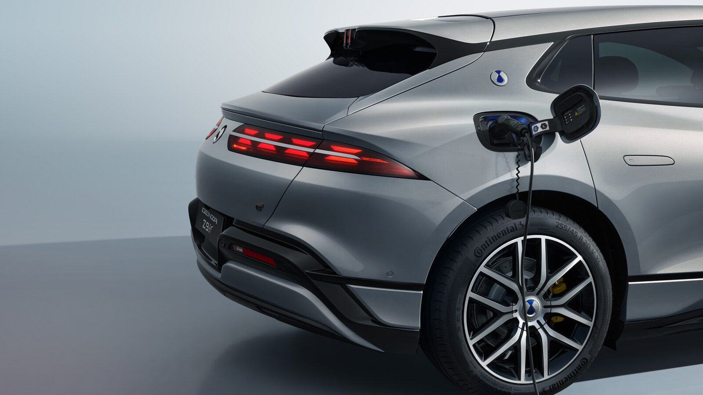
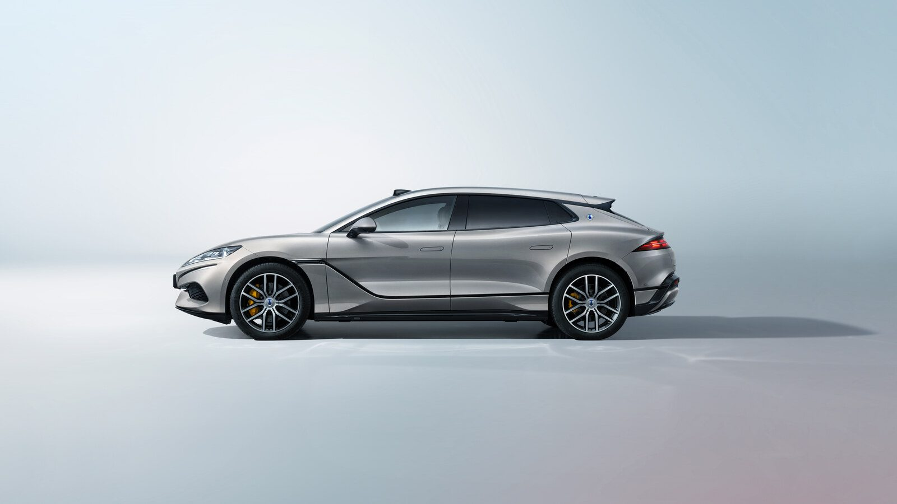
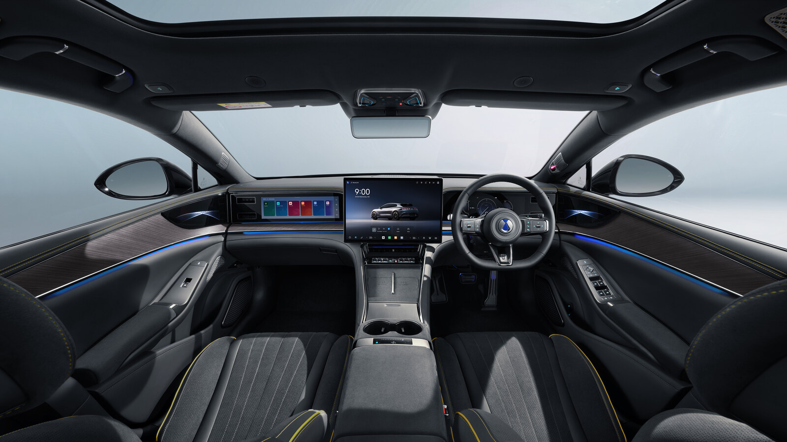
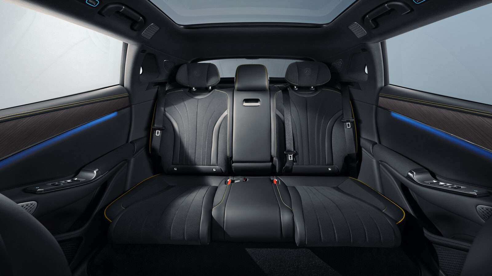
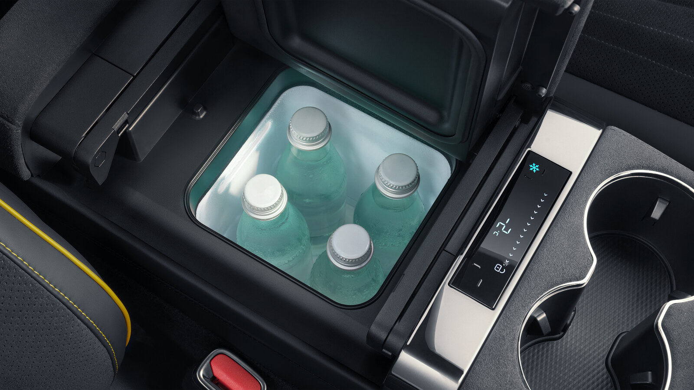

Three motors, 1,156 PS, and a car that can turn a full circle without going anywhere. The Denza Z9 GT is now on sale in India at ₹1,56,80,000 ex-showroom, and it is the most technically ambitious thing BYD has ever put on an Indian price list.

It is also a shape India almost never gets. The Z9 GT is a shooting brake, which means the long bonnet and low roof of a grand tourer attached to an estate's tail. Four doors, five seats, a 495-litre boot, and a silhouette that will stop traffic because nothing else here looks like it.

## Price, variant and where you can buy one

One variant, fully electric, fully imported. Globally the Z9 GT is also sold as a plug-in hybrid, but India gets only the battery electric version. Bookings are open at ₹10 lakh.

Denza is not sharing showrooms with BYD. The brand gets its own retail network, beginning with Gurugram, Mumbai, Ahmedabad, Bengaluru, Chennai and Hyderabad. Each car comes with a six-year or 1,50,000km vehicle warranty, an eight-year or 1,60,000km high-voltage powertrain warranty, six years of roadside assistance and an 11 kW home charger with installation.

## Three motors, 1,156 PS, 2.7 seconds

The hardware is split front to rear. One AC asynchronous motor sits at the front making 230 kW and 410 Nm. Two permanent magnet synchronous motors sit at the rear, one per wheel, each making 310 kW and 400 Nm.

Add it up and you get 850 kW, or 1,156 PS, with 1,210 Nm. Denza claims 0-100 kph in 2.7 seconds and a top speed of 270 kph. For context, that acceleration figure puts the Z9 GT in the same conversation as cars costing twice as much, and it is doing it while carrying five people and their luggage.

Five driving modes are offered: Sport, Normal, Eco, Racing and Snow.

## 122.49 kWh, 670 km, and a charging question

Power comes from a 122.49 kWh second-generation BYD Blade battery, with a claimed 670km on the NEDC cycle. As always, NEDC flatters. Drive it the way 1,156 PS invites you to and that number will fall quickly, which is the oldest trade-off in fast cars and has not changed just because the engine disappeared.

On charging, Denza's India specification lists 11 kW three-phase AC charging and an 11 kW charging box, and that is all it commits to. No DC fast-charging time has been published for the India-spec car, which is worth noting on a ₹1.57 crore EV. The car does get regenerative braking and V2L, so it can power external equipment off its own battery.

## It can walk sideways

This is the part that makes the Z9 GT more than a fast estate. BYD's e³ system controls each wheel independently, and that opens up a set of manoeuvres no other car in India offers.

Crab Walk moves the car diagonally. The 360-degree Compass Turn spins it on the spot, which Denza is calling a first for the segment in India. There is also a drift mode and flexible steering. More usefully for anyone who parks in Indian basements, the turning radius is 5.35 metres, which is tighter than a lot of hatchbacks and genuinely absurd for a 5,180mm car.

Holding it all together is DiSus-A intelligent air suspension, with double wishbones at the front and a multi-link rear. Brakes are drilled discs at both ends, and the car runs 20-inch alloys on Pirellis, 255/45 at the front and 275/40 at the rear.

## Designed by the man who drew Audis

The Z9 GT's shape comes from Denza design director Wolfgang Egger, and the company describes the inspiration as the way silk falls. That sounds like brochure language until you look at the side profile, where a single unbroken line runs from the nose to the tail.

Denza built it to golden ratio proportions, with a wheel-to-bonnet ratio of over 3:1 and wheels taller than half the car's height. The functional bits are hidden well: frameless doors that pull themselves shut electrically, an active air vent, an electric rear spoiler, a powered charge port cover, a front boot, and a panoramic glass sunroof. The tailgate opens on an augmented reality projection, so you can open it without touching anything.

Glass and mirror technology gets an unusual amount of attention. There is heat-insulating glass all round, an insulating coating on the windscreen, and double-layer acoustic insulation for the windscreen and all four door windows. The mirrors heat, fold, dip when reversing, remember positions, carry footwell lights and go anti-glare automatically, and the interior mirror is a streaming media unit. Three colours are offered: Rime Gold, Obsidian Black and Fjord Green.

## Three screens, 20 speakers and a karaoke mic

Inside, the Z9 GT is finished in genuine leather with a real wood dashboard panel and a knitted velvet headliner. In front of the driver sits a 13.2-inch digital instrument panel, with an AR head-up display throwing speed and navigation onto the windscreen. The centre screen measures 17.3 inches, and the front passenger gets a 13.2-inch display of their own.

The front seats do 8-way power adjustment, memory, heating, ventilation and massage, with adjustable lumbar, headrests and thigh support, plus active side bolsters for the driver that hold you in through corners. The outer rear seats also recline electrically and get heating, ventilation and massage. A Boss Button lets a rear passenger push the front seat forward.

Running the cabin is BYD's DiLink system with Apple CarPlay, Android Auto, GPS, 4G, over-the-air updates and a four-zone voice assistant that understands English. Audio is a 20-speaker Devialet setup, and yes, there is a karaoke system with a UHF microphone. Ambient lighting changes colour in time with the music.

Climate control is four-zone, air purification combines a CN95 filter with a negative ion generator, and there is a refrigerator built into the front console. Wireless charging pads sit in both rows at 50W, and access is by Bluetooth key, NFC card, card key or keyless entry.

## Safety

Airbags cover the front, the front and rear sides, the curtains and the far side for driver and front passenger. There is a 360-degree camera, TPMS, six radars at the front and six at the rear, parking sensors and driver fatigue monitoring.

The assistance suite includes forward collision warning, automatic emergency braking, blind spot detection, front and rear cross traffic alert and braking, rear collision warning, door open warning, adaptive cruise, intelligent cruise, lane departure assist, emergency lane keeping assist and curve speed warning. Automated parking assist is joined by an e³ version that uses the independent wheel control to slot into spaces conventionally impossible. ABS, ESC, EBD, electric parking brake and hill descent control cover the basics, and a reflective vest, tow hook and tyre repair kit come in the boot.

## The numbers

| Specification | Denza Z9 GT |
| --- | --- |
| Price (ex-showroom) | ₹1,56,80,000 |
| Battery | 122.49 kWh, 2nd-gen BYD Blade |
| Claimed range | 670 km (NEDC) |
| Motors | 230 kW front, 310 kW x2 rear |
| Combined output | 850 kW (1,156 PS), 1,210 Nm |
| 0-100 kph | 2.7 seconds |
| Top speed | 270 kph |
| AC charging | 11 kW three-phase |
| Length / width / height | 5,180 / 1,990 / 1,490 mm |
| Wheelbase | 3,125 mm |
| Boot space | 495 litres |
| Turning radius | 5.35 m |
| Seating | 5 |

## What this means for you

Denza is not expecting to sell many of these, and that is fine. The Z9 GT exists to tell India what the brand is capable of, the way BYD's [Yangwang division does with cars that turn like tanks](/blogs/yangwang-altior-byd-luxury-sedan).

The closest rival on price and intent is the Porsche Taycan, which costs considerably more, and buyers in this bracket will also be looking at the BMW i5 and the Mercedes-Benz EQS. The Denza beats all of them on raw output and on party tricks. It loses to all of them on badge recognition at the valet stand, and that matters more at ₹1.57 crore than anywhere else in the market.

What it does do is change what BYD means in India. This is no longer only the company that makes sensible electric crossovers. The other half of this launch, [the D9 MPV at ₹90 lakh](/blogs/denza-d9-india-launch-price-specs), makes the same point from the opposite direction, and [the full launch story is here](/blogs/denza-d9-z9-gt-india-launch).
