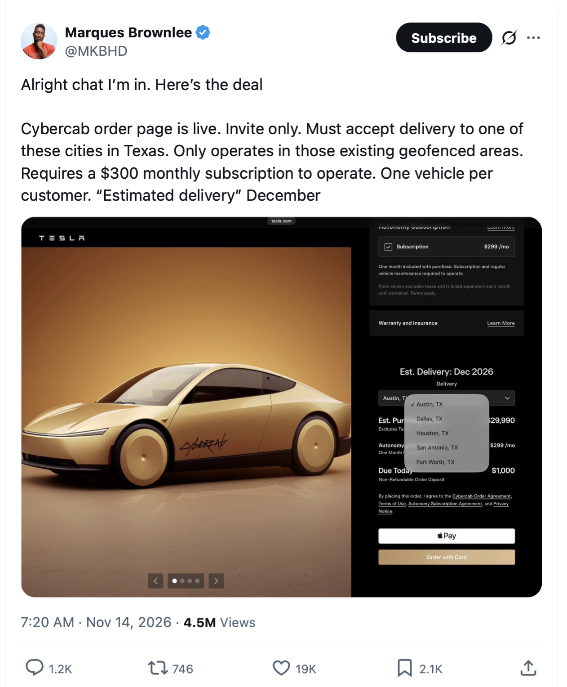
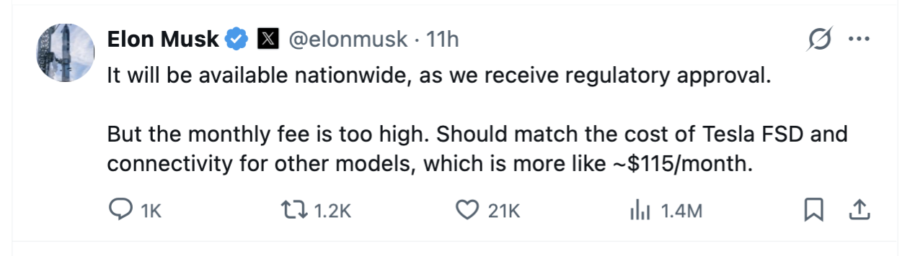

The Tesla Cybercab price is now official: $29,990. That is $10 under the line Marques Brownlee bet his hair on two years ago. And when he posted the order page on Saturday, Elon Musk took less than five hours to agree with his biggest complaint about it.

At roughly ₹94 to a dollar, that is about ₹28 lakh for a Tesla that drives itself. In India the cheapest Tesla is a [Model Y](/blogs/tesla-model-y-halloween-mode-india) at ₹50.89 lakh ex-showroom, import duty included, and it still needs you at the wheel.

## A bet made in October 2024

On 10 October 2024, Musk walked onto a film studio lot in California and showed off a gold two-seater that had neither a steering wheel nor pedals. He called it the Cybercab. It would cost below $30,000, he said, and be in production before 2027.

Brownlee, better known as MKBHD and one of the most-watched tech reviewers on YouTube, was not buying it. In his video on the event he called the promise impossible. Then he raised the stakes on himself: "I will shave my head on camera."

For a long while it looked like the safest bet on the internet. Then the car started turning up, and the two of them kept trading rounds.

Round one, February 2026. Giga Texas built its first Cybercab. Musk's verdict on the bet: "gonna happen."

Round two, September. Paying riders in Austin got their first Cybercab trips on the 3rd. The same month, a new video from Brownlee repeated the bet and added to it. Should a $30,000 Cybercab reach an ordinary buyer before 2027, the hair goes and a cancer research donation goes with it. Musk again: "I guess he really wants to shave his head."

## Round three: the Tesla Cybercab order page

Late on Friday in the US, Tesla opened Cybercab sales to a first batch of invited private buyers. A few hours later, at 7:20 AM India time on Saturday, Brownlee posted: "Alright chat I'm in." The year had 47 days left.

He did not say whether "in" means he has an invite or has already paid the deposit. What he did share was the order page:

- Price: $29,990 before taxes, about ₹28 lakh
- Deposit: $1,000, non-refundable
- Autonomy Subscription: $299 a month, about ₹28,000, with the first month included
- Estimated delivery: December 2026, in one of five Texas cities
- Limit: one car per customer

The third line is the catch. Stop paying and the car stays parked, apart from a 2 mph shuffle you can do from the touchscreen. Tesla's existing Robotaxi zones are the only places it will drive.

The fine print goes further. The monthly fee is not fixed either: one month's notice is all Tesla needs to change it. The contract allows private use only, so the car cannot earn money on a ride-hailing app without Tesla's written go-ahead. You also cannot sell the car unless Tesla agrees in writing. Sell anyway and the contract puts the damages at $50,000 or more.

## Musk's reply changes the math

Musk's reply had two parts.

First, regulators hold the key to a nationwide rollout. That is no small condition. Pedals are missing from the Cybercab, and US safety rules were written for cars that have them. NHTSA, the US road-safety regulator, raised exactly that gap in a formal order to Tesla in September, and the matter is still open.

Then the part nobody expected: "But the monthly fee is too high." His benchmark is the FSD and connectivity bill on Tesla's other cars, roughly $115 a month, or about ₹10,800.

That is a CEO agreeing in public with a critic about his own company's price, hours after it went live. No date came with it, and the order page still shows $299.

Here is why the number matters. The first month is included, so over five years an owner pays for 59 months.

- At $299 a month: 59 × $299 = $17,641. With the car, $47,631.
- At $115 a month: 59 × $115 = $6,785. With the car, $36,775.

At $299, the fees alone come to nearly 59% of the car's price all over again. At $115 they drop to under 23%.

In fairness, the fee buys more than software. Tyres, the windshield, wipers, roadside help and connectivity are inside it. Insurance, charging and parking are not.

So where does the bet stand? Under $30,000: done, with $10 to spare. On sale to customers: done, though only by invitation. Delivered to a regular customer before 2027: that box is still empty. Tesla has pencilled in December.

## What this means for you

You cannot buy a Cybercab in India, and you should not expect one soon. The car only drives in mapped zones in the US. Driverless cars also face a political wall here: road transport minister Nitin Gadkari has ruled them out more than once, pointing to the jobs of 70 to 80 lakh drivers.

The pricing idea is worth understanding though, because Indian buyers have already met its cousin. MG sells the Windsor EV from ₹9.99 lakh if you rent the battery at ₹4.30 per km. Lower sticker price, running cost billed separately. The Cybercab takes that idea a step further. Here the monthly fee pays for the driver, and the driver is software.

So when a car comes with a subscription, the showroom price is only half the answer. Ask what the monthly bill is, who can change it, and what happens to the car if you stop paying.

Our view: give Tesla its due here. In 2024, a driverless Tesla under $30,000 before 2027 sounded like one more Musk timeline. Today it has an order page, a price $10 inside the promise and a delivery month. Tesla is even [ending the Cybertruck](/blogs/tesla-cybertruck-production-ends-cybercab) to make factory room for it.

The $299 fee is the weak spot, and the good news is that the loudest voice against it belongs to Musk. If it drops to around $115, the Cybercab becomes a much easier car to say yes to.

One customer delivery in December, and the clippers come out.
