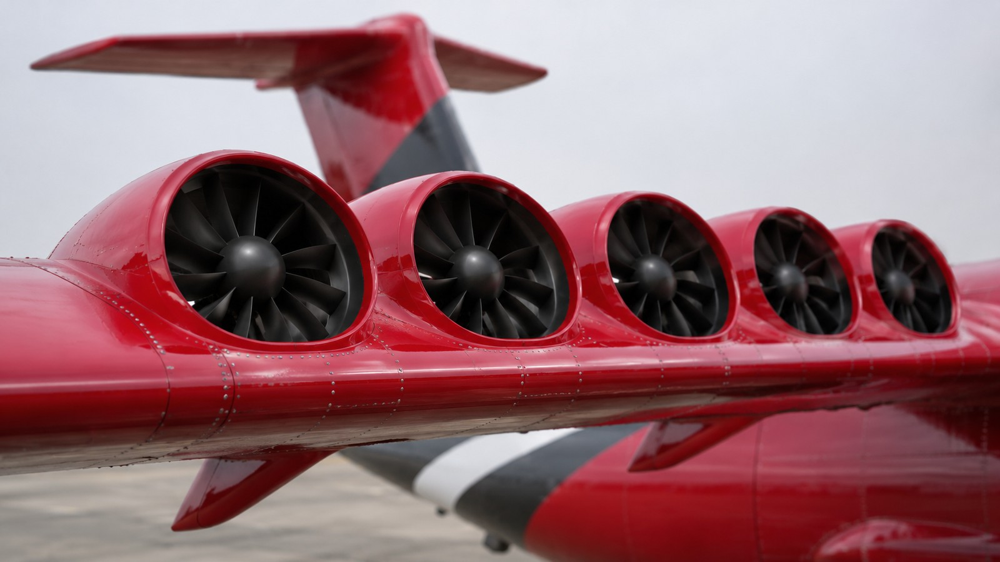
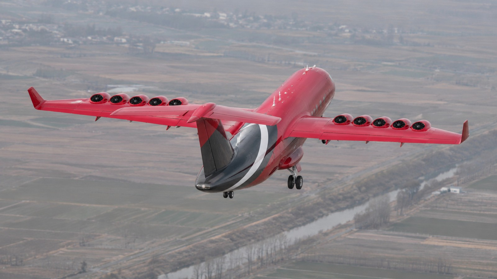

China put three people inside an electric aeroplane on Saturday and flew it. The COMAC CE-25A, a 19-seat electric commercial aircraft, lifted off from Binzhou in Shandong province on 14 November with three people on board, two pilots plus a flight-test engineer. It is the first time the aircraft has flown with anyone in the cockpit. COMAC says it behaved normally and every performance reading landed where the team expected.

If you follow electric cars and not aeroplanes, there is still a reason to care about this one. The battery company attached to it is CATL.

## Ten fans on the wing, zero jet engines

Look under the wing of the CE-25A and you will not find an engine hanging there. The thrust comes from ten small electric ducted fans, five on each wing, built into the wing itself instead of slung below it in pods.

This is called distributed electric propulsion, and the thinking behind it is the same thinking an EV uses when it puts a motor on each axle instead of one big engine under the bonnet. Many small units, not one large one. If a fan quits, the aircraft keeps flying on the other nine. Spreading the thrust across the wing also helps the aircraft behave better at low speed, which matters on short runways.

The rest of the sheet reads like a small regional aircraft, because that is what it is:

- 19 passengers
- 10 tonnes maximum take-off weight
- 300 km/h cruising speed
- 2,400 metres cruising altitude
- 400 km range

Short city-to-city hops. Nothing longer.

## The CATL angle

CATL is a development partner on the CE-25A, alongside Shanghai Jiao Tong University plus a handful of Chinese suppliers. This is not a new flirtation. COMAC, CATL and Shanghai Jiao Tong's enterprise arm set up a joint venture called COMAC Times (Shanghai) Aviation back in July 2023, with registered capital of roughly $82.5 million.

One thing to be careful about, because plenty of posts online are getting it wrong: COMAC has not said which battery is inside this aircraft. CATL has previously shown a 500 Wh/kg condensed battery, and said at the time that the cell was being put through aviation qualification. Nobody has confirmed that it ended up in the CE-25A. Two separate facts, and they have not been joined up yet.

## 16 minutes up, 400 km promised

Now the honest part, because the gap here is wide.

The aircraft was airborne for 16 minutes and 38 seconds and covered 60.4 km. The whole test, start to finish, ran 57 minutes and 46 seconds. Do the arithmetic on the airborne portion and the flight averaged about 218 km/h, well short of the 300 km/h cruise figure, and 60.4 km is about 15% of the 400 km range on the spec sheet.

None of that is a failure. A first crewed flight is meant to be short and careful, and the CE-25A had already flown 19 times with nobody on board since its first autonomous flight on 2 February. But a 16-minute hop is a long way from a paying passenger, and the paperwork says the same thing. China's civil aviation regulator has *accepted* COMAC's type certificate application under CCAR-25 rules for transport aircraft. Accepted means the review has started. It does not mean approved, and nothing carries fare-paying passengers until that review is finished.

Worth clearing up one more claim doing the rounds: this is not the world's first electric passenger aircraft. Sweden's Heart Aerospace flew its larger X1 testbed in August 2026, and that programme is also aiming at the 2030s. What China has here is its own first electric commercial aircraft in this weight class, with a crew on board.

## What this means for India

400 km and 19 seats is an oddly familiar combination if you have looked at India's regional flying map. Most of the routes the UDAN scheme has been trying to make work sit comfortably inside 400 km, and they are flown by small turboprops burning expensive fuel on thin passenger loads. Delhi to Chandigarh is around 250 km in a straight line. An aircraft with no fuel bill, far fewer moving parts and cheap overnight charging changes the running-cost maths on a route like that more than it changes anything on a long sector.

India is nowhere near this. There is no Indian 19-seat electric aircraft flying, and the domestic effort is still mostly in small air-taxi and eVTOL concepts. So if a 19-seat electric aircraft ever shows up on an Indian regional route, the realistic reading is that it arrives as an import, and quite possibly a Chinese one.

## The EVGyan take

Strip away the headlines and the useful signal here is not the aeroplane. It is CATL.

The company that supplies a huge slice of the world's electric cars is now sitting inside an aircraft programme that has actually flown with people in it. Cars gave battery makers volume. Aviation gives them a reason to chase energy density hard, because every extra Wh/kg buys range that no amount of clever software can. Whatever happens to the CE-25A itself, that pressure flows back down into the packs that end up in cars and buses.

The aircraft will be judged on its certification file, not on 16 minutes over Shandong. But the direction of travel is clear enough: when battery makers run out of road on the ground, they start looking up.
