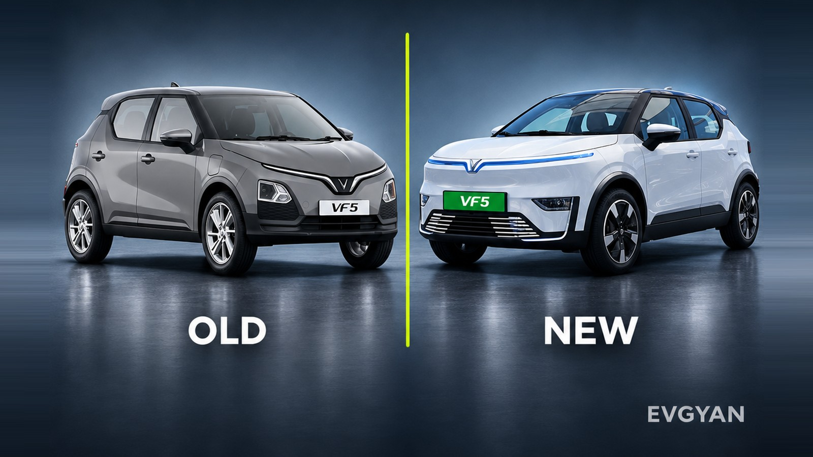
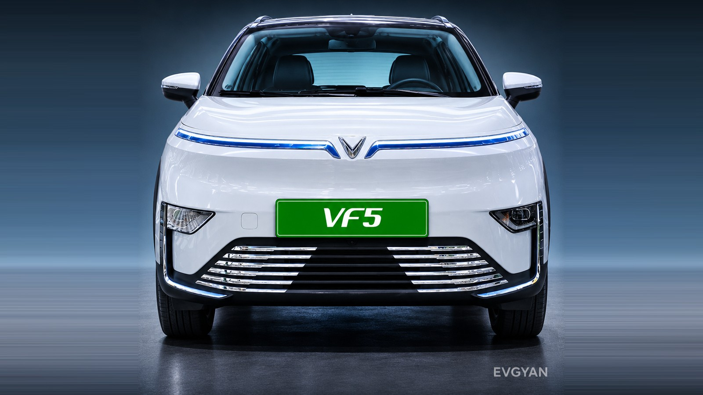
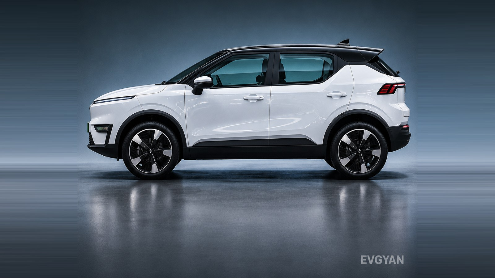
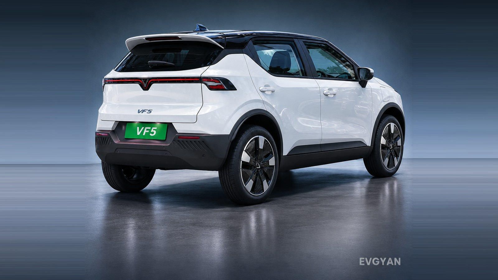
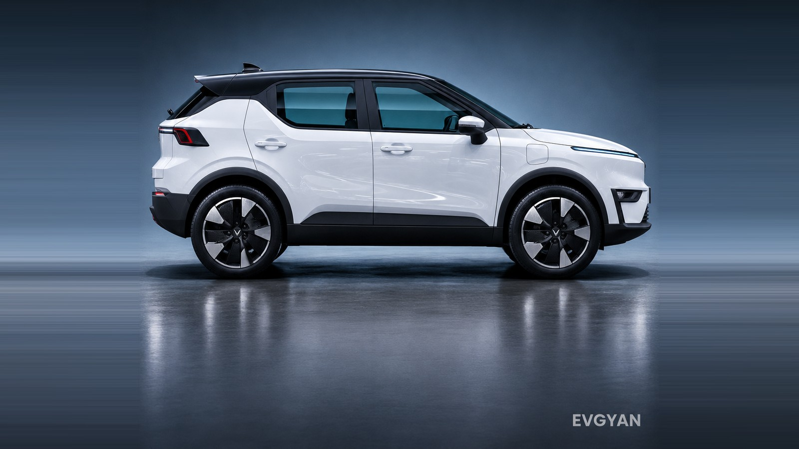
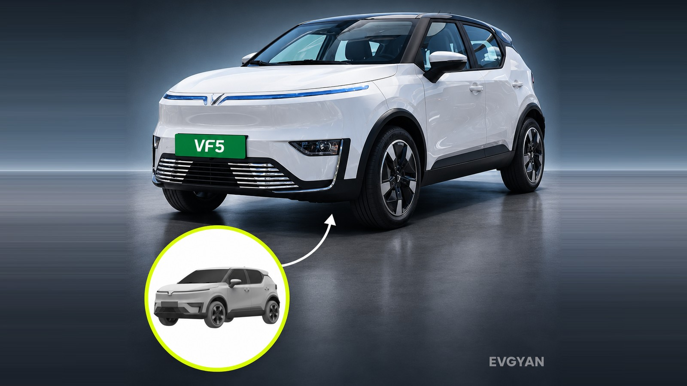

VinFast has revealed the facelifted VF5, and the change that matters is not the new face. It is the battery. The old car was sold with packs of 29.6kWh and 37.23kWh depending on the market, which was always its weakest point. The facelift goes up to **43kWh**, with a claimed **370km** of range.

Bookings opened in Vietnam on 12 November. For us, there is a more interesting detail: VinFast filed a design patent in India for this exact car in October, and test mules have already been spotted on Indian roads.

## Two batteries, and one number to be careful with

There are two versions in Vietnam. The Green variant uses the 37.23kWh pack and claims up to 320km. The Premium gets the new 43kWh pack and claims up to 370km. Both run the same single motor, 72kW, which works out to roughly 97hp with 180Nm. DC fast charging is rated at 60kW, AC at 6.6kW, and VinFast says the Premium goes from 10 to 70 percent in under 28 minutes.

Now the careful bit. That 370km is an **NEDC** figure, and NEDC is the oldest and most generous test cycle still in use. It is not comparable to the MIDC numbers you see on Indian cars, and MIDC itself is optimistic. From a 43kWh pack, a realistic mixed-use figure lands somewhere in the 230 to 270km band, and less if you spend time on a highway at 100kmph. Read 370km as a brochure number and nothing more.

97hp in a car this small is adequate rather than quick. VinFast has clearly spent the update on range, not on acceleration.

## It finally looks like an SUV

The old VF5 was a tallboy hatchback wearing SUV cladding. This one commits to the SUV look properly.

A long, flat wraparound chrome strip runs across the nose and dips in the middle to frame the VinFast V. The headlamps have dropped down into the bumper, with slim vertical intakes beside them and a slatted air dam below, all of it chrome-lined.

Down the side there is black cladding all round, a sharply kinked window line, and the charging flap sitting above the front-right wheel arch. The Premium rides on 17-inch aero-optimised alloys; the Green gets 16-inch steel wheels with covers, which tells you where that variant is aimed.

At the back, a full-width LED light bar, a raked windscreen, a large roof spoiler with the stop lamp built in, and thick black bumper cladding.

The body has grown in every direction except the one that would have mattered most. It is now 3,987mm long (20mm more), 1,772mm wide (49mm more) and 1,595mm tall (16mm more), but the wheelbase is unchanged at 2,514mm. So the car looks bigger and sits wider, but nobody in the back seat is getting extra legroom. Ground clearance is 178mm, and the sub-4-metre length is not an accident if India is on the list.

## Inside: one screen instead of two

The old car had an 8-inch touchscreen and a separate 7-inch driver display. The facelift merges them into a single **10.1-inch touchscreen** that handles most of the car's functions, paired with a new two-spoke steering wheel flattened at the top and bottom, and a redesigned centre console.

The Premium adds wireless charging, rear AC vents, an electronic parking brake with Auto Hold, Phone As A Key, six airbags, a 360-degree camera, cruise control and disc brakes on all four wheels. The Green is the stripped-out one, built with fleet and commercial buyers in mind.

Six airbags and a 360 camera as standard on the top variant is a genuinely competitive package at this size. Moving "major vehicle functions" into a touchscreen is the part we would want to use before praising it.

In Vietnam the Green is listed at 460 million VND and the Premium at 540 million VND. A straight conversion puts those near ₹15.5 lakh and ₹18.5 lakh, but do not read that as an India price. Duties, local assembly and equipment levels change that figure completely.

## What this means for India

Three things are confirmed. VinFast filed a design patent in India for the VF5 facelift in October, covering the exterior and matching the car shown in Vietnam. Test mules have been seen here. And VinFast already builds cars in India, at Thoothukudi in Tamil Nadu, where the VF6 and VF7 are assembled.

Nothing else is confirmed. No launch date, no India-spec battery or power figures, no price. Autocar India reports a launch is possible in the coming months at around ₹10 lakh to ₹12 lakh; other reports point to 2027 instead. Until VinFast says it out loud, that is an estimate.

## The EVGyan take

VinFast is already doing better here than most people expected. It sold 2,961 electric cars in September and finished fourth, ahead of Maruti Suzuki and Kia. But the VF6 and VF7 are both larger, pricier cars. The VF5 would be its first genuinely affordable product in India, in the part of the market where the volume actually sits.

At ₹10 to 12 lakh it runs straight into the Tata Punch EV, the Mahindra XUV 3XO EV, the Citroen eC3 and the cheaper Nexon EV variants. Every one of those rivals has a service network VinFast cannot match today, and in this segment buyers ask about the nearest workshop before they ask about the touchscreen.

The product looks ready. The patent is filed, the plant is running, the cars are on our roads. What decides this one is the price and the after-sales promise, not the chrome.
